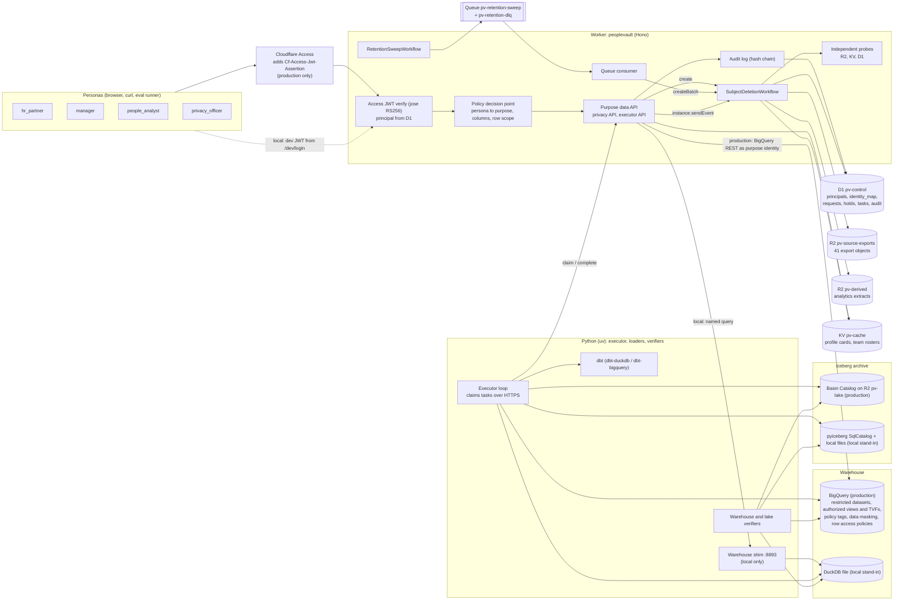

# PeopleVault

Workforce privacy and data lifecycle governance for synthetic workforce data. One policy file (`policy/policy.yaml`) decides which of four stakeholder personas (`hr_partner`, `manager`, `people_analyst`, `privacy_officer`) may use which of five purposes, which columns each purpose sees and how they are masked, and how each of 13 registered assets in six categories (source exports, warehouse tables, historical snapshots, identity mappings, derived datasets, application caches) is erased, verified and retained. A Cloudflare Worker verifies Cloudflare Access JWTs and enforces purpose-scoped access; Cloudflare Workflows run subject deletion and retention sweeps; a Python executor erases warehouse and Iceberg data; independent probes verify that nothing is left.

All workforce data is synthetic and generated deterministically. No real person's data is used anywhere.

## Status

2026-10-10: everything in the core plan is built and runs locally; the production paths are written but have not run against Cloudflare or Google Cloud. The design contract is [SPEC.md](SPEC.md); progress against its commit plan, the exact check status and every deviation are in [PROGRESS.md](PROGRESS.md).

| Area | State |
|---|---|
| Policy file, compiler (TypeScript JSON, DuckDB and BigQuery SQL), drift check | built, tested |
| HKDF and HMAC pseudonyms (TypeScript and Python, shared vectors) | built, tested |
| Deterministic synthetic population with golden counts | built, tested |
| Access JWT verification (local RS256 keys), principals, purpose-scoped decision point | built, tested locally |
| 100 authorization cases (all at the decision point, 48 also on DuckDB purpose views) | built, passing locally |
| dbt project for DuckDB and BigQuery (merge-only protected tables, generated purpose views and functions) | built; DuckDB runs, BigQuery parses only |
| Loaders, identity xref, snapshot replay, Iceberg history (pyiceberg SqlCatalog) | built, tested locally |
| Subject deletion Workflow, conditional R2 rewrites, Python executor, independent probes and scanners | built, tested locally (Miniflare, DuckDB, SqlCatalog) |
| Legal holds, retention sweep Workflow, cron and queue consumer | built, tested locally |
| Residual tracking (Iceberg, BigQuery, D1, KV) and the deletion eval with an independent oracle and fault injection | built, run locally (results below) |
| CI (GitHub Actions: worker, python and e2e jobs, no secrets) | workflow written; each job's commands pass locally and in a fresh clone; it has not run on GitHub because the repository has not been pushed |
| `npm run doctor` and `npm run doctor -- --prod` | built; tested with fakes and recorded responses; on this Mac the production lines all report missing setup |
| `npm run setup:prod`, `pv setup gcp`, `npm run deploy`, `npm run seed:prod` | written, not yet executed (dry-run plans golden-tested) |
| BigQuery path (dbt build, protected-table controls, 48 cases as purpose service accounts, 37 ceiling probes, Worker REST client) | written, not yet executed |
| Cloudflare Access in front of the deployed Worker, R2, D1, KV and Workflows on Cloudflare | written, not yet executed |
| Production executor, residual check and Basin Catalog self-test | written, not yet executed |
| Production deletion eval profile (`pv eval deletion --profile prod`) | written, not yet executed |

Nothing in this repository has run against Cloudflare or Google Cloud. Local stand-ins are never described as the production service.

## Architecture



## What runs where

| Concern | Local (works offline and in CI) | Production (after the setup in docs/PRODUCTION.md) |
|---|---|---|
| Identity | locally generated RS256 JWKS, `/dev/login` cookie (loopback only), executor dev JWT | Cloudflare Access (Zero Trust Free), team JWKS, service tokens |
| Worker, Workflows, Queues, Cron | Miniflare via `wrangler dev` on 8793, Worker `peoplevault-local` | Workers Paid deployment `peoplevault` on the account's workers.dev subdomain |
| Control plane | D1 in `.wrangler/state` | D1 `pv-control` (Time Travel 30 days, tracked as a residual) |
| Source exports and extracts | R2 in `.wrangler/state` | R2 `pv-source-exports`, `pv-derived` |
| Caches | KV in `.wrangler/state` (immediate) | KV `pv-cache` (70 s propagation wait before verification) |
| Warehouse | DuckDB file, dbt-duckdb, shim on 8893 with emulated ceilings | BigQuery US, dbt-bigquery, purpose service accounts, authorized views and table functions, policy tags, data masking, row access policies |
| Recovery windows | modeled from the 48 h setting (labeled modeled) | observed with time travel queries; fail-safe modeled |
| Iceberg archive | pyiceberg SqlCatalog, explicit expiry and orphan purge | Basin Catalog on `pv-lake`, managed snapshot expiration |
| Audit copy | D1 only; stream disabled | D1 (a Basin Pipelines copy is planned, P1) |
| Executor | `pv serve` thread | `pv executor run --target prod` from the owner's machine, impersonating `pv-executor` |
| Production API calls | recorded-response contract tests and `--dry-run` golden plans only | live, after setup |

## Local quickstart

Needs Node 24 and uv 0.12.17 (Python 3.12 is installed by uv). Seeding builds the whole local world (D1, R2 and KV in `.wrangler/state`, DuckDB and the Iceberg catalog in `pipelines/.data`) and takes several minutes.

```bash
npm ci
uv sync --project pipelines --locked
npm run dev:keys                      # .dev.vars with local-only keys
npm run seed:local                    # synthesize, migrate, load, warm caches, verify every count
npm run dev                           # wrangler dev on 127.0.0.1:8793 and pv serve (shim and executor) on 8893
npm run dev:token -- privacy-01       # a local Access-style JWT for a persona
npm run eval:deletion:ci              # the ci deletion eval (seeds again, then oracle and gate)
npm run stop:local
```

## Production setup

Everything a script can do is in `npm run setup:prod` (idempotent; `-- --dry-run` prints the plan) and `npm run doctor -- --prod` (prints exactly what is missing, with the fix for each line). The steps only the owner can do (accounts, Workers Paid, Zero Trust onboarding, tokens, logins, billing) are listed in [docs/PRODUCTION.md](docs/PRODUCTION.md).

## Results

<!-- results:start -->
All results below are local (Miniflare, DuckDB, pyiceberg SqlCatalog); nothing here ran on Cloudflare or Google Cloud. Generated by `npm run readme:results` from `evals/results/`.

**Deletion eval, full profile** (`npm run eval:deletion`, 2026-10-10; local (Miniflare, DuckDB, pyiceberg SqlCatalog))

- Requests: 136 (completed with residuals 110, failed 20, held 6)
- Coverage (system verdicts, retention and DSR requests that were not held): 100.0% of 1055 applicable pairs
  - source exports: 100.0% of 110 applicable pairs
  - warehouse tables: 100.0% of 220 applicable pairs
  - historical snapshots: 100.0% of 216 applicable pairs
  - identity mappings: 100.0% of 220 applicable pairs
  - derived datasets: 100.0% of 169 applicable pairs
  - application caches: 100.0% of 120 applicable pairs
- Independent oracle: coverage 100.0%, agreement 100.0%, false clean 0, false residue 0
- Fault detection: 20 of 20 planted residues of designed types detected (r2 6/6, warehouse 5/5, iceberg 3/3, kv 3/3, d1 3/3); 3 out-of-design variants undetected by design
- Legal holds: 6 held requests, held data intact for 6
- Retention sweep: 70 retention requests (2 held), 3 export objects deleted and 5 minimized for holds, 3 extracts expired; every count equal to the golden counts
- Applicability agreement with ground truth: 1318 of 1320 pairs (cache.kv.team_rosters: system not_present, truth present; cache.kv.team_rosters: system not_present, truth present)
- Audit hash chain: verified over 1368 events
- Workflow duration (create to terminal, local): p50 63.2 s, p95 97.2 s
- Gate: passed

**Deletion eval, ci profile** (`npm run eval:deletion:ci`, 2026-10-10; local (Miniflare, DuckDB, pyiceberg SqlCatalog))

- Requests: 25 (completed with residuals 16, failed 5, held 4)
- Coverage (system verdicts, retention and DSR requests that were not held): 100.0% of 157 applicable pairs
  - source exports: 100.0% of 16 applicable pairs
  - warehouse tables: 100.0% of 32 applicable pairs
  - historical snapshots: 100.0% of 32 applicable pairs
  - identity mappings: 100.0% of 32 applicable pairs
  - derived datasets: 100.0% of 25 applicable pairs
  - application caches: 100.0% of 20 applicable pairs
- Independent oracle: coverage 100.0%, agreement 100.0%, false clean 0, false residue 0
- Fault detection: 5 of 5 planted residues of designed types detected (r2 1/1, warehouse 1/1, iceberg 1/1, kv 1/1, d1 1/1)
- Legal holds: 4 held requests, held data intact for 4
- Retention sweep: 10 retention requests (2 held), 3 export objects deleted and 5 minimized for holds, 3 extracts expired; every count equal to the golden counts
- Applicability agreement with ground truth: 192 of 192 pairs
- Audit hash chain: verified over 958 events
- Workflow duration (create to terminal, local): p50 11.0 s, p95 18.0 s
- Gate: passed

**Authorization cases** (`npm run eval:authz`, 2026-10-10; local (Miniflare, DuckDB, pyiceberg SqlCatalog))

- Decision point (Worker app, fixture world): 100 of 100 cases
- Warehouse layer (DuckDB purpose views): 48 of 48 cases
<!-- results:end -->

About the two applicability disagreements in the full profile: a team roster is cached as one KV key per manager, and erasing any member of a team removes that key. When two members of one team (or a manager and a direct report) are deleted at the same time, the second request can find the key already gone and record `not_present`, which was true when it looked; the ground truth is computed before any request runs and cannot know their order. The disagreements are reported as measured.

## Design notes

- Policy as code: `policy/policy.yaml` compiles to TypeScript-readable JSON, DuckDB SQL, BigQuery SQL and BigQuery infrastructure specs; CI fails on drift.
- One BigQuery identity per purpose (ADR 0002), so BigQuery enforces a ceiling that the Worker cannot exceed.
- Verification is independent of deletion (ADR 0003): probes scan whole stores with boundary-aware matching, and the eval oracle shares no code with them.
- Protected BigQuery tables are merge-only (ADR 0006).
- Residuals (Iceberg snapshots and orphan files, BigQuery time travel and fail-safe, D1 Time Travel, KV propagation) are tracked separately and never counted in coverage.

See [CONTEXT.md](CONTEXT.md) for the glossary and [docs/adr](docs/adr) for decisions.

## License

MIT, see [LICENSE](LICENSE).
