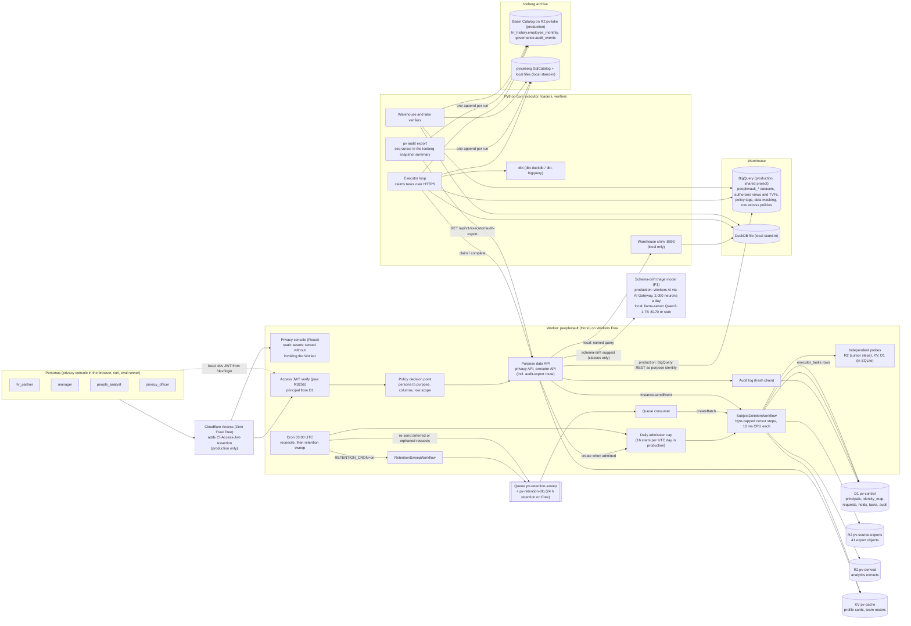
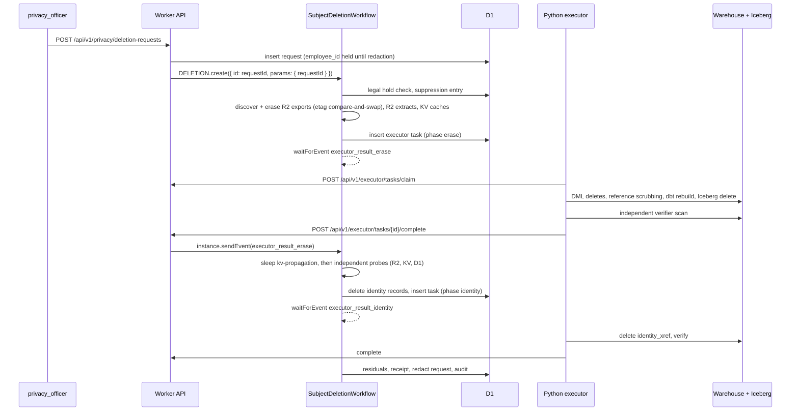

# PeopleVault

Workforce privacy and data lifecycle governance for synthetic workforce data. One policy file (`policy/policy.yaml`) decides which of four stakeholder personas (`hr_partner`, `manager`, `people_analyst`, `privacy_officer`) may use which of five purposes, which columns each purpose sees and how they are masked, and how each of 13 registered assets in six categories (source exports, warehouse tables, historical snapshots, identity mappings, derived datasets, application caches) is erased, verified and retained. A Cloudflare Worker verifies Cloudflare Access JWTs and enforces purpose-scoped access; Cloudflare Workflows run subject deletion and retention sweeps; a Python executor erases warehouse and Iceberg data; independent probes scan every store for each of the subject's identifier tokens (exact and boundary-aware matches).

All workforce data is synthetic and generated deterministically. No real person's data is used anywhere.

## Status

2026-10-11: everything in the commit plan is built and runs locally, and CI passes on GitHub; the production paths are written for the **Cloudflare Workers Free plan** but have not run against Cloudflare or Google Cloud (the doctor and the setup dry runs have read both accounts, read-only). Production shares one Cloudflare account and one Google Cloud project (`master-magnet-444903-u4`) with three other repos, so this repo plans for at most 25% of every per-account Free allowance and names everything it creates in Google Cloud with the `peoplevault` prefix (SPEC.md section 30, [ADR 0007](docs/adr/0007-production-on-workers-free.md)). The design contract is [SPEC.md](SPEC.md); progress against its commit plan, the exact check status and every deviation are in [PROGRESS.md](PROGRESS.md).

| Area | State |
|---|---|
| Policy file, compiler (TypeScript JSON, DuckDB and BigQuery SQL), drift check | built, tested |
| HKDF and HMAC pseudonyms (TypeScript and Python, shared vectors) | built, tested |
| Deterministic synthetic population with golden counts | built, tested |
| Access JWT verification (local RS256 keys), principals, purpose-scoped decision point | built, tested locally |
| 100 authorization cases (all at the decision point, 48 also on DuckDB purpose views) | built, passing locally |
| dbt project for DuckDB and BigQuery (merge-only protected tables, generated purpose views and functions, `peoplevault_*` schemas) | built; DuckDB runs, BigQuery parses only |
| Loaders, identity xref, snapshot replay, Iceberg history (pyiceberg SqlCatalog) | built, tested locally |
| Subject deletion Workflow (30 steps per completed deletion: byte-capped cursor steps for R2 erasure and probing, D1 token matching inside SQLite, daily admission, request-level idempotency), conditional R2 rewrites, Python executor, independent probes and scanners | built, tested locally (Miniflare, DuckDB, SqlCatalog); Miniflare enforces no CPU or query limit, so the Free plan budgets per step are counted in tests |
| Legal holds, retention sweep Workflow (at most 8 new subjects a day in production), cron (reconcile, then the sweep when `RETENTION_CRON=on`) and queue consumer | built, tested locally |
| Residual tracking (Iceberg, BigQuery, D1 Time Travel 7 days on Free, KV) and the deletion eval with an independent oracle and fault injection | built, run locally (results below) |
| Audit hash chain, windowed verification (50 events per request), the deletion report in SQL, and the exactly-once audit copy into the Iceberg table `governance.audit_events` (`pv audit export`, which replaces the Workers Paid Basin Pipelines stream) | built; the audit copy runs locally in the ci eval (pyiceberg SqlCatalog); the production export (Basin Catalog) is written, not yet executed |
| Workers Free budget model (`scripts/lib/free-budget.ts`; the budget test fails if a cap pushes the worst-case day past the 25% share) and `npm run bench:cpu` | built, tested |
| CI (GitHub Actions on ubuntu-latest: worker, python and e2e jobs, no secrets; the e2e job runs the ci deletion eval with its gate and the case file through the local API) | runs on every push; all three jobs passed on 2026-10-11 ([run 38128292785](https://github.com/nitishsjsucs/peoplevault/actions/runs/38128292785), [run 38130716213](https://github.com/nitishsjsucs/peoplevault/actions/runs/38130716213) for the end of builder 4's round, and [run 38165653478](https://github.com/nitishsjsucs/peoplevault/actions/runs/38165653478) part way through the review fixes of the same day); commits made after the last pushed one are covered by the next run, not by these |
| `npm run doctor` and `npm run doctor -- --prod` (including the Workers Free usage lines) | built; tested with fakes and recorded responses; run read-only against the real logins on 2026-10-11, it lists 22 missing items, each with its fix ([docs/PRODUCTION.md](docs/PRODUCTION.md#doctor-run-of-2026-10-11-read-only)); the usage lines need a deployed Worker |
| `npm run setup:prod` (with `--retention-cron on\|off`; refuses to adopt a same-named Cloudflare resource it did not create), `pv setup gcp`, `npm run deploy`, `npm run seed:prod` | written, not yet executed; dry-run plans golden-tested, and the dry runs read the real accounts on 2026-10-11 (`pv setup gcp --dry-run` plans 67 steps on the shared project, starting with the 4 APIs that are off there) |
| BigQuery path (dbt build, protected-table controls, 48 cases as purpose service accounts, 37 ceiling probes, Worker REST client with 20 polls, 10 pages and a 100 MiB byte cap; every Python and dbt query capped at 1 GiB) | written, not yet executed |
| Cloudflare Access in front of the deployed Worker, R2, D1, KV and Workflows on Cloudflare | written, not yet executed |
| Production executor, residual check and Basin Catalog self-test | written, not yet executed |
| Production deletion eval profile (`pv eval deletion --profile prod`, canary deletion first) | written, not yet executed |
| Scheduled production executor (GitHub Actions `executor.yml`, hourly, with the audit copy when due and the daily residual check) | on GitHub and active; its job is skipped until `npm run setup:prod -- --only github` sets its secrets and `PV_PROD_ENABLED` |
| The 100 authorization cases through the API with one token per persona principal (`npm run authz:prod` through Cloudflare Access; rehearsed locally with `npm run authz:api:local`) | built; the local rehearsal ran (Results); the production run is written, not yet executed |
| Privacy console (React SPA in `src/web`, deployed with the Worker as Workers static assets: sign-in, purpose-scoped employee browser with masked columns labeled, deletion requests with identity lookup by POST, request detail with receipt and retry, legal holds, coverage report, audit log with the windowed chain check) | built, tested (happy-dom against a mocked API, plus a contract test of every route it reads); used locally against `wrangler dev`; not yet deployed |
| Schema-drift triage (P1): rule classes plus a model's class for a column of a quarantined export, suggestion max_severity(rule, model), never a policy change; Workers AI `@cf/meta/llama-3.3-70b-instruct-fp8-fast` through the AI Gateway (no stored logs, no cache) with a D1 neuron meter capped at 2,000 a day; Qwen3-1.7B on llama-server or a stub locally; resumable eval over 120 labeled columns | built, tested; the local eval ran on Qwen3-1.7B (Results); the Workers AI path and its two-day production eval are written, not yet executed |

Nothing in this repository has created or changed anything on Cloudflare or Google Cloud; the doctor and the setup dry runs only read the accounts. Local stand-ins are never described as the production service. Until the production runs in [docs/PRODUCTION.md](docs/PRODUCTION.md) pass, the honest wording for the BigQuery and Cloudflare parts is "designed for" them and "verified against local stand-ins" (SPEC.md section 24). In particular, phrases such as "BigQuery restricted views, column masking", "Integrated ... with BigQuery access controls" and "using Cloudflare Access" wait on committed production result files from `pv authz warehouse --target bigquery --write-results --ceiling-probes`, `pv eval deletion --profile prod` and `npm run authz:prod`; none exists yet, so the wording today is "designed for BigQuery (authorized views and table functions, policy tags, data masking, row access policies) and verified against a DuckDB stand-in" and "Access JWT verification tested with locally generated RS256 keys".

## Architecture



### Deletion request sequence



### Trust model

Cloudflare Access authenticates; the Worker verifies the Access JWT itself and is the policy enforcement point for per-user row scope (org units, direct reports), which it derives from the D1 principal record and passes as query parameters. BigQuery enforces the ceiling for each purpose independently of the Worker: a purpose's service account can only read that purpose's dataset of authorized views and table functions, policy tags block or mask sensitive columns for that identity, and row access policies hide the restricted population from purposes that must not see it. A compromised Worker could read anything the five purpose identities can read, but never a column class or population that the purpose ceiling denies. The ceiling only holds while tags and row access policies stay attached, and BigQuery drops both on `CREATE OR REPLACE TABLE`, so no tagged or row-policy table is ever replaced after its first creation (section 9.3). The local stand-in (DuckDB) has no IAM, so locally the ceiling is emulated in the generated view SQL and by the shim's purpose-to-schema allowlist; README says so.

## What runs where

| Concern | Local (works offline and in CI) | Production (after the setup in docs/PRODUCTION.md) |
|---|---|---|
| Identity | locally generated RS256 JWKS, `/dev/login` cookie (loopback only; the console's local sign-in page lists the fixture principals), executor dev JWT | Cloudflare Access, Zero Trust Free team `old-truth-a7dc` (5 of 50 seats), team JWKS, 5 service tokens |
| Privacy console | `dist/web` served by `wrangler dev` on 8793 (`npm run dev` builds it when stale) | the same build uploaded by `npm run deploy` as Workers static assets behind the same Access application; only `/api/*` and `/dev/*` invoke the Worker, and static asset requests are free and unlimited |
| Worker, Workflows, Queues, Cron | Miniflare via `wrangler dev` on 8793, Worker `peoplevault-local` | Workers **Free** deployment `peoplevault` at `https://peoplevault.nitish-ratakonda.workers.dev`; no `limits` block |
| CPU and per-invocation limits | not enforced by Miniflare; counted in tests (bytes, D1 statements, calls) | 10 ms per request and per Workflow step: byte-capped cursor steps (4 MiB erase, 2 MiB probe), D1 matching inside SQLite, at most 40 D1 statements per step, windowed audit verification |
| Daily capacity | unlimited (`DAILY_DELETION_STARTS` and `RETENTION_DAILY_MAX` empty, `RETENTION_CRON` on) | at most 16 deletion starts per UTC day, 8 of them retention; deferred and orphaned requests re-admitted by the cron; retention cron off until the production eval is committed |
| Control plane | D1 in `.wrangler/state` | D1 `pv-control` (Time Travel 7 days on Free, tracked as a residual) |
| Source exports and extracts | R2 in `.wrangler/state` | R2 `pv-source-exports`, `pv-derived` |
| Caches | KV in `.wrangler/state` (immediate) | KV `pv-cache` (70 s propagation wait before verification) |
| Warehouse | DuckDB file with `peoplevault_*` schemas, dbt-duckdb, shim on 8893 with emulated ceilings | BigQuery US in the shared project, `peoplevault_*` datasets, dbt-bigquery, `peoplevault-*` purpose service accounts, authorized views and table functions, policy tags, data masking, row access policies; dataset- and resource-scoped grants only; every query byte-capped |
| Recovery windows | modeled from the 48 h setting (labeled modeled) | observed with time travel queries; fail-safe modeled |
| Iceberg archive | pyiceberg SqlCatalog, explicit expiry and orphan purge | Basin Catalog on `pv-lake` (R2 subscription, Free plan), managed snapshot expiration |
| Audit copy | `pv audit export --target local` into the SqlCatalog table `governance.audit_events` | the same command into the Basin Catalog table `governance.audit_events` (exactly once, cursor in the snapshot summary), from `executor.yml` or the production eval; no Basin Pipelines (Workers Paid only) |
| Schema-drift triage model | deterministic stub by default; Qwen3-1.7B Q4_0 on llama-server (port 8170, `npm run llm:serve`) for the local eval; no cap | Workers AI `@cf/meta/llama-3.3-70b-instruct-fp8-fast` through AI Gateway `peoplevault` (no stored logs, no cache), at most 2,000 neurons per UTC day (the triage falls back to the rule class above it) |
| Executor | `pv serve` thread (0.5 s poll) | `pv executor run --target prod` from the owner's Mac (5 s poll), impersonating `peoplevault-executor`; hourly in `executor.yml` |
| Production API calls | recorded-response contract tests and `--dry-run` golden plans only | live, after setup; each path labeled "written, not yet executed" above until it has run |

## Local quickstart

Needs Node 24 and uv 0.12.17 (Python 3.12 is installed by uv). Seeding builds the whole local world (D1, R2 and KV in `.wrangler/state`, DuckDB and the Iceberg catalog in `pipelines/.data`) and takes several minutes.

```bash
npm ci
uv sync --project pipelines --locked
npm run dev:keys                      # .dev.vars with local-only keys
npm run seed:local                    # synthesize, migrate, load, warm caches, verify every count
npm run dev                           # builds the console if stale; wrangler dev on 127.0.0.1:8793 and pv serve (shim and executor) on 8893
open http://127.0.0.1:8793/           # the privacy console: pick a fixture principal (for example privacy-01 or hrbp-01)
npm run dev:token -- privacy-01       # a local Access-style JWT for a persona
npm run eval:deletion:ci              # the ci deletion eval (seeds again, then oracle and gate)
npm run authz:api:local               # the 100-case file through the local API against the full population
npm run stop:local
```

## Tests and evals

```bash
npm test                    # vitest: the Worker project (Miniflare), the node project (scripts, doctor, setup plans, budget model, console build) and the web project (console pages, happy-dom)
npm run build:web           # the privacy console into dist/web (npm run dev, deploy:check and deploy run it too)
npm run test:py             # pytest (the live BigQuery suite and the end-to-end API run are opt-in markers)
npm run eval:authz          # the 100 authorization cases at the decision point and the 48 warehouse cases on DuckDB
npm run eval:deletion:ci    # the ci deletion eval and its gate (CI runs it); npm run eval:deletion runs the full profile
npm run bench:cpu           # CPU of the Worker's hot paths over the generated population (local)
uv run --project pipelines pv eval drift --target local --start --ai-mode llama-server   # schema-drift triage over 120 labeled columns (starts llama-server and the Worker, stops both)
```

## Production setup

Production runs on **Workers Free**: nothing needs Workers Paid, Basin Pipelines or a new Google Cloud project. Everything a script can do is in `npm run setup:prod` (idempotent; `-- --dry-run` prints the plan) and `npm run doctor -- --prod` (prints exactly what is missing, with the fix for each line; its read-only run of 2026-10-11 is in [docs/PRODUCTION.md](docs/PRODUCTION.md#doctor-run-of-2026-10-11-read-only)). The steps only the owner can do are listed in [docs/PRODUCTION.md](docs/PRODUCTION.md): enable billing on the shared Google Cloud project (the BigQuery sandbox has no DML) with a $1 budget alert, add the One-time PIN login method, create the two Cloudflare tokens, write `.secrets/prod.env`, and run the commands in order. The production eval submits one canary deletion alone before the other 11, and the retention cron stays off until its result is committed (`npm run setup:prod -- --only worker --retention-cron on`).

The production executor can run hourly in GitHub Actions (`.github/workflows/executor.yml`, enabled by `npm run setup:prod -- --only github`), which also copies the audit chain when due. GitHub disables scheduled workflows in a public repository after 60 days without repository activity; `npm run doctor -- --prod` reports the workflow's state and the age of its last successful run, and deletions that wait more than 24 hours for the executor fail (and can be retried).

## Results

<!-- results:start -->
All results below are local (Miniflare, DuckDB, pyiceberg SqlCatalog, llama-server); nothing here ran on Cloudflare or Google Cloud. Generated by `npm run readme:results` from `evals/results/`.

**Deletion eval, full profile** (`npm run eval:deletion`, 2026-10-11; local (Miniflare, DuckDB, pyiceberg SqlCatalog))

- Requests: 136 (completed with residuals 110, failed 20, held 6)
- Coverage (system verdicts, retention and DSR requests that were not held): 100.0% of 1055 applicable pairs
  - source exports: 100.0% of 110 applicable pairs
  - warehouse tables: 100.0% of 220 applicable pairs
  - historical snapshots: 100.0% of 216 applicable pairs
  - identity mappings: 100.0% of 220 applicable pairs
  - derived datasets: 100.0% of 169 applicable pairs
  - application caches: 100.0% of 120 applicable pairs
- Independent oracle: coverage 100.0%, agreement 100.0%, false clean 0, false residue 0
- Fault detection: 20 of 20 planted residues of designed types detected (r2 6/6, warehouse 5/5, iceberg 3/3, kv 3/3, d1 3/3); 3 out-of-design variants undetected by design
- Legal holds: 6 held requests, held data intact for 6
- Retention sweep: 70 retention requests (2 held), 3 export objects deleted and 5 minimized for holds, 3 extracts expired; every count equal to the golden counts
- Applicability agreement with ground truth: 1318 of 1320 pairs (cache.kv.team_rosters: system not_present, truth present; cache.kv.team_rosters: system not_present, truth present)
- Audit hash chain: verified over 1398 events (14 windows of at most 100)
- Audit copy (`pv audit export`, pyiceberg SqlCatalog table `governance.audit_events`): 1401 rows, 1401 copied by this run; last hash equals D1's at seq 1401
- Workflow duration (create to terminal, local): p50 65.8 s, p95 110.0 s
- Gate: passed

**Deletion eval, ci profile** (`npm run eval:deletion:ci`, 2026-10-11; local (Miniflare, DuckDB, pyiceberg SqlCatalog))

- Requests: 25 (completed with residuals 16, failed 5, held 4)
- Coverage (system verdicts, retention and DSR requests that were not held): 100.0% of 157 applicable pairs
  - source exports: 100.0% of 16 applicable pairs
  - warehouse tables: 100.0% of 32 applicable pairs
  - historical snapshots: 100.0% of 32 applicable pairs
  - identity mappings: 100.0% of 32 applicable pairs
  - derived datasets: 100.0% of 25 applicable pairs
  - application caches: 100.0% of 20 applicable pairs
- Independent oracle: coverage 100.0%, agreement 100.0%, false clean 0, false residue 0
- Fault detection: 5 of 5 planted residues of designed types detected (r2 1/1, warehouse 1/1, iceberg 1/1, kv 1/1, d1 1/1)
- Legal holds: 4 held requests, held data intact for 4
- Retention sweep: 10 retention requests (2 held), 3 export objects deleted and 5 minimized for holds, 3 extracts expired; every count equal to the golden counts
- Applicability agreement with ground truth: 192 of 192 pairs
- Audit hash chain: verified over 962 events (10 windows of at most 100)
- Audit copy (`pv audit export`, pyiceberg SqlCatalog table `governance.audit_events`): 964 rows, 964 copied by this run; last hash equals D1's at seq 964
- Workflow duration (create to terminal, local): p50 5.8 s, p95 10.1 s
- Gate: passed

**Authorization cases** (`npm run eval:authz`, 2026-10-11; local (Miniflare, DuckDB, pyiceberg SqlCatalog))

- Decision point (Worker app, fixture world): 100 of 100 cases
- Warehouse layer (DuckDB purpose views): 48 of 48 cases

**Authorization cases** (`pv authz api --target local --allow-writes`, 2026-10-11; local (Miniflare, DuckDB, pyiceberg SqlCatalog))

- Through the API (local Worker, limited to the tokens production has, full synthetic population, one token per persona principal and the executor): 85 of 85 runnable cases passed; 15 of 100 not runnable there
  - 10 skipped: forged, missing or unmapped tokens cannot pass Cloudflare Access (the edge answers first)
  - 2 skipped: no completed deletion in this principal's scope yet
  - 1 skipped: no subject for selector hrbp-01/held_in_unit index 0 in this population
  - 1 skipped: principal mgr-003 has no token in this environment (only the persona principals and the executor do)
  - 1 skipped: principal mgr-009 has no token in this environment (only the persona principals and the executor do)

**CPU of the Worker's hot paths** (`npm run bench:cpu`, 2026-10-11; local (Node v25.9.0 on darwin arm64, Apple M5); 10 cores, 1-minute load average 6.53 at the start)

- Prefiltered transform byte-identical to the unfiltered one: 123 comparisons over all 41 generated export objects
- Erase step at the 4 MiB cap (6 HRIS objects, 3.62 MiB): 2.084 ms (fastest run 1.734 ms); the revision 2 HRIS step that parsed every line of 13 objects: 22.688 ms (fastest run 19.539 ms)
- Probe step at the 2 MiB cap (1.81 MiB): 2.263 ms (fastest run 2.196 ms) after a clean erasure, 2.094 ms (fastest run 1.957 ms) with the subject still in every object
- Audit verification window of 100 events: 2.626 ms (fastest run 1.794 ms); audit export page of 500 rows: 0.79 ms (fastest run 0.556 ms); KV probe over 420 values: 0.217 ms (fastest run 0.188 ms)
- Largest step-sized path: 2.196 ms (fastest warm run; largest median 2.626 ms) on this machine; at 3 times (edge cores and cold isolates) 6.59 ms against Free's 10 ms (within the design target of 2.5 ms here, which keeps a 25% margin). Miniflare enforces no CPU limit; production readings come from the canary deletion and the doctor's CPU p99 line

**Schema-drift triage, local** (`uv run --project pipelines pv eval drift --target local --start --ai-mode llama-server`, 2026-10-11; local (Miniflare, llama-server/Qwen3-1.7B-Q4_0 on port 8170))

- Model: `llama-server/Qwen3-1.7B-Q4_0`; every number below comes from this model only (the deterministic stub produces no reported number)
- Sensitive recall: 97.6% of 84 labeled sensitive columns put in a sensitive class (97.4% where the name is opaque); rule classes alone 58.3%, suggestions max_severity(rule, model) 98.8%
- Exact class accuracy 79.2% over 120 columns; 33.3% of the non-sensitive columns suggested as sensitive; 0 answers outside the schema
- Cost: 0 neurons in 120 calls over 1 day(s) (rates of 2026-10-10, no cap locally)
<!-- results:end -->

About the two applicability disagreements in the full profile: a team roster is cached as one KV key per manager, and erasing any member of a team removes that key. When two members of one team (or a manager and a direct report) are deleted at the same time, the second request can find the key already gone and record `not_present`, which was true when it looked; the ground truth is computed before any request runs and cannot know their order. The disagreements are reported as measured.

## Design notes

- Policy as code: `policy/policy.yaml` compiles to TypeScript-readable JSON, DuckDB SQL, BigQuery SQL and BigQuery infrastructure specs; CI fails on drift.
- One BigQuery identity per purpose (ADR 0002), so BigQuery enforces a ceiling that the Worker cannot exceed.
- Verification is independent of deletion (ADR 0003): probes scan whole stores with boundary-aware matching, and the eval oracle shares no code with them.
- Protected BigQuery tables are merge-only (ADR 0006).
- Residuals (Iceberg snapshots and orphan files, BigQuery time travel and fail-safe, D1 Time Travel, KV propagation) are tracked separately and never counted in coverage.
- The privacy console holds no token and no policy: it reads `/api/v1/me`, shows the pages of the caller's purposes, and the Worker decides every call again. Identity lookups go out as POST bodies, so no name or email prefix reaches a URL; its static assets carry a same-origin Content-Security-Policy, deny framing and send no Referer.
- Workers Free (ADR 0007): every Workflow step and request is sized for 10 ms of CPU and 40 D1 statements; a deletion's R2 work advances through cursor steps whose key-listing digest is re-checked, so no object is skipped; at most 16 deletions start per UTC day; the audit copy is pulled exactly once instead of streamed; a budget test keeps the worst-case day within a 25% share of every per-account allowance.

## Limitations and known gaps

- New HRIS drops are not suppression-filtered on arrival in R2; the suppression list is applied when loading the warehouse and the lake.
- D1 Time Travel keeps deleted identity rows recoverable for 7 days on Workers Free (tracked as a residual).
- In the shared Google Cloud project the warehouse verifier scans only this repo's `peoplevault_*` datasets: a copy someone places in another repo's dataset is outside its scope.
- `subject_ref` and opaque principal ids are kept in the audit log by design (ADR 0005).
- The 20 planted residues of the full eval are of the types the probes are designed to find; detecting them shows the probes reach every store, not that they would find any possible copy.
- The CPU sizing rests on measurements on the owner's Mac times 3; the canary deletion and the doctor's CPU p99 line check it in production, and the byte caps are Worker vars.
- The schema-drift triage suggests a class; it never releases a quarantined export (only an edit of `policy.yaml` does). Sample values of a quarantined export go to the model (in production through an AI Gateway that stores nothing) and are never stored, logged or returned. The local recall comes from a 1.7B model and says nothing about the production model's.
- The privacy console is tested with happy-dom against a mocked API and a Worker contract test of the routes it reads; there is no automated browser test against a running Worker.
- The audit copy lags D1 by up to a day in production (exported when 1,000 events wait or the last copy is a day old).
- Re-identification: the `people_analyst` purpose reads pseudonymous rows that keep quasi-identifiers (org unit, level, job title, location, hire year, birth year, gender, ethnicity and the coarsened bands). In the 1,200-person synthetic population nearly every non-restricted employee is unique on them, so an analyst can single people out, and counting list rows reveals the org unit and level cells under 5 that `headcount_monthly` suppresses: that suppression protects the aggregate only. Restricted employees are excluded; k-anonymity for row-level analytics and extracts is future work (SPEC.md section 28).
- The Cloudflare account is shared with three other repos. The Iceberg catalog token in `executor.yml`'s secrets must be the one docs/PRODUCTION.md step 8 describes, scoped to the bucket `pv-lake`; an R2 "Admin Read & Write" token would let a leak of this public repo's secret read and delete the other repos' buckets.

See [CONTEXT.md](CONTEXT.md) for the glossary and [docs/adr](docs/adr) for decisions.

## License

MIT, see [LICENSE](LICENSE).
