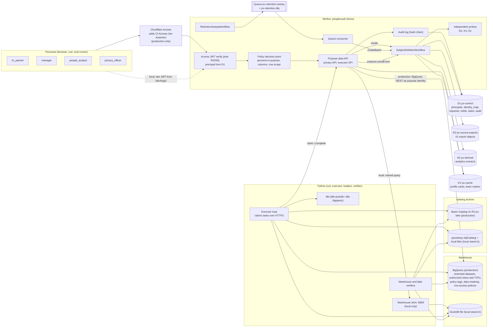

# PeopleVault

Workforce privacy and data lifecycle governance for synthetic workforce data. One policy file (`policy/policy.yaml`) decides which of four stakeholder personas (`hr_partner`, `manager`, `people_analyst`, `privacy_officer`) may use which of five purposes, which columns each purpose sees and how they are masked, and how each of 13 registered assets in six categories (source exports, warehouse tables, historical snapshots, identity mappings, derived datasets, application caches) is erased, verified and retained. A Cloudflare Worker verifies Cloudflare Access JWTs and enforces purpose-scoped access; Cloudflare Workflows run subject deletion and retention sweeps; a Python executor erases warehouse and Iceberg data; independent probes verify that nothing is left.

All workforce data is synthetic and generated deterministically. No real person's data is used anywhere.

## Status

Under construction (2026-10-10). The design contract is [SPEC.md](SPEC.md); progress against its commit plan, the exact check status and every deviation are in [PROGRESS.md](PROGRESS.md).

| Area | State |
|---|---|
| Policy file, compiler (TypeScript JSON, DuckDB and BigQuery SQL), drift check | built, tested |
| HKDF and HMAC pseudonyms (TypeScript and Python, shared vectors) | built, tested |
| Deterministic synthetic population with golden counts | built, tested |
| Access JWT verification (local RS256 keys), principals, purpose-scoped decision point | built, tested locally |
| 100 authorization cases (all at the decision point, 48 also on DuckDB purpose views) | built, passing locally |
| dbt project for DuckDB and BigQuery (merge-only protected tables, generated purpose views and functions) | built; DuckDB runs, BigQuery parses only |
| Loaders, identity xref, snapshot replay, Iceberg history (pyiceberg SqlCatalog) | built, tested locally |
| Subject deletion Workflow, conditional R2 rewrites, Python executor, independent probes and scanners | built, tested locally (Miniflare, DuckDB, SqlCatalog) |
| Legal holds, retention sweep Workflow, cron and queue consumer | built, tested locally |
| Residual checks, deletion eval with oracle and fault injection, CI | not built yet |
| Production paths (BigQuery, Cloudflare Access, R2 and Workflows on Cloudflare, Basin Catalog), `setup:prod`, `doctor` | not built yet; once written they are labeled "written, not yet executed" until a committed production result exists |

Nothing in this repository has run against Cloudflare or Google Cloud. Local stand-ins are never described as the production service.

## Architecture



## What runs where

| Concern | Local (works offline and in CI) | Production (after the setup in docs/PRODUCTION.md) |
|---|---|---|
| Identity | locally generated RS256 JWKS, `/dev/login` cookie (loopback only), executor dev JWT | Cloudflare Access (Zero Trust Free), team JWKS, service tokens |
| Worker, Workflows, Queues, Cron | Miniflare via `wrangler dev` on 8793, Worker `peoplevault-local` | Workers Paid deployment `peoplevault` on the account's workers.dev subdomain |
| Control plane | D1 in `.wrangler/state` | D1 `pv-control` (Time Travel 30 days, tracked as a residual) |
| Source exports and extracts | R2 in `.wrangler/state` | R2 `pv-source-exports`, `pv-derived` |
| Caches | KV in `.wrangler/state` (immediate) | KV `pv-cache` (70 s propagation wait before verification) |
| Warehouse | DuckDB file, dbt-duckdb, shim on 8893 with emulated ceilings | BigQuery US, dbt-bigquery, purpose service accounts, authorized views and table functions, policy tags, data masking, row access policies |
| Recovery windows | modeled from the 48 h setting (labeled modeled) | observed with time travel queries; fail-safe modeled |
| Iceberg archive | pyiceberg SqlCatalog, explicit expiry and orphan purge | Basin Catalog on `pv-lake`, managed snapshot expiration |
| Audit copy | D1 only; stream disabled | D1 (a Basin Pipelines copy is planned, P1) |
| Executor | `pv serve` thread | `pv executor run --target prod` from the owner's machine, impersonating `pv-executor` |
| Production API calls | recorded-response contract tests and `--dry-run` golden plans only | live, after setup |

## Local quickstart

Not runnable yet. The intended flow (SPEC.md section 25) is:

```bash
npm ci
uv sync --project pipelines --locked
npm run dev:keys
npm run seed:local
npm run dev
npm run dev:token -- privacy-01
npm run stop:local
```

## Production setup

Everything a script can do will be in `npm run setup:prod` (idempotent) and `npm run doctor -- --prod` (prints exactly what is missing). The steps only the owner can do (accounts, Workers Paid, Zero Trust onboarding, tokens, logins, billing) are listed in [docs/PRODUCTION.md](docs/PRODUCTION.md).

## Results

<!-- results:start -->
No results yet. This block is rewritten by `npm run readme:results` from committed files in `evals/results/`, and only contains numbers those files hold, each with its command and date.
<!-- results:end -->

## Design notes

- Policy as code: `policy/policy.yaml` compiles to TypeScript-readable JSON, DuckDB SQL, BigQuery SQL and BigQuery infrastructure specs; CI fails on drift.
- One BigQuery identity per purpose (ADR 0002), so BigQuery enforces a ceiling that the Worker cannot exceed.
- Verification is independent of deletion (ADR 0003): probes scan whole stores with boundary-aware matching, and the eval oracle shares no code with them.
- Protected BigQuery tables are merge-only (ADR 0006).
- Residuals (Iceberg snapshots and orphan files, BigQuery time travel and fail-safe, D1 Time Travel, KV propagation) are tracked separately and never counted in coverage.

See [CONTEXT.md](CONTEXT.md) for the glossary and [docs/adr](docs/adr) for decisions.

## License

MIT, see [LICENSE](LICENSE).
