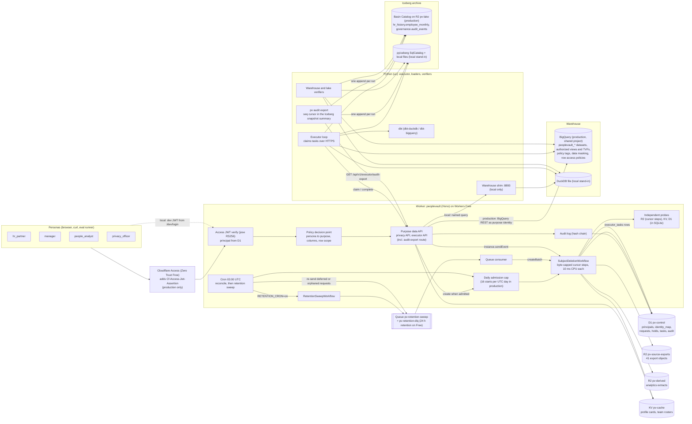
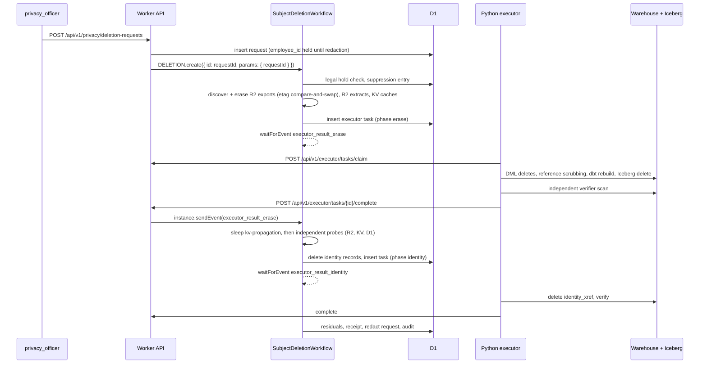

# PeopleVault v1: Workforce Privacy and Data Lifecycle Governance

Design spec, revision 2, written 2026-10-10 before any code exists (revision 1 plus the fixes from review 1; section 29 is the review log). This file is the contract for the build session. Nothing else is in the repository yet.

Revision 3 (2026-10-10, after commit 38): production runs on the Cloudflare Workers Free plan, in a Cloudflare account and a Google Cloud project (`master-magnet-444903-u4`) shared with three other repos. Section 30 holds the facts, the audit, the redesign and the usage budget, and overrides any earlier text it contradicts; ADR 0007 records the decision; section 26 lists the migration commits that come first for builder 3.

- Local path: `~/Developer/projects/peoplevault`. Remote: `github.com/nitishsjsucs/peoplevault` (public, empty, default branch not yet set; checked with `gh repo view` on 2026-10-10).
- Author of record: Nitish Chowdary. Git identity in this repo only: `user.name "nitishsjsucs"`, `user.email "227862909+nitishsjsucs@users.noreply.github.com"`. No `Co-Authored-By` trailer on any commit. Nobody pushes from the build session; the owner publishes.
- Built from scratch. No code from any earlier implementation anywhere is read or reused.
- No em dashes anywhere in prose (README, docs, comments that render). Use colons, parentheses, semicolons or two sentences.

The resume text in section 0 is the target, not a description of anything that has run. Section 24 lists the claims that stay false until Nitish completes the production setup in section 23 and the production checks pass.

---

## 0. Resume text this v1 must make true

> PeopleVault -- Workforce Privacy and Data Lifecycle Governance
>
> Built a policy-driven governance engine for synthetic workforce data that supported purpose-scoped access, historical retention, and auditable deletion. Integrated Cloudflare Access, R2, and Workflows with BigQuery access controls to manage sensitive information across current records, historical data, and derived assets.
>
> * Built automated retention and deletion workflows spanning six asset categories: source exports, warehouse tables, historical snapshots, identity mappings, derived datasets, and application caches.
> * Built purpose-scoped authorization for four stakeholder personas using Cloudflare Access, BigQuery restricted views, column masking, and HMAC-based employee pseudonymization, with approximately 100 authorization and policy test cases.
> * Built deletion verification and audit reporting targeting 100% coverage of applicable active-data assets, while tracking simulated legal holds, Iceberg snapshot cleanup, and BigQuery recovery windows separately.

### Exact numbers this repo commits to

Single source of truth: `policy/policy.yaml` (personas, purposes, classes, assets, retention) and `pipelines/src/peoplevault/synth/counts.py` (population). Every row below is asserted by a named test (section 18).

| Resume phrase | Exact v1 value | Asserted by |
|---|---|---|
| six asset categories | exactly 6 categories (`source_exports`, `warehouse_tables`, `historical_snapshots`, `identity_mappings`, `derived_datasets`, `application_caches`) over exactly 13 registered assets (section 8.5) | `test_policy_registry.py::test_six_categories_13_assets`, `test/worker/assets.registry.test.ts` |
| automated retention and deletion workflows | 2 Cloudflare Workflows (`SubjectDeletionWorkflow`, `RetentionSweepWorkflow`), 1 Cron Trigger, 1 Queue (+ dead letter queue) | `test/worker/workflow.*.test.ts`, deletion eval |
| four stakeholder personas | exactly 4: `hr_partner`, `manager`, `people_analyst`, `privacy_officer` (system principals such as the executor are not personas) | `test/worker/pdp.personas.test.ts` |
| purpose-scoped | exactly 5 purposes, each bound to personas and to its own BigQuery service identity (section 11) | `pdp.personas.test.ts`, `test_policy_compile.py` |
| column masking | 6 sensitive data classes, each a BigQuery policy tag; visibility per purpose is `allow`, `deny`, `mask_nullify` or `mask_date_year` (section 8.3) | category C of the authz cases |
| HMAC-based employee pseudonymization | HKDF-SHA256 per-purpose keys from one master key, HMAC-SHA256 pseudonyms, identical in TypeScript and Python (section 10) | `test/worker/pseudo.vectors.test.ts`, `test_pseudo_vectors.py` |
| approximately 100 authorization and policy test cases | exactly 100 cases in `policy/cases/authz_cases.yaml` over the committed, hand-authored fixture world (`data/fixtures/world.yaml`): all 100 run against the Worker policy decision point, 48 of them also against the purpose views of a DuckDB warehouse built from the same world. In production the same 48 run against BigQuery, plus 37 BigQuery ceiling probes that are reported as a separate count and never added to the 100 (section 15.8) | `test/worker/authz.cases.test.ts` (100 generated tests), `test_authz_warehouse.py` (48) |
| targeting 100% coverage of applicable active-data assets | measured by `pv eval deletion` as `coverage` (system verdicts) and `oracle_coverage` (independent oracle), with `false_clean` (must be 0), applicable pair counts per category (a category with 0 applicable pairs prints `n/a`, never 100%), and fault detection over 20 planted residues of designed types plus 3 out-of-design variants reported as `undetected_by_design`. The README reports whatever is measured | section 19 |
| tracking simulated legal holds | 2 matters, 6 held subjects; held requests are reported in their own bucket, never in the coverage denominator | eval `held_*` metrics |
| Iceberg snapshot cleanup | per deletion: retained snapshots of `hr_history.employee_monthly` that still contain the subject, orphaned data files that still contain the subject (local), cleared or pending | eval `iceberg_*` metrics, `test_lake_residuals.py` |
| BigQuery recovery windows | per deleted-from or rebuilt BigQuery table: time travel end (`max_time_travel_hours`, set to 48) and fail-safe end (+7 days); observed in production by `pv-executor` (which needs the custom time travel role in 15.2 because the tables carry row access policies), modeled locally and labeled as modeled | `test_residuals_model.py`, production `pv residuals check` |

---

## 1. Goals and non-goals

### Goals

1. One policy file drives everything: which persona may use which purpose, which columns each purpose sees and how they are masked, which assets exist and how each one is erased, verified and retained. The compiler emits TypeScript-readable JSON, DuckDB SQL, BigQuery SQL and BigQuery infrastructure specs from it, and CI fails if generated files drift from the policy.
2. Purpose-scoped access: every data read names a purpose; the Worker authorizes persona to purpose, resolves row scope from the verified identity, runs a fixed, parameterized query against that purpose's restricted views under that purpose's warehouse identity, and filters columns again before responding.
3. Identity from Cloudflare Access: the Worker verifies the `Cf-Access-Jwt-Assertion` RS256 JWT itself (signature, issuer, audience, expiry, algorithm) against the team JWKS in production and against a locally generated JWKS in development. Persona and scope come from the D1 principals table, never from token claims or request parameters.
4. HMAC pseudonymization with per-purpose keys so that analytics identifiers cannot be joined to identified views, and URLs, logs, audit events, queue messages and workflow state never carry raw employee identifiers. Principal ids are opaque (`mgr-007`, never `mgr-E00042`), so the hash-chained audit log never needs scrubbing when a manager is deleted.
5. Subject deletion across 13 assets in 6 categories, orchestrated by a Cloudflare Workflow, with Worker-native erasure (R2, KV, D1) and Python-native erasure (warehouse DML, Iceberg, one aggregate rebuild) bridged by a D1 task table and Workflow events. Concurrent deletions never lose each other's updates: R2 rewrites are etag-conditional compare-and-swap loops and only one active request per subject is allowed.
6. Verification that does not trust the deletion code: independent probes search every store (including unregistered tables, prefixes, keys and Iceberg tables) for every identifier token of the subject, with boundary-aware matching so one employee's tokens never match another employee's values.
7. Retention: a daily sweep enforces per-asset retention periods, minimizes rather than deletes objects that contain held subjects, and turns terminated employees past retention into subject deletion requests through a Queue.
8. Legal holds that suspend deletion and retention for held subjects, tracked and reported separately.
9. Residual tracking that is honest about what deletion does not remove: Iceberg snapshots and orphaned files, BigQuery time travel and fail-safe, D1 Time Travel, KV propagation. Each residual has an expected clear time and an observed state.
10. Audit: a hash-chained D1 audit log for every access decision and lifecycle action, deletion receipts hashed into the chain, a deletion coverage report, and an exactly-once copy of every audit event in the Iceberg table `governance.audit_events` (Basin Catalog in production, SqlCatalog locally), pulled by `pv audit export` (section 30.3.3; Basin Pipelines is Workers Paid only).
11. Two fully specified paths: a local path that works offline and in CI, and a production path that runs the moment credentials exist, with an idempotent `npm run setup:prod` and a `npm run doctor` that prints exactly what is missing. Production code that cannot run in the build session is covered by `--dry-run` golden tests and recorded-response contract tests, and the README labels it "written, not yet executed" until Nitish runs it.

### Non-goals (v1)

- Real HR system integration. All workforce data is synthetic and generated deterministically.
- Employee self-service access (data subject access export). Only the four personas use the system.
- Crypto-shredding and key rotation of the pseudonym master key. Documented as future work.
- Suppression-aware ingest of new source export drops into R2. v1 applies the suppression list when loading the warehouse and the lake; a new HRIS drop that still contains a deleted subject would land in R2 unfiltered (documented known gap, section 28).
- R2 bucket lock rules as legal hold preservation (P1 note only).
- Workload Identity Federation for GitHub Actions and Google Cloud. From Nitish's Mac the executor impersonates `pv-executor` with his own credentials (no key on disk); only the P1 `executor.yml` job uses a `pv-executor` key stored as a GitHub secret (WIF is later hardening).
- Running the Python executor on Cloudflare (Containers). v1 runs it locally (and, in P1, as a GitHub Actions job).
- OpenLineage and MetricFlow. Lineage for derived datasets comes from the dbt manifest.
- Persona access to the Iceberg archive. Iceberg tables are an archive tier reachable only by the executor.
- Multi-tenancy, i18n, rate limiting, email notifications.

### Build priority (P0 above the cut line, P1 below)

Every resume claim is covered by P0. The build ships P0 completely, records the first local eval, and only then touches P1. P1 items are marked "(P1)" wherever they appear.

| P0 | P1 |
|---|---|
| Policy file, compiler, generated artifacts, drift check | `executor.yml` (scheduled production executor in GitHub Actions, with the log and scheduling hardening in section 20) |
| Pseudonymization (TS and Python) with shared vectors | Audit copy into `governance.audit_events` by `pv audit export` (replaces the Basin Pipelines stream of revision 2, which is Workers Paid only; section 30.3.3) |
| Synthetic generator with exact counts, token-collision constraints and golden counts | `npm run authz:prod` (the 100 cases through Access with service tokens) |
| D1 migrations, opaque principals, identity records | `seed:prod` KV warm-up and extracts through the deployed API |
| Access JWT verification (remote and local JWKS), dev login, PDP, hand-authored fixture world, 100 authz cases | React UI (privacy console, purpose-scoped employee browser) |
| dbt project (raw, core, snapshots, marts, purpose views and routines) for DuckDB and BigQuery, merge-only for tagged or row-policy tables | Workers AI schema-drift triage through AI Gateway, with llama-server and stub locally |
| Loaders, suppression, Iceberg `hr_history.employee_monthly` via pyiceberg (SqlCatalog locally, REST catalog in production) | (absorbed: the audit copy above runs against the local SqlCatalog with the same code) |
| Warehouse shim (local) and BigQuery REST client (production, with a row normalizer) behind one interface | Production orphan-file verification for Iceberg (needs R2 S3 credentials) |
| Purpose data API with KV profile cache (suppression-aware), audit hash chain | R2 bucket lock preservation for held subjects; Workload Identity Federation; suppression-aware ingest endpoint |
| SubjectDeletionWorkflow with conditional R2 rewrites, executor protocol, Python executor, independent verifiers | |
| Legal holds, RetentionSweepWorkflow, Cron, Queue consumer | |
| Residual tracking (Iceberg, BigQuery, D1, KV) | |
| Deletion eval with oracle (reads Miniflare state directly) and fault injection; authz eval summary | |
| CI, README with Results, `setup:prod`, `doctor`, production template config, BigQuery live suite with ceiling probes (written, run by Nitish), `--dry-run` golden tests and recorded-response contract tests for every production path | |

---

## 2. Architecture



### Deletion request sequence



### Trust model in one paragraph

Cloudflare Access authenticates; the Worker verifies the Access JWT itself and is the policy enforcement point for per-user row scope (org units, direct reports), which it derives from the D1 principal record and passes as query parameters. BigQuery enforces the ceiling for each purpose independently of the Worker: a purpose's service account can only read that purpose's dataset of authorized views and table functions, policy tags block or mask sensitive columns for that identity, and row access policies hide the restricted population from purposes that must not see it. A compromised Worker could read anything the five purpose identities can read, but never a column class or population that the purpose ceiling denies. The ceiling only holds while tags and row access policies stay attached, and BigQuery drops both on `CREATE OR REPLACE TABLE`, so no tagged or row-policy table is ever replaced after its first creation (section 9.3). The local stand-in (DuckDB) has no IAM, so locally the ceiling is emulated in the generated view SQL and by the shim's purpose-to-schema allowlist; README says so.

---

## 3. Version pins (verified on this Mac, 2026-10-10)

Node side (exact versions, no carets):

| Package | Pin | Notes from verification |
|---|---|---|
| node | `.nvmrc` = `24` (Krypton LTS; latest 24.21.0 on 2026-10-10), `package.json` `"engines": { "node": ">=24" }` | Node 25 reached end of life on 2026-06-01 (nodejs/Release `schedule.json`), so it is not pinned for a public repo's CI. Node 26 becomes LTS on 2026-10-28. `doctor` accepts majors 24, 25 and 26, so Nitish's Mac (25.9.0) still passes. Scripts run as `node scripts/x.ts` (type stripping is unflagged in 24), so scripts use erasable TypeScript only (no `enum`, no parameter properties, no namespaces) and import with explicit `.ts` extensions. Engines checked: wrangler and miniflare `>=22.0.0`, vitest `>=24.0.0` allowed, vite `>=22.12.0` |
| wrangler | 4.149.0 | devDependency; there is no global `wrangler` on PATH on this Mac (`command not found`), always `npx wrangler` |
| @cloudflare/vitest-plugin | 1.4.0 | renamed `@cloudflare/vitest-pool-workers` (npm deprecation message says so; 0.23.0 receives no updates). 1.4.0 pins wrangler 4.149.0 and miniflare 5.20261006.1-alpha; peer `vitest ^4.1.0 \|\| ^5.0.0`. Spike: Workflow + `introspectWorkflowInstance` + `mockEvent` + `disableSleeps` + D1 migrations + R2 + `createMessageBatch`/`getQueueResult` all passed |
| vitest | 4.1.11 | used for the spike; 5.0.3 is allowed by the peer range but untested here |
| hono | 4.13.13 | |
| jose | 6.2.12 | `generateKeyPair('RS256')`, `exportJWK`, `SignJWT`, `createLocalJWKSet`, `createRemoteJWKSet`, `jwtVerify` checked |
| zod | 4.6.5 | |
| yaml | 2.9.1 | reads `policy/cases/authz_cases.yaml` in vitest |
| typescript | 7.0.2 | `tsc` CLI only (no JS API in 7.x). Spike typecheck found two fixable issues: add `"esnext.disposable"` to `lib` for `await using`, and type the queue handler as `ExportedHandler<Env, SweepMessage>`. Fallback 6.0.3 if a tool breaks |
| react, react-dom | 19.3.0 | (P1 UI) |
| vite | 8.3.4 | (P1 UI build) |
| @vitejs/plugin-react | 6.1.2 | (P1) |
| happy-dom, @testing-library/react | 20.14.6, 16.3.3 | (P1) |
| Runtime types | `wrangler types --strict-vars false` writes `worker-configuration.d.ts` (committed); generated with workerd 1.20261006.1. CI runs `wrangler types --strict-vars false --check`. Because `wrangler.jsonc` declares `secrets.required`, the output is byte-identical with and without a `.dev.vars` file (checked with wrangler 4.149.0: without `secrets.required`, `.dev.vars` keys are added to `Env` and the header hash changes). Production-only bindings that are absent locally (`AUDIT_STREAM`, P1) are declared optional in the hand-written `env-extra.d.ts`. No dependency on `@cloudflare/workers-types` (5.20261010.1 was installed only to read type definitions during research) | |

`compatibility_date: "2026-10-01"`, `compatibility_flags: ["nodejs_compat"]`. `package.json` must have `"type": "module"` (the spike failed with "This package is ESM only" without it).

Python side (`pipelines/pyproject.toml`, `requires-python = "==3.12.*"`, committed `pipelines/uv.lock`). `uv lock` resolved these together in a scratch project (127 packages) and `dbt --version` reported core 1.12.5 with adapters bigquery 1.12.1 and duckdb 1.11.0, all "Up to date":

| Package | Pin | Notes |
|---|---|---|
| dbt-core | 1.12.5 | |
| dbt-duckdb | 1.11.0 | requires dbt-adapters, dbt-common, dbt-core, duckdb; ran `dbt build` (table, view, snapshot, 2 data tests) with dbt-core 1.12.5; supports the `merge` incremental strategy (`impl.py` adds `merge` for recent DuckDB) |
| dbt-bigquery | 1.12.1 | `dbt parse --target <bigquery>` works with no credentials; `dbt compile` fails without credentials ("Your default credentials were not found"), so CI runs `parse` only. Source read in review 1: the profile field `impersonate_service_account` exists (`credentials.py`); incremental strategies are only `merge`, `insert_overwrite`, `microbatch` (no custom strategies); on an existing table `merge` is a `MERGE` DML statement and creates no temp table while `on_schema_change` is `ignore`; first creation runs `CREATE OR REPLACE TABLE`, then post-hooks, then `persist_docs`; the `view` materialization also calls `persist_docs`, and `update_columns` writes `policyTags` for every documented column (an empty list when the column declares none) |
| duckdb | 1.5.6 | `sha256`, `date_trunc`, `regexp_replace`, schema-qualified table macros with bound parameters checked; `MERGE INTO ... WHEN NOT MATCHED BY SOURCE THEN DELETE` checked in review 1 |
| pyarrow | 26.0.0 | |
| pyiceberg[sql-sqlite,pyarrow] | 0.12.0 | see section 17.4 for the probe results |
| google-cloud-bigquery | 3.46.1 | `AccessEntry` supports entity type `ROUTINE`; `Dataset.max_time_travel_hours` exists |
| google-cloud-datacatalog | 3.32.0 | `datacatalog_v1.PolicyTagManagerClient` |
| google-cloud-bigquery-datapolicies | 0.10.1 | `bigquery_datapolicies_v2.DataPolicy` has `grantees`, `policy_tag`, `data_masking_policy`; predefined expressions include `ALWAYS_NULL`, `DATE_YEAR_MASK`, `SHA256`, `EMAIL_MASK`, `RANDOM_HASH` |
| google-auth | 2.61.0 | `impersonated_credentials`: the executor, loaders and dbt run as `pv-executor` on top of Nitish's user ADC, and the BigQuery authz suite runs as each purpose SA |
| click | 8.5.0 | CLI |
| pydantic | 2.14.0 | policy model |
| pyyaml | 6.0.3 | |
| httpx | 0.28.1 | executor client |
| pyjwt[crypto] | 2.15.1 | executor mints local dev JWTs |
| pytest | 9.1.1 | |
| pytest-timeout | 2.4.0 | |
| ruff | 0.17.0 | lint |

Not used: dbt-metricflow, metricflow, openlineage-python, openlineage-dbt (non-goals), `agents` (no Durable Object agent in this project).

GitHub Actions: `actions/checkout@v7`, `actions/setup-node@v7`, `actions/upload-artifact@v7` (each has a moving `v7` tag: `gh api repos/actions/<name>/git/ref/tags/v7` returns a commit), and `astral-sh/setup-uv@v10.3.0` with `version: "0.12.17"` so CI runs the same uv that wrote `uv.lock`. setup-uv publishes only full tags since v8 (`v10.3.0, v10.2.0, ..., v8.0.0`; `gh api repos/astral-sh/setup-uv/git/ref/tags/v10` returns 404), so `@v10` would not resolve. Its v10.3.0 `action.yml` has the `version`, `python-version` and `enable-cache` inputs used here.

Local tools: uv 0.12.17, Python 3.12.13 (Homebrew), llama-server version 0.5.0 build 11146 (P1 only).

---

## 4. Exact file tree

Files marked (gen) are generated and committed; CI regenerates them and fails on any diff. Files marked (P1) are created only below the cut line.

```
peoplevault/
├── README.md
├── SPEC.md
├── CONTEXT.md                          # domain glossary: subject, asset, applicability, residual, hold, purpose
├── LICENSE                             # MIT
├── .gitignore                          # node_modules, .wrangler, dist, data/generated, pipelines/.data, .dev.vars, .dev/ (pidfiles), .secrets/, infra/cloudflare/wrangler.production.jsonc, pipelines/dbt/target, pipelines/dbt/logs
├── .nvmrc                              # 24
├── .dev.vars.example
├── package.json
├── package-lock.json
├── tsconfig.base.json
├── tsconfig.worker.json
├── tsconfig.node.json
├── tsconfig.web.json                   # (P1)
├── wrangler.jsonc                      # local development configuration, Worker name peoplevault-local (placeholder resource ids)
├── worker-configuration.d.ts           # (gen) wrangler types --strict-vars false (checked with --check in CI)
├── env-extra.d.ts                      # hand-written: optional production-only bindings (AUDIT_STREAM?: Pipeline, P1)
├── vitest.config.ts
├── vite.config.ts                      # (P1)
├── index.html                          # (P1)
├── docs/
│   ├── PRODUCTION.md                   # section 23 of this spec, kept current
│   └── adr/
│       ├── 0001-python-executor-bridged-by-workflow-events.md
│       ├── 0002-one-bigquery-identity-per-purpose.md
│       ├── 0003-verification-independent-of-deletion.md
│       ├── 0004-no-client-side-snapshot-expiry-on-basin-catalog.md
│       ├── 0005-audit-subject-ref-retention-exception.md
│       ├── 0006-merge-only-protected-bigquery-tables.md
│       └── 0007-production-on-workers-free.md          # revision 3
├── policy/
│   ├── policy.yaml
│   ├── cases/authz_cases.yaml          # exactly 100 cases
│   ├── test-vectors/pseudonyms.json    # fixed test master key, 12 vectors
│   └── compiled/policy.json            # (gen) pv policy compile
├── migrations/
│   ├── 0001_principals_identity.sql
│   ├── 0002_requests_holds_residuals.sql
│   ├── 0003_executor_tasks.sql
│   └── 0004_audit.sql
├── src/
│   ├── shared/
│   │   ├── policy-types.ts             # Persona, Purpose, DataClass, Visibility, AssetCategory, AssetDef
│   │   └── api-schemas.ts              # zod request and response schemas
│   ├── worker/
│   │   ├── index.ts                    # default export { fetch, queue, scheduled }, Workflow class exports
│   │   ├── app.ts                      # Hono app and route mounting
│   │   ├── env.ts                      # Env type re-export, runtime config parsing and validation
│   │   ├── auth/
│   │   │   ├── access-verifier.ts      # remote JWKS (production) and local JWKS (development)
│   │   │   ├── token.ts                # token extraction (header; cookie only in local mode)
│   │   │   ├── principals.ts           # D1 principal resolution
│   │   │   ├── middleware.ts           # auth, CSRF header, request context
│   │   │   └── dev-login.ts            # /dev/login and /dev/logout, registered only when AUTH_MODE=local-jwks
│   │   ├── policy/
│   │   │   ├── compiled.ts             # typed view over policy/compiled/policy.json
│   │   │   └── pdp.ts                  # decide(), columnFilter(), rowScope()
│   │   ├── pseudo/hmac.ts              # HKDF + HMAC via WebCrypto
│   │   ├── warehouse/
│   │   │   ├── client.ts               # WarehouseClient interface and factory
│   │   │   ├── bigquery-rest.ts        # jobs.query with named parameters, useQueryCache=false
│   │   │   ├── gcp-auth.ts             # gateway SA JWT bearer grant + generateAccessToken per purpose
│   │   │   └── shim-client.ts          # local warehouse shim client
│   │   ├── assets/
│   │   │   ├── registry.ts             # 13 AssetDefs from compiled policy
│   │   │   └── subject.ts              # SubjectIdentifiers loaded per step from D1, never returned from steps
│   │   ├── storage/
│   │   │   ├── r2-rewrite.ts           # rewriteObject(): get + transform + put with onlyIf.etagMatches, jittered retry
│   │   │   └── op-budget.ts            # counting wrapper for KV, R2 and D1 calls (enforced in tests, logged as counts)
│   │   ├── erase/
│   │   │   ├── jsonl-objects.ts        # R2 object rewrite with reference scrubbing (exports and extracts), via r2-rewrite
│   │   │   ├── kv-cache.ts             # list + bulk get (100 keys per call) + per-key delete
│   │   │   └── d1-identity.ts          # identity_map + principals rows
│   │   ├── verify/                     # must not import from erase/ (enforced by test/node/verify.isolation.test.ts)
│   │   │   ├── tokens.ts               # identifier token set and boundary-aware matchers for a subject
│   │   │   ├── r2-probe.ts             # lists whole buckets, scans every key name, object body and custom metadata
│   │   │   ├── kv-probe.ts             # lists every key, bulk-reads every value
│   │   │   └── d1-probe.ts             # scans every TEXT column of every table except control and internal tables
│   │   ├── workflows/
│   │   │   ├── subject-deletion.ts
│   │   │   └── retention-sweep.ts
│   │   ├── executor/task-store.ts      # D1 executor_tasks: create, claim with lease, complete, purge payloads
│   │   ├── holds/holds.ts
│   │   ├── retention/
│   │   │   ├── rules.ts                # retention evaluation for Worker-native assets
│   │   │   ├── queue-consumer.ts       # pv-retention-sweep -> DELETION.createBatch
│   │   │   └── scheduled.ts            # cron -> RETENTION.create({ id: "retention-YYYY-MM-DD" })
│   │   ├── residuals/residuals.ts
│   │   ├── audit/
│   │   │   ├── audit-log.ts            # hash chain append and verify
│   │   │   ├── audit-stream.ts         # (P1) Basin Pipelines binding in production; removed by revision 3 (audit copy via executor export route)
│   │   │   └── receipts.ts
│   │   ├── cache/profile-cache.ts
│   │   ├── reports/deletion-report.ts
│   │   └── routes/
│   │       ├── health.ts
│   │       ├── me.ts
│   │       ├── data.ts                 # /api/v1/purposes/:purpose/...
│   │       ├── privacy.ts              # requests, holds, assets, reports, audit, retention
│   │       └── executor.ts             # claim, complete, suppression list
│   └── web/                            # (P1) React SPA
│       ├── main.tsx, App.tsx, api.ts, styles.css
│       └── pages/ (MePage, EmployeesPage, ProfilePage, RequestsPage, RequestDetailPage, HoldsPage, ReportPage, AuditPage)
├── test/
│   ├── worker/                         # @cloudflare/vitest-plugin project (section 18); reads only committed files
│   ├── node/                           # scripts project (also holds file-reading checks such as verify.isolation.test.ts)
│   ├── web/                            # (P1)
│   └── fixtures/
│       ├── fake-warehouse.ts           # in-memory WarehouseClient built from data/fixtures/purpose_rows.json
│       ├── tokens.ts                   # test RS256 keys, token factory (valid, expired, wrong aud, alg none, HS256 confusion)
│       ├── seed.ts                     # loads data/fixtures/d1_seed.sql and small R2/KV fixtures for workflow tests
│       └── contracts/                  # recorded-response fixtures: BigQuery jobs.query and getQueryResults (f/v rows, jobComplete false, pageToken), Google token endpoint, generateAccessToken, Access apps/service tokens/organizations, Workers subdomain, account subscriptions
├── data/
│   ├── expected_counts.json            # golden counts, committed
│   ├── fixtures/
│   │   ├── world.yaml                  # hand-authored fixture world (about 40 employees, 4 org units, every principal and subject the 100 cases need)
│   │   ├── purpose_rows.json           # (gen) pv fixtures build: rows the DuckDB purpose views return for world.yaml
│   │   ├── authz_subjects.json         # (gen) case selector -> subject refs, from world.yaml
│   │   └── d1_seed.sql                 # (gen) principals and identity_map for world.yaml, test master key
│   └── generated/                      # gitignored output of pv synth (full population)
├── evals/
│   └── results/                        # committed JSON outputs quoted by README (deletion-*.json, authz-*.json)
├── infra/
│   ├── cloudflare/
│   │   ├── wrangler.production.template.jsonc   # main and migrations_dir are ../../ paths (resolved relative to this file)
│   │   ├── wrangler.production.jsonc            # gitignored; rendered by setup:prod next to the template so the paths stay valid
│   │   ├── audit-stream.schema.json             # (P1)
│   │   ├── audit-pipeline.sql                   # (P1)
│   │   └── access-app.template.json
│   └── bigquery/                       # (gen) from policy
│       ├── datasets.json
│       ├── taxonomy.json
│       ├── data_policies.json
│       ├── custom_roles.json           # pvTimeTravelReader
│       ├── protected_schemas.json      # columns of every protected model; changes need a migration (ADR 0006)
│       ├── migrations/                 # explicit ALTER TABLE scripts for protected tables
│       └── iam_bindings.json
├── scripts/
│   ├── lib/run.ts                      # spawn helper (no shell), JSON parsing, retries
│   ├── lib/cf-api.ts                   # Cloudflare REST client (PV_CF_API_TOKEN)
│   ├── lib/checks.ts                   # shared doctor checks
│   ├── lib/pids.ts                     # pidfiles under .dev/pids/ and process-group kill (same on macOS and Linux)
│   ├── dev.ts                          # starts wrangler dev (8793, inspector 9243) and pv serve (8893) as detached process groups, writes pidfiles, kills both on exit
│   ├── stop-local.ts                   # kills the process groups recorded in .dev/pids/, then checks 8793, 9243, 8893, 8170 with a TCP connect probe (no lsof)
│   ├── dev-keys.ts                     # RS256 dev keys, master key, shim token -> .dev.vars
│   ├── dev-token.ts                    # prints a dev JWT for a seeded principal (curl use)
│   ├── seed-local.ts
│   ├── doctor.ts
│   ├── setup-prod.ts
│   ├── deploy-prod.ts                  # wrangler deploy -c infra/cloudflare/wrangler.production.jsonc --secrets-file .secrets/worker-secrets.env
│   ├── seed-prod.ts
│   ├── authz-prod.ts                   # (P1)
│   └── update-readme.ts                # rewrites the README Results block from evals/results
├── pipelines/
│   ├── pyproject.toml
│   ├── uv.lock
│   ├── .python-version                 # 3.12
│   ├── src/peoplevault/
│   │   ├── __init__.py
│   │   ├── cli.py                      # `pv` entry point (click)
│   │   ├── config.py                   # PV_ENV, targets, paths, reads ../.dev.vars locally
│   │   ├── pseudo.py
│   │   ├── policy/model.py, compile.py, sqlgen.py, bqinfra.py
│   │   ├── synth/counts.py, names.py, population.py, exports.py, history.py, principals.py, truth.py, generate.py
│   │   ├── sources/local_files.py, wrangler_r2.py
│   │   ├── load/raw.py, identity.py, snapshots.py, lake.py, suppression.py
│   │   ├── warehouse/base.py, duck.py, bq.py
│   │   ├── lake/catalog.py, ops.py, residuals.py
│   │   ├── executor/api.py, auth.py, handlers.py, loop.py
│   │   ├── logging_redact.py           # logging filter that replaces employee ids, emails, names and pseudonyms with [redacted]
│   │   ├── shim/server.py, queries.py
│   │   ├── verify/tokens.py, warehouse_scan.py, lake_scan.py    # must not import executor/, load/
│   │   ├── residuals/bq.py
│   │   ├── authz/cases.py, warehouse_runner.py, bq_ceiling.py  # bq_ceiling: the 37 production ceiling probes
│   │   ├── evals/deletion.py, cohorts.py, faults.py, oracle.py, miniflare_state.py, report.py   # oracle shares no code with verify/
│   │   ├── fixtures/world.py           # world.yaml -> temp DuckDB -> committed fixtures
│   │   ├── setup/gcp.py, doctor_gcp.py, bq_controls.py   # bq_controls: asserts tags and row access policies after every prod dbt run
│   │   └── dbtrun.py                   # in-process dbtRunner wrapper (--log-level warn, policy tag vars, refuses --full-refresh on prod)
│   ├── dbt/
│   │   ├── dbt_project.yml
│   │   ├── profiles.yml                # targets: local (duckdb), bigquery (always runs as pv-executor: oauth + impersonate_service_account, or the pv-executor keyfile in the P1 Actions job), bigquery_ci (parse only)
│   │   ├── macros/ masking.sql, row_access.sql, purpose_routines.sql, generic_tests.sql
│   │   ├── models/
│   │   │   ├── sources.yml
│   │   │   ├── staging/ stg_hris_employees.sql, stg_payroll_compensation.sql, stg_leave_requests.sql, stg_performance_reviews.sql
│   │   │   ├── core/ dim_employee.sql, fct_compensation.sql, fct_leave.sql, fct_performance.sql, schema.yml
│   │   │   ├── marts/ attrition_features.sql, team_roster.sql, headcount_monthly.sql, schema.yml
│   │   │   └── purpose/ (gen) one folder per purpose with views and schema.yml
│   │   └── snapshots/dim_employee_history.yml
│   └── tests/ (section 18)
└── .github/workflows/
    ├── ci.yml
    └── executor.yml                    # (P1) production executor, gated by repository variable PV_PROD_ENABLED
```

---

## 5. Ports, processes and local layout

| Process | Port | Started by | Notes |
|---|---|---|---|
| `wrangler dev` | 8793 | `npm run dev`, `pv eval deletion` | `--port 8793 --inspector-port 9243 --ip 127.0.0.1` |
| workerd inspector | 9243 | same | |
| `pv serve` (warehouse shim + executor loop + in-process dbt) | 8893 | `npm run dev`, `pv eval deletion` | `PV_SHIM_PORT` overrides. 8893 is not one of the three ports the orchestrator assigned; it was chosen as 8793 + 100 to stay clear of 879x/924x/816x used by the parallel repos. `doctor` checks it is free |
| `llama-server` (P1) | 8170 | `npm run llm:serve` | `-np 1 -c 8192 -ngl 99 --port 8170 -m ~/Developer/projects/_models/Qwen3-1.7B-Q4_0-rtn.gguf` |

Every launcher (`scripts/dev.ts`, `pv eval deletion`, `npm run llm:serve`) starts its children as detached process groups and writes `.dev/pids/<name>.json` (`{ pid, pgid, port, startedAt }`). `npm run stop:local` sends SIGTERM and then SIGKILL to each recorded process group (`process.kill(-pgid)` in Node, `os.killpg` in Python), removes the pidfiles, and then confirms 8793, 9243, 8893 and 8170 refuse TCP connections. No `lsof`, so it behaves the same on macOS and on ubuntu-latest. The build session must run it before finishing.

Why one Python process: DuckDB allows one read-write process per database file. `pv serve` owns the connection, serves shim queries on a thread, runs the executor loop on another thread, and runs dbt in-process through `dbtRunner` (probe: a second in-process connection by dbt-duckdb to the same file while the first stays open worked, and both saw each other's writes). Anything else that needs the DuckDB file (seeding, the eval oracle, pytest) runs while `pv serve` is stopped.

Local state locations:
- Miniflare state: `.wrangler/state` (default). `wrangler d1 execute --local`, `wrangler r2 object get --local`, `wrangler kv key list --local` read the same state that `wrangler dev` writes (checked in the spike while dev was running).
- DuckDB: `pipelines/.data/warehouse.duckdb`.
- Iceberg: `pipelines/.data/lake/catalog.db` (SQLite) and `pipelines/.data/lake/warehouse/` (Parquet and metadata).
- Generated synthetic data: `data/generated/`.

---

## 6. Configuration

### 6.1 `wrangler.jsonc` (local development)

```jsonc
{
  "$schema": "node_modules/wrangler/config-schema.json",
  "name": "peoplevault-local",
  "main": "src/worker/index.ts",
  "compatibility_date": "2026-10-01",
  "compatibility_flags": ["nodejs_compat"],
  "observability": { "enabled": true, "logs": { "invocation_logs": false } },
  "secrets": { "required": ["DEV_ACCESS_JWKS", "DEV_ACCESS_PRIVATE_JWK", "PV_PSEUDONYM_MASTER_KEY", "WAREHOUSE_SHIM_TOKEN", "GCP_GATEWAY_SA_KEY"] },
  "workflows": [
    { "name": "pv-subject-deletion", "binding": "DELETION", "class_name": "SubjectDeletionWorkflow" },
    { "name": "pv-retention-sweep", "binding": "RETENTION", "class_name": "RetentionSweepWorkflow" }
  ],
  "queues": {
    "producers": [{ "binding": "SWEEP_QUEUE", "queue": "pv-retention-sweep" }],
    "consumers": [{ "queue": "pv-retention-sweep", "max_batch_size": 25, "max_batch_timeout": 2, "max_retries": 3, "dead_letter_queue": "pv-retention-dlq" }]
  },
  "d1_databases": [{ "binding": "DB", "database_name": "pv-control", "database_id": "00000000-0000-0000-0000-000000000000", "migrations_dir": "migrations" }],
  "r2_buckets": [
    { "binding": "EXPORTS", "bucket_name": "pv-source-exports" },
    { "binding": "DERIVED", "bucket_name": "pv-derived" }
  ],
  "kv_namespaces": [{ "binding": "CACHE", "id": "00000000000000000000000000000000" }],
  "triggers": { "crons": ["0 3 * * *"] },
  "vars": {
    "PV_ENV": "local",
    "AUTH_MODE": "local-jwks",
    "WAREHOUSE_MODE": "local-shim",
    "AUDIT_STREAM_MODE": "disabled",
    "KV_PROPAGATION_WAIT": "1 second",
    "EXECUTOR_WAIT_TIMEOUT": "1 hour",
    "RETENTION_AS_OF": "2026-09-30",
    "DEV_ACCESS_ISSUER": "https://dev.peoplevault.test",
    "DEV_ACCESS_AUD": "peoplevault-local",
    "WAREHOUSE_SHIM_URL": "http://127.0.0.1:8893",
    // production-only vars, declared empty so env.ts typechecks under strict mode; "" means unset
    "ACCESS_TEAM_DOMAIN": "", "ACCESS_AUD": "", "GCP_PROJECT_ID": "", "BQ_LOCATION": "", "BQ_GATEWAY_SA_EMAIL": "",
    "BQ_PURPOSE_SA_EMPLOYEE_RELATIONS": "", "BQ_PURPOSE_SA_TEAM_MANAGEMENT": "", "BQ_PURPOSE_SA_WORKFORCE_ANALYTICS": "",
    "BQ_PURPOSE_SA_PRIVACY_COMPLIANCE": "", "BQ_PURPOSE_SA_LEGAL_HOLD_MANAGEMENT": ""
  }
}
```

The Worker name is `peoplevault-local` so a mistaken `wrangler deploy` without `-c` can never overwrite the production Worker `peoplevault`.

`secrets.required` does three things in wrangler 4.149.0 (config schema text and `cli.js` read in review 1): it replaces `.dev.vars` inference in `wrangler types`, so `worker-configuration.d.ts` is identical on a laptop with `.dev.vars` and in CI without one (checked: same hash both ways, and `wrangler types --check` exits 0 in both); `wrangler dev` loads from `.dev.vars` only keys that are listed there or are already vars, so every local secret must be listed; and a missing listed secret is only a warning in dev. `GCP_GATEWAY_SA_KEY` is production-only, so `npm run dev:keys` writes it as an empty line (`GCP_GATEWAY_SA_KEY=`) to keep dev free of warnings, and `env.ts` treats an empty string as unset. One caveat from the same source: when `secrets` is defined, wrangler dev also reads `process.env` for listed keys and vars, so `scripts/dev.ts` starts wrangler with an environment that contains none of the Worker var or secret names.

Invocation logs are off (`observability.logs.invocation_logs: false`, accepted by the config schema and by `wrangler deploy --dry-run` without warnings): Workers Logs records the method and URL of every request by default and keeps them 7 days on Workers Paid, which would be an untracked copy of request data. Console logs stay on and never contain identifiers (`logging.test.ts`).

`env-extra.d.ts` declares `interface Env { AUDIT_STREAM?: Pipeline }` (and the same inside `namespace Cloudflare`), because there is deliberately no local `pipelines` binding: Miniflare's local pipeline binding is a no-op (`miniflare/dist/src/workers/pipelines/pipeline.worker.js` is `async send(_data) {}`), so binding it locally would pretend to stream. `AUDIT_STREAM_MODE=disabled` makes the health endpoint report `auditStream: "disabled_local"`. Revision 3 removes the declaration, the binding and the var with the Basin Pipelines stream (section 30.3.3); health reports `auditCopy: "executor_export"`.

### 6.2 `infra/cloudflare/wrangler.production.template.jsonc`

Same shape with these differences: `"name": "peoplevault"`, `"workers_dev": true`; `"main": "../../src/worker/index.ts"` and `"migrations_dir": "../../migrations"`, because wrangler resolves both relative to the config file's own directory (checked with wrangler 4.149.0: `wrangler deploy --dry-run -c infra/cloudflare/<template>` with `"main": "src/worker/index.ts"` fails with 'The entry-point file at "src/worker/index.ts" was not found', and with `../../` it passes; `wrangler d1 migrations list --local -c infra/cloudflare/<config>` finds migrations only with `../../migrations`); real resource ids (placeholders `__D1_ID__`, `__KV_ID__`); `"secrets": { "required": ["PV_PSEUDONYM_MASTER_KEY", "GCP_GATEWAY_SA_KEY"] }` (production secrets only: with `secrets.required`, deploy adds an inherit binding for every listed secret and refuses to deploy a Worker that does not exist yet unless the values come from `--secrets-file`, per `secrets-validation.ts` in wrangler 4.149.0, so the local-only secret names must not be listed here); the same `observability` block with `invocation_logs: false`; no `limits` block and no `pipelines` binding (revision 3: `limits` is only supported for the Standard usage model and Basin Pipelines is Workers Paid only, section 30); and production vars:

```
PV_ENV=production, AUTH_MODE=access, WAREHOUSE_MODE=bigquery,
ACCESS_TEAM_DOMAIN=https://old-truth-a7dc.cloudflareaccess.com, ACCESS_AUD=<application AUD tag>,
GCP_PROJECT_ID=master-magnet-444903-u4, BQ_LOCATION=US, BQ_GATEWAY_SA_EMAIL (peoplevault-gateway@...),
BQ_PURPOSE_SA_EMPLOYEE_RELATIONS, BQ_PURPOSE_SA_TEAM_MANAGEMENT, BQ_PURPOSE_SA_WORKFORCE_ANALYTICS,
BQ_PURPOSE_SA_PRIVACY_COMPLIANCE, BQ_PURPOSE_SA_LEGAL_HOLD_MANAGEMENT (peoplevault-<x>-reader@...),
KV_PROPAGATION_WAIT=70 seconds, EXECUTOR_WAIT_TIMEOUT=24 hours,
DAILY_DELETION_STARTS=16, RETENTION_DAILY_MAX=8, RETENTION_CRON=off (on after the production eval),
R2_ERASE_STEP_BYTES=4194304, R2_PROBE_STEP_BYTES=2097152
```

The local `wrangler.jsonc` declares the same five new vars with `""` (unlimited), `""`, `"on"` and the same byte caps, and drops `AUDIT_STREAM_MODE`.

Secrets (production): `PV_PSEUDONYM_MASTER_KEY`, `GCP_GATEWAY_SA_KEY` (JSON). They are written once by `setup:prod` into `.secrets/worker-secrets.env` (mode 600, gitignored) and uploaded with every deploy by `wrangler deploy --secrets-file .secrets/worker-secrets.env` (flag present in 4.149.0; "applies additively", so omitted secrets are not deleted). `wrangler secret put` is not used: before the first deploy it would prompt to create the Worker, and with `secrets.required` a first deploy without the values fails.

`setup:prod` renders the template into `infra/cloudflare/wrangler.production.jsonc` (gitignored, same directory, so the `../../` paths stay valid) using ids it records in `.secrets/prod-resources.json` (gitignored). `npm run deploy` runs `scripts/deploy-prod.ts`, which refuses to run if the rendered file still contains a `__..._ID__` placeholder or if the secrets file is missing. `npm run deploy:check` runs `wrangler deploy --dry-run -c infra/cloudflare/wrangler.production.template.jsonc`: verified in review 1 to pass without login with placeholder ids, `secrets.required`, `limits.cpu_ms`, `invocation_logs: false` and a Pipeline `stream` binding, printing the bindings table.

### 6.3 `.dev.vars` (written by `npm run dev:keys`, gitignored; `.dev.vars.example` committed with empty values)

```
DEV_ACCESS_JWKS={"keys":[...public RS256 JWK, kid dev-<date>...]}
DEV_ACCESS_PRIVATE_JWK={...}            # only used by /dev/login and by the local executor
PV_PSEUDONYM_MASTER_KEY=<32 random bytes, base64>
WAREHOUSE_SHIM_TOKEN=<random>
GCP_GATEWAY_SA_KEY=                     # deliberately empty locally (production-only secret; see 6.1)
```

These are exactly the names in `secrets.required`. The issuer, audience and shim URL are plain vars in `wrangler.jsonc`. The Python side reads both files (`config.py`) so the executor and loaders use the same master key, issuer and audience and can mint executor JWTs.

### 6.4 Runtime config validation (`src/worker/env.ts`)

`loadConfig(env)` validates with zod and throws at first request if inconsistent:
Empty strings count as unset.
- `AUTH_MODE=access` requires `ACCESS_TEAM_DOMAIN` (https URL ending `.cloudflareaccess.com`) and `ACCESS_AUD`, and forbids `DEV_ACCESS_PRIVATE_JWK`.
- `AUTH_MODE=local-jwks` requires `PV_ENV=local`.
- `PV_ENV=production` rejects a `PV_PSEUDONYM_MASTER_KEY` that equals the published test-vector key in `policy/test-vectors/pseudonyms.json` or decodes to fewer than 32 bytes.
- `WAREHOUSE_MODE=bigquery` requires `GCP_PROJECT_ID`, `GCP_GATEWAY_SA_KEY`, the gateway email and all five purpose SA emails.
- `AUDIT_STREAM_MODE=pipelines` requires the `AUDIT_STREAM` binding (P1).
- `/dev/*` routes are registered only when `AUTH_MODE=local-jwks`, and each `/dev/*` request is additionally refused (404) unless the request URL's hostname is `127.0.0.1`, `localhost` or `[::1]`.

### 6.5 npm scripts

| Script | Command |
|---|---|
| `dev` | `node scripts/dev.ts` |
| `dev:worker` | `wrangler dev --port 8793 --inspector-port 9243 --ip 127.0.0.1` |
| `stop:local` | `node scripts/stop-local.ts` |
| `dev:keys` | `node scripts/dev-keys.ts` |
| `dev:token` | `node scripts/dev-token.ts` |
| `types` | `wrangler types --strict-vars false` |
| `types:check` | `wrangler types --strict-vars false --check` |
| `typecheck` | `tsc -p tsconfig.worker.json && tsc -p tsconfig.node.json` (+ web in P1) |
| `test` | `vitest run` |
| `test:py` | `uv run --directory pipelines pytest` (runs inside `pipelines/`, so its `pyproject.toml` pytest config and the default `-m "not bigquery and not e2e"` apply) |
| `policy:compile` | `uv run --project pipelines pv policy compile` |
| `seed:local` | `node scripts/seed-local.ts` |
| `eval:deletion` | `uv run --project pipelines pv eval deletion --profile full` |
| `eval:deletion:ci` | `uv run --project pipelines pv eval deletion --profile ci` |
| `eval:authz` | `vitest run --project worker test/worker/authz.cases.test.ts && uv run --project pipelines pv authz warehouse --target local --write-results` |
| `readme:results` | `node scripts/update-readme.ts` |
| `doctor` | `node scripts/doctor.ts` (add `-- --prod` for production) |
| `setup:prod` | `node scripts/setup-prod.ts` |
| `seed:prod` | `node scripts/seed-prod.ts` |
| `deploy:check` | `wrangler deploy --dry-run -c infra/cloudflare/wrangler.production.template.jsonc` |
| `deploy` | `node scripts/deploy-prod.ts` (`wrangler deploy -c infra/cloudflare/wrangler.production.jsonc --secrets-file .secrets/worker-secrets.env`) |
| `authz:prod` | (P1) `node scripts/authz-prod.ts` |
| `llm:serve` | (P1) `node scripts/llm-serve.ts` |

### 6.6 `pv` CLI (pipelines)

```
pv synth [--out data/generated]                       # deterministic generator, writes truth + exports + seed SQL
pv policy compile | pv policy check                   # check = compile to temp and diff against committed files
pv load --target local|prod [--from-r2]               # raw tables, identity_xref, snapshot replay, dbt build, lake
pv serve                                              # local: shim on 8893 + executor loop + dbt in-process
pv executor run --target local|prod [--once] [--drain]
pv lake init|expire|residuals --target local|prod     # expire is refused for prod (ADR 0004)
pv verify subject --request <id> --target ...         # runs the independent warehouse and lake scanners
pv residuals check --target local|prod
pv authz warehouse --target local|bigquery [--write-results] [--ceiling-probes]   # ceiling probes: bigquery only (15.8)
pv eval deletion --profile ci|full|prod [--no-seed]
pv report deletion [--from --to]
pv setup gcp [--dry-run] | pv doctor gcp [--json]
pv dbt <args...>                                      # dbt with the repo's project and profiles dirs; on target bigquery adds --vars with the policy tag resource names from .secrets/prod-resources.json and refuses --full-refresh
pv fixtures build | pv fixtures check                 # data/fixtures/{purpose_rows.json, authz_subjects.json, d1_seed.sql} from world.yaml
```

`pv fixtures build` reads the hand-authored `data/fixtures/world.yaml` (about 40 employees in 4 org units, with every principal and subject selector the 100 authz cases use: two HR partners with different units, managers with direct reports, a skip-level chain, a peer manager, restricted and terminated employees, a held subject, a disabled principal, and three subjects marked `deleted: true` for cases D14 to D16). With the test master key from `policy/test-vectors/pseudonyms.json` it loads a temporary DuckDB through the real loaders and dbt (deleted subjects go through the suppression path, so they never reach the warehouse), then writes three committed files: `purpose_rows.json` (rows each case needs, read from the real purpose views), `authz_subjects.json` (selector to refs) and `d1_seed.sql` (principals and identity_map). The Worker test project reads only these committed files, never `data/generated/`, so the CI worker job needs no `pv synth`. `pv fixtures check` (CI python job) rebuilds into a temp dir and fails on any byte difference; that rebuild is the DuckDB cross-check of the hand-authored world.

### 6.7 Local seeding (`npm run seed:local [-- --fresh]`)

1. `--fresh`: delete `.wrangler/state`, `pipelines/.data`, `data/generated`.
2. `uv run --project pipelines pv synth` (reads the master key from `.dev.vars`).
3. `npx wrangler d1 migrations apply pv-control --local`, then `npx wrangler d1 execute pv-control --local --file data/generated/seed.sql` (133 principals, 1,200 identity rows, 6 holds).
4. `npx wrangler r2 object put pv-source-exports/<key> --local --file <path>` for the 41 export objects.
5. `uv run --project pipelines pv load --target local` (raw tables, identity xref, 13-step snapshot replay, `dbt build`, Iceberg table `hr_history.employee_monthly`).
6. Start `wrangler dev` and `pv serve` (pidfiles); warm the 420 KV entries through the API as the personas in `kv_warmup.json`; create the 6 extracts as `analyst-01`; stop both.
7. Verify counts against `data/expected_counts.json` (D1 through `wrangler d1 execute --local --json`, KV through `wrangler kv key list --local`, DuckDB and lake directly) and exit 1 on any mismatch.

---

## 7. Synthetic data generator and exact counts

`pv synth` is deterministic: `SEED = 20261010`, `AS_OF = 2026-09-30`. Each entity family draws from its own `random.Random(f"{SEED}:{family}")` (string seeds are hashed with SHA-512 by CPython, so streams are stable across runs and machines). Output goes to `data/generated/`; nothing generated is committed except `data/expected_counts.json` (golden) and `data/fixtures/purpose_rows.json` (small Worker test fixture). Re-running produces byte-identical files, which `test_synth_determinism.py` checks by hashing two runs into temp dirs.

### 7.1 Input counts (constants in `synth/counts.py`, asserted by `test_synth_counts.py`)

| Entity | Exact count | Construction |
|---|---|---|
| Employees ever | 1,200 | ids `E00001` to `E01200` (fixed width, so no id is a substring of another); unique full names from 60 first names x 40 last names sampled without replacement. The name lists are constrained so that no first name is a proper suffix of another first name and no last name is a proper prefix of another last name (case-insensitive), which rules out collisions such as `ian.chen@` inside `brian.chen@`, `ann.li@` inside `joann.li@`, "Ann Li" inside "Ann Lin" and "Ann Ng" inside "Ann Nguyen"; `test_token_collisions.py` checks the result (section 14.3) |
| Active on 2026-09-30 | 1,000 | |
| Terminated | 200 | 72 with `termination_date` on or before the retention cutoff 2023-09-30 (past the 3-year retention), 128 after; no termination date falls within 3 days of the cutoff, so the boundary rule in 8.7 can never flip a subject |
| Org units | 12 | `ENG-PLATFORM, ENG-PRODUCT, ENG-DATA, SALES-NA, SALES-EMEA, CUSTOMER-SUCCESS, MARKETING, FINANCE, PEOPLE, LEGAL, OPERATIONS, EXECUTIVE` |
| Managers (active, at least one active direct report) | 120 | CEO `E00001` + 11 org heads + 108 line managers; every active non-manager reports to a manager in the same org unit |
| Restricted population (active) | 24 | CEO, 11 org heads, 12 non-manager employees flagged confidential |
| Human principals | 132 | 6 `hr_partner` (each assigned exactly 2 org units, together covering all 12), 120 `manager` (one per manager), 4 `people_analyst`, 2 `privacy_officer`. All are employees; principal email = work email. Principal ids are opaque and never derived from employee data: `hrbp-01`..`hrbp-06`, `mgr-001`..`mgr-120` (assigned by a seeded shuffle, not in employee id order), `analyst-01`..`analyst-04`, `privacy-01`, `privacy-02` |
| System principals | 1 locally | `pv-executor-local` (service). Production adds `pv-executor` and 4 persona service-token principals (section 22) |
| Legal hold matters | 2 | `LH-2026-001`: 2 subjects terminated on or before 2023-09-30 and hired before 2019-10-01, 1 active. `LH-2026-002`: 1 active, 2 terminated after 2023-09-30 |
| Held subjects | 6 | 2 retention-eligible, 2 active, 2 recently terminated |
| Attribute changes inside the 13 weekly exports | 60 promotions, 40 transfers (org unit and manager change), 30 manager-only changes | drives SCD2 history in the dbt snapshot |
| R2 source export objects | 41 | HRIS weekly 13 (Mondays 2026-07-06 to 2026-09-28), payroll monthly 12 (2025-10 to 2026-09), leave monthly 12 (2025-10 to 2026-09), performance 4 (cycles 2024H2, 2025H1, 2025H2, 2026H1) |
| R2 derived extracts | 6 | months 2026-04 to 2026-09, created through the analyst extract API during seeding |
| Iceberg `hr_history.employee_monthly` | 93 months (2019-01 to 2026-09), written as 8 appends (one per year) | the only Iceberg table in v1 (revision 1's `compensation_events` was cut for scope) |
| Record ids in exports | `leave_id` = `LV-` + 6 digits, `review_id` = `RV-` + 6 digits, sequential in generation order | never embed an employee id or any other identifier token |
| KV cache entries after warm-up | 420 | 300 profile cards (120 via `employee_relations`, 120 via `team_management`, 60 via `workforce_analytics`, all distinct purpose and ref pairs) and 120 team rosters (each manager lists their team once) |

Personal fields are synthetic and reserved: emails end in `@peoplevault.test` (work) and `@example.test` (personal); phones are in the fictional `+1-555-01xx` range; ethnicity values are `group_a` to `group_e`. Review texts are template sentences that never mention another person.

### 7.2 Derived golden counts (`data/expected_counts.json`)

Computed from the generator's ground truth on first build, committed, and asserted afterwards by `test_expected_counts.py` (Python, from the generated seed SQL, exports and a temp load) and by step 7 of `seed-local.ts` (live local D1, KV, DuckDB and lake). Changing the generator requires regenerating the file and reviewing the diff in the same commit. Keys:

```
export_rows.{hris,payroll,leave,performance}            # per object and total
warehouse.{raw.*, core.*, snapshots.dim_employee_history, restricted.identity_xref, marts.*}
lake.employee_monthly                                    # rows and snapshots
d1.{principals, identity_map, legal_holds}               # 133, 1200, 6
kv.{profile, team}                                       # 300, 120
retention_expected.{export_objects_expired, export_objects_minimized_for_hold,
                    extracts_expired, retention_requests, retention_held,
                    lake_rows_expired_employee_monthly}
retention_expected_ci.{...same keys...}                  # ci profile: max_subjects 10, so retention_requests 10, retention_held 2
```

Retention expectations by construction (asserted exactly, using the inclusive cutoff rule of 8.7 with `as_of` 2026-09-30): export objects past retention = 8 (HRIS 5: 2026-07-06, 07-13, 07-20, 07-27, 08-03, cutoff 2026-08-05; payroll 2: 2025-10 and 2025-11, period ends on or before cutoff 2025-12-04; performance 1: 2024H2, cycle end on or before cutoff 2025-04-08; leave 0, cutoff 2025-09-30). Each of those 8 is either deleted or minimized to held subjects' rows; the split is golden. Extracts past 90 days = 3 (2026-04, 05, 06; cutoff 2026-07-02). Retention subject requests = 70 plus 2 recorded as held (full), 10 plus 2 held (ci).

### 7.3 Ground truth (`data/generated/truth/`)

`subjects.json` (per employee: raw id, names, emails, phone, status, manager, org unit, restricted flag, hold matter, where their rows are in every export object), `cohorts.json` (eval cohorts, section 19), `kv_warmup.json`. The eval oracle reads truth, never the system. Authz subjects come from the committed fixture world (6.6), not from generated truth.

---

## 8. Policy model (`policy/policy.yaml`)

### 8.1 Personas and purposes

```yaml
version: 1
personas:
  hr_partner:      { label: "HR Business Partner", purposes: [employee_relations] }
  manager:         { label: "People Manager",      purposes: [team_management] }
  people_analyst:  { label: "People Analyst",      purposes: [workforce_analytics] }
  privacy_officer: { label: "Privacy Officer",     purposes: [privacy_compliance, legal_hold_management] }
system_roles:
  executor: { actions: [executor_claim, executor_complete, executor_suppression] }
purposes:
  employee_relations:    { row_scope: org_units,       restricted_population: include, terminated: include, ref: employee_ref, bq_identity: pv-er-reader }
  team_management:       { row_scope: direct_reports,  restricted_population: exclude, terminated: exclude, ref: employee_ref, bq_identity: pv-tm-reader }
  workforce_analytics:   { row_scope: all,             restricted_population: exclude, terminated: include, ref: analytics_id, bq_identity: pv-wa-reader }
  privacy_compliance:    { row_scope: identity_lookup, restricted_population: include, terminated: include, ref: employee_ref, bq_identity: pv-pc-reader }
  legal_hold_management: { row_scope: identity_lookup, restricted_population: include, terminated: include, ref: employee_ref, bq_identity: pv-lh-reader }
```

Actions per persona (deny by default): `hr_partner` and `manager`: `list_employees`, `read_profile`. `people_analyst`: `list_employees`, `read_profile` (pseudonymous), `read_dataset`, `create_extract`. `privacy_officer`: `identity_lookup` (both purposes), `create_deletion_request`, `read_deletion_request`, `place_legal_hold`, `release_legal_hold`, `read_assets`, `read_report`, `read_audit`, `run_retention`.

### 8.2 Data classes and column classification

Six sensitive classes, each a BigQuery policy tag in taxonomy `peoplevault`: `direct_identifier`, `date_of_birth`, `compensation`, `performance`, `health_leave`, `protected_attribute`. Untagged classes: `job`, `coarsened`, `pseudonym`.

| Column | Class |
|---|---|
| `employee_id`, `full_name`, `work_email`, `personal_email`, `phone`, `manager_employee_id`, `reviewer_employee_id` | direct_identifier |
| `birth_date` | date_of_birth |
| `base_salary`, `bonus_target_pct` | compensation |
| `rating`, `review_text` | performance |
| `leave_type`, `leave_reason`, `accommodation_note` | health_leave |
| `gender`, `ethnicity` | protected_attribute |
| `hire_date`, `termination_date`, `employment_status`, `job_title`, `job_level`, `org_unit`, `location`, `is_restricted`, `leave_category`, `start_date`, `end_date`, `cycle`, `pay_period_end`, `currency`, `export_date` | job |
| `salary_band`, `rating_band`, `age_band`, `hire_year`, `tenure_years` | coarsened |
| `employee_key`, `employee_ref`, `analytics_id`, `subject_ref`, `manager_key`, `manager_ref`, `reviewer_key` | pseudonym |

Unknown columns in a source export are a load error: the loader writes the file to a quarantine report and refuses to load it (fail closed). Coarsened columns are materialized in core models with their own class, because BigQuery masking applies through views: a view that computed `salary_band` from a nullified `base_salary` would return nulls.

### 8.3 Visibility matrix (purpose x class)

| Class | employee_relations | team_management | workforce_analytics | privacy_compliance | legal_hold_management |
|---|---|---|---|---|---|
| direct_identifier | allow | allow | deny | allow | allow |
| date_of_birth | mask_date_year | deny | mask_date_year | deny | deny |
| compensation | allow | mask_nullify | deny | deny | deny |
| performance | allow | allow | deny | deny | deny |
| health_leave | mask_nullify | deny | deny | deny | deny |
| protected_attribute | deny | deny | allow | deny | deny |

The matrix is a ceiling. Purpose views select a subset (for example `team_management` selects `full_name` and `work_email`, not `personal_email` or `phone`). `deny` means the purpose views never select the column and the purpose's BigQuery identity holds neither Fine-Grained Reader nor a masking grant on that tag. Mapping to BigQuery (generated into `infra/bigquery/`): `allow` = `roles/datacatalog.categoryFineGrainedReader` on the policy tag for the purpose SA; `mask_nullify` = grantee of a `DATA_MASKING_POLICY` with predefined expression `ALWAYS_NULL` on that tag; `mask_date_year` = grantee of `DATE_YEAR_MASK`. Locally the same cells compile to view expressions: `NULL::<type>` and `CAST(date_trunc('year', col) AS DATE)`.

### 8.4 Row scope

| Purpose | Mechanism (BigQuery and DuckDB) | Parameter source |
|---|---|---|
| employee_relations | table function `employees_in_org_units(org_units ARRAY<STRING>)` and `profile(org_units, employee_ref)` | principal.org_units from D1 |
| team_management | table function `direct_reports(manager_key STRING)` and `report_profile(manager_key, employee_ref)` | HMAC(warehouse_key, principal.employee_id) |
| workforce_analytics | views `employees`, `attrition_features`, `headcount_monthly`; profile by `analytics_id` | none |
| privacy_compliance, legal_hold_management | table function `identity_lookup(q STRING)`, max 20 rows, prefix match on name or work email | JSON body field `q` of a POST (min 3 chars); never a URL query parameter, so names and email prefixes cannot reach request logs |

Restricted population exclusion is enforced twice in production: in the view or function SQL and by a BigQuery row access policy granted only to the purposes that include it (section 15.4).

### 8.5 Asset registry (exactly 13 assets in 6 categories)

`executor: worker` assets are erased and probed inside the Workflow; `executor: python` assets by the Python executor and its independent verifiers. An asset with several parts (tables or export families) records per-part counts and findings in `finding_json` and the receipt (`parts: { "<table or prefix>": { rows_before, rows_erased, refs_scrubbed, verify } }`); the asset is clean only when every part is clean. Revision 1 had 23 finer-grained assets; review 1 consolidated them for scope without dropping a category, store or erase mechanism except the second Iceberg table.

| # | Asset id | Category | Store and location (parts) | Erase method | Executor |
|---|---|---|---|---|---|
| 1 | `src.r2.exports` | source_exports | R2 `pv-source-exports/exports/`: HRIS weekly (13 JSONL), payroll monthly (12 CSV), leave monthly (12 JSONL), performance cycles (4 JSONL) | etag-conditional rewrite of each object without the subject's rows (`storage/r2-rewrite.ts`); scrub `manager_employee_id` (HRIS) and `reviewer_employee_id` (performance) references to `REDACTED` | worker |
| 2 | `wh.raw` | warehouse_tables | `pv_raw.hris_employees`, `payroll_compensation`, `leave_requests`, `performance_reviews` | DELETE by `employee_id`; UPDATE `manager_employee_id` and `reviewer_employee_id` references | python |
| 3 | `wh.core` | warehouse_tables | `pv_core.dim_employee` (current records), `fct_compensation`, `fct_leave`, `fct_performance` | DELETE by `employee_key`; UPDATE `manager_key` and `reviewer_key` | python |
| 4 | `hist.dbt.dim_employee_history` | historical_snapshots | `pv_snapshots.dim_employee_history` (dbt snapshot, SCD2) | DELETE; UPDATE `manager_key` | python |
| 5 | `hist.lake.employee_monthly` | historical_snapshots | Iceberg `hr_history.employee_monthly` | one transaction: copy-on-write delete of subject rows, filtered overwrite of rows whose `manager_key` is the subject | python |
| 6 | `id.d1.identity_records` | identity_mappings | D1 `identity_map` and `principals` | DELETE the subject's rows; scrub `identity_map.manager_employee_id` references to `REDACTED` | worker |
| 7 | `id.wh.identity_xref` | identity_mappings | `pv_restricted.identity_xref` | DELETE | python |
| 8 | `drv.marts.attrition_features` | derived_datasets | `pv_marts.attrition_features` (incremental merge) | DELETE by `analytics_id` | python |
| 9 | `drv.marts.team_roster` | derived_datasets | `pv_marts.team_roster` (incremental merge, one row per employee with `manager_key`) | DELETE by `employee_key`; UPDATE `manager_key` references to `REDACTED` | python |
| 10 | `drv.marts.headcount_monthly` | derived_datasets | `pv_marts.headcount_monthly` (aggregate by month, org unit and level; restricted population excluded at build; cells under 5 suppressed; no tagged column and no row access policy) | `dbt build --select headcount_monthly` (table rebuild, safe because nothing is attached to the table that a replace could drop); applicability `aggregate_recompute` | python |
| 11 | `drv.r2.analytics_extracts` | derived_datasets | R2 `pv-derived/extracts/workforce_analytics/` | etag-conditional rewrite without subject `analytics_id` rows | worker |
| 12 | `cache.kv.profile_cards` | application_caches | KV `profile:{purpose}:{ref}` | delete the subject's keys for every purpose, and every other `profile:` entry whose value mentions the subject (for example as manager); dropping a cache entry is always safe | worker |
| 13 | `cache.kv.team_rosters` | application_caches | KV `team:{manager_ref}` | delete the subject's own roster and every `team:` entry that lists the subject | worker |

Not assets (no stored rows): dbt staging views, purpose views and table functions. Not one of the six categories, by design: the D1 governance tables (`audit_events`, `legal_holds`, `suppression_list`, `residuals`, `deletion_asset_results`) which hold only `subject_ref` and opaque principal ids (ADR 0005), and the transient control rows (`deletion_requests.employee_id`, `executor_tasks.payload_json`) which are purged by the `redact-request` step and checked afterwards.

### 8.6 Applicability and coverage definitions

For one request and one registered asset, discovery assigns:
- `present`: row-level asset with at least one subject row or reference at plan time.
- `not_present`: zero at plan time. Still probed after erasure; residue found there is reported as `residue_in_not_present_asset` and counted as an applicable pair that is not clean (conservative).
- `aggregate_recompute`: asset 10 (`drv.marts.headcount_monthly`) only. Reported with `recomputed: true|false`, not in the coverage denominator.
- `held`: every asset of a held subject. Reported in the held bucket, not in the denominator.

Verification can also report `unregistered_residue` at a location outside the registry (another table, prefix, key family, Iceberg table or D1 table). Each such location becomes an extra applicable pair that is not clean.

`coverage = clean_pairs / applicable_pairs` where `applicable_pairs = present + residue_in_not_present + unregistered_residue`. Every report prints `applicable_pairs` next to each coverage value, overall and per category; a category with 0 applicable pairs prints `n/a`, never 100%. Active data means the current state of every store above. Iceberg snapshots other than the current one, BigQuery time travel and fail-safe, D1 Time Travel and KV edge caches during the propagation window are residual stores, tracked in section 14.4, never counted as clean or dirty in coverage.

### 8.7 Retention rules

One boundary rule for every row below: `cutoff = as_of - period`, and an item is past retention if and only if its basis date is on or before `cutoff` (inclusive). `test_retention_boundary.py` and `retention.rules.test.ts` check the boundary day itself, the day before and the day after.

| Asset(s) | Rule | Basis |
|---|---|---|
| `src.r2.exports` HRIS part | 56 days | object date from key |
| `src.r2.exports` payroll part | 300 days | period end |
| `src.r2.exports` leave part | 365 days | month end |
| `src.r2.exports` performance part | 540 days | cycle end |
| `wh.raw` | same as their source | `export_date` column |
| `hist.lake.employee_monthly` | 84 months | `month` |
| `drv.r2.analytics_extracts` | 90 days | month end from `month` custom metadata |
| `cache.kv.*` | `expirationTtl: 3600` on every write | native |
| every subject-bearing asset | terminated employees whose `termination_date` is on or before `as_of - 3 years` (2023-09-30 locally) | subject deletion workflow, `kind: "retention"` |

An object past retention that contains rows of a held subject is minimized (rewritten to keep only held subjects' rows, through the same etag-conditional rewrite as deletion, so a concurrent deletion and a minimization cannot overwrite each other) instead of deleted; an object delete is conditional on the etag that was evaluated. Row deletions skip held subjects. `RETENTION_AS_OF` pins the clock locally (2026-09-30) so eval numbers are deterministic; production omits it (uses the current date).

### 8.8 Legal holds

- A hold is `(hold_id, matter_id, subject_ref, reason, placed_by, placed_at, released_at, released_by)`. Placed and released only by `privacy_officer` under `legal_hold_management`.
- Effects while active: subject deletion stops after `check-legal-hold` with request status `held` and every asset `held`; no suppression entry is written; retention row deletes, object deletes and the terminated-subject enqueue skip the subject (the enqueue records a `held` retention request instead).
- Release: if no other active hold covers the subject, every `held` request for that subject is resubmitted as a new workflow instance `<requestId>-r<n>`.
- Holds are reported separately: count of held requests, and for each held subject the oracle confirms data is still present where truth says it should be (`held_data_intact`).
- Conflict rule: reference scrubbing never modifies rows that belong to a held subject. If a deleted manager is referenced in a held subject's rows, verification finds the reference, and the deletion request fails (conservative: never reported clean); the privacy officer retries after the hold is released. The generator picks held subjects whose managers and reviewers (at any point in their history, including the Iceberg monthly rows) are outside every eval cohort, so the eval does not hit this case; `test_erase_handlers.py::test_hold_reference_conflict` and `workflow.deletion.residue.test.ts` cover it.

---

## 9. Data model

### 9.1 R2 object formats

| Prefix | Format | Fields |
|---|---|---|
| `exports/hris/employees/dt=YYYY-MM-DD/employees.jsonl` | JSONL | `employee_id, full_name, work_email, personal_email, phone, birth_date, gender, ethnicity, hire_date, termination_date, employment_status, job_title, job_level, org_unit, location, manager_employee_id, is_restricted, export_date` |
| `exports/payroll/compensation/period=YYYY-MM/compensation.csv` | CSV with header | `employee_id, pay_period_end, base_salary, bonus_target_pct, currency` |
| `exports/leave/requests/month=YYYY-MM/requests.jsonl` | JSONL | `leave_id, employee_id, start_date, end_date, leave_type, leave_category, leave_reason, accommodation_note, status` |
| `exports/performance/reviews/cycle=YYYYH#/reviews.jsonl` | JSONL | `review_id, employee_id, cycle, rating, review_text, reviewer_employee_id` |
| `pv-derived: extracts/workforce_analytics/attrition/month=YYYY-MM/attrition.jsonl` | JSONL, custom metadata `{ purpose, subject_key: "analytics_id", created_by, month }` | `analytics_id, org_unit, job_level, salary_band, rating_band, tenure_years, age_band, gender, terminated_in_month` |

Rewrites keep the object key, set custom metadata `pv_rewritten_by: <requestId>` and `pv_rows_removed: <n>`. R2 has no object versioning to purge (not verified this session; see section 27).

Every rewrite goes through `rewriteObject(bucket, key, transform)`: `get` the object (body and `etag`), apply the pure transform, then `put(key, body, { onlyIf: { etagMatches: etag }, customMetadata })`. A `null` result means another writer changed the object in between, so it re-reads and retries with full-jitter backoff (25 to 400 ms, at most 25 attempts, then the step throws and the Workflow step retry takes over). Without this, concurrent deletions that rewrite the same objects lose each other's updates and erased rows come back. Checked in review 1 under `@cloudflare/vitest-plugin` 1.4.0: 10 concurrent naive read-filter-write rewrites of one 11-line object left 10 lines (only one subject removed); the same 10 with `etagMatches` removed all 10 subjects (retries per writer 0 to 9), and a stale-etag `put` returned `null`.

### 9.2 D1 schema (`migrations/`)

```sql
-- 0001_principals_identity.sql
CREATE TABLE principals (
  id TEXT PRIMARY KEY,                       -- opaque: hrbp-01, mgr-007, analyst-01, privacy-01, pv-executor-local; never contains an employee identifier
  kind TEXT NOT NULL CHECK (kind IN ('human','system')),
  persona TEXT CHECK (persona IN ('hr_partner','manager','people_analyst','privacy_officer')),
  system_role TEXT CHECK (system_role IN ('executor')),
  email TEXT UNIQUE,                          -- human principals (Access email claim)
  service_client_id TEXT UNIQUE,              -- system or service-token principals (Access common_name)
  employee_id TEXT,                           -- link to identity_map for humans
  org_units TEXT NOT NULL DEFAULT '[]',       -- JSON array, hr_partner only
  status TEXT NOT NULL DEFAULT 'active' CHECK (status IN ('active','disabled')),
  created_at TEXT NOT NULL,
  CHECK ((kind = 'human' AND persona IS NOT NULL AND system_role IS NULL)
      OR (kind = 'system' AND system_role IS NOT NULL AND persona IS NULL)),
  CHECK (email IS NOT NULL OR service_client_id IS NOT NULL)
  -- production persona service-token principals are kind 'human' with persona set, email NULL, service_client_id set
);
CREATE TABLE identity_map (
  employee_id TEXT PRIMARY KEY,
  work_email TEXT NOT NULL UNIQUE,
  full_name TEXT NOT NULL,
  employee_ref TEXT NOT NULL UNIQUE,
  warehouse_key TEXT NOT NULL UNIQUE,
  analytics_id TEXT NOT NULL UNIQUE,
  subject_ref TEXT NOT NULL UNIQUE,
  manager_employee_id TEXT,
  employment_status TEXT NOT NULL,
  termination_date TEXT
);

-- 0002_requests_holds_residuals.sql
CREATE TABLE deletion_requests (
  id TEXT PRIMARY KEY,                        -- uuid, also the workflow instance id
  kind TEXT NOT NULL CHECK (kind IN ('dsr','retention')),
  subject_ref TEXT NOT NULL,
  employee_id TEXT,                           -- set to NULL by redact-request
  status TEXT NOT NULL CHECK (status IN ('received','held','running','completed','completed_with_residuals','failed')),
  requested_by TEXT NOT NULL,                 -- principal id
  workflow_instance_id TEXT,
  created_at TEXT NOT NULL, completed_at TEXT,
  summary_json TEXT                           -- counts only
);
-- one active request per subject: concurrent DSRs for the same subject get 409 active_request_exists;
-- the retention sweep skips subjects that already have one (counted as already_active)
CREATE UNIQUE INDEX deletion_requests_one_active ON deletion_requests(subject_ref)
  WHERE status IN ('received','held','running');
CREATE TABLE deletion_asset_results (
  request_id TEXT NOT NULL, asset_id TEXT NOT NULL, category TEXT NOT NULL,
  applicability TEXT NOT NULL CHECK (applicability IN ('present','not_present','aggregate_recompute','held','unregistered')),
  rows_before INTEGER, rows_erased INTEGER, references_scrubbed INTEGER,
  action_status TEXT NOT NULL CHECK (action_status IN ('pending','erased','recomputed','skipped_hold','failed')),
  verify_status TEXT NOT NULL CHECK (verify_status IN ('pending','clean','residue','error','not_applicable')),
  verify_matches INTEGER, finding_json TEXT, verified_at TEXT,
  PRIMARY KEY (request_id, asset_id)
);
CREATE TABLE legal_holds (
  id TEXT PRIMARY KEY, matter_id TEXT NOT NULL, subject_ref TEXT NOT NULL, reason TEXT NOT NULL,
  placed_by TEXT NOT NULL, placed_at TEXT NOT NULL, released_at TEXT, released_by TEXT
);
CREATE INDEX legal_holds_active ON legal_holds(subject_ref) WHERE released_at IS NULL;
CREATE TABLE suppression_list (subject_ref TEXT PRIMARY KEY, request_id TEXT NOT NULL, created_at TEXT NOT NULL);
CREATE TABLE residuals (
  id TEXT PRIMARY KEY, request_id TEXT, asset_id TEXT NOT NULL,
  kind TEXT NOT NULL CHECK (kind IN ('iceberg_snapshots','iceberg_orphan_files','bq_time_travel','bq_fail_safe','d1_time_travel','kv_propagation')),
  state TEXT NOT NULL CHECK (state IN ('pending','cleared','modeled','error')),   -- error: the check itself failed; never read as cleared
  evidence TEXT NOT NULL CHECK (evidence IN ('observed','modeled')),
  expected_clear_at TEXT, cleared_at TEXT, detail_json TEXT
);
CREATE TABLE retention_runs (id TEXT PRIMARY KEY, as_of TEXT NOT NULL, started_at TEXT NOT NULL, finished_at TEXT, status TEXT NOT NULL, summary_json TEXT);

-- 0003_executor_tasks.sql
CREATE TABLE executor_tasks (
  id TEXT PRIMARY KEY, request_id TEXT, run_id TEXT, workflow TEXT NOT NULL, instance_id TEXT NOT NULL,
  phase TEXT NOT NULL CHECK (phase IN ('erase','identity','retention')),
  event_type TEXT NOT NULL,                   -- executor_result_erase | executor_result_identity | executor_result_retention
  payload_json TEXT,                          -- identifiers; NULLed by redact-request
  status TEXT NOT NULL CHECK (status IN ('pending','leased','done','failed')),
  lease_owner TEXT, lease_expires_at TEXT, attempts INTEGER NOT NULL DEFAULT 0,
  result_json TEXT, created_at TEXT NOT NULL, updated_at TEXT NOT NULL
);
CREATE INDEX executor_tasks_pending ON executor_tasks(status, phase, created_at);

-- 0004_audit.sql
CREATE TABLE audit_events (
  seq INTEGER PRIMARY KEY AUTOINCREMENT,
  id TEXT NOT NULL UNIQUE, ts TEXT NOT NULL,
  actor TEXT NOT NULL, actor_kind TEXT NOT NULL, persona TEXT, purpose TEXT,
  action TEXT NOT NULL, route TEXT,           -- route template, never a concrete ref
  subject_ref TEXT, request_id TEXT,
  decision TEXT NOT NULL CHECK (decision IN ('allow','deny','info')),
  reason TEXT NOT NULL, row_count INTEGER, detail_json TEXT,
  prev_hash TEXT NOT NULL, hash TEXT NOT NULL
);
```

Audit fields never hold an employee identifier token: `actor` is the opaque principal id, subjects appear only as `subject_ref`, `route` is a template, and `detail_json` holds counts and enums. Because the chain cannot be scrubbed without breaking it, `test_identifier_free_principals.py` (every generated principal id, every audit field written during the full eval, every field the P1 stream would send) and `audit.identifier-free.test.ts` assert that no value contains any identifier token of any employee. Audit chain: `hash = hex(sha256(prev_hash + "\n" + canonicalJson(event_without_hashes)))`, genesis `prev_hash = "0" * 64`. Appends run inside one D1 batch that reads the last hash and inserts, and the insert carries a `WHERE (SELECT hash FROM audit_events ORDER BY seq DESC LIMIT 1) = ?` guard so concurrent appends retry instead of forking the chain.

### 9.3 Warehouse (BigQuery datasets, DuckDB schemas of the same names)

| Dataset | Contents | Who can read (production) |
|---|---|---|
| `pv_raw` | landed exports + `employee_key`, `export_date`, `_loaded_at` | executor only |
| `pv_core` | `dim_employee`, `fct_compensation`, `fct_leave`, `fct_performance` (identified current records keyed by `employee_key`, with `employee_ref`, `analytics_id`, coarsened columns) | executor; purpose views via authorization |
| `pv_snapshots` | `dim_employee_history` (dbt snapshot, `strategy: timestamp`, `updated_at: export_date`, replayed over the 13 weekly exports) | executor; purpose views via authorization |
| `pv_restricted` | `identity_xref`, `suppression` | executor only |
| `pv_marts` | `attrition_features` (incremental merge, by `analytics_id` and month), `team_roster` (incremental merge, one row per employee), `headcount_monthly` (table, cells under 5 suppressed, restricted population excluded, no tags and no row access policy) | executor; purpose views via authorization |
| `pv_purpose_employee_relations` | views and table functions for that purpose | `pv-er-reader` only |
| `pv_purpose_team_management` | | `pv-tm-reader` only |
| `pv_purpose_workforce_analytics` | | `pv-wa-reader` only |
| `pv_purpose_privacy_compliance` | | `pv-pc-reader` only |
| `pv_purpose_legal_hold_management` | | `pv-lh-reader` only |

Dataset option `max_time_travel_hours = 48` on `pv_raw`, `pv_core`, `pv_snapshots`, `pv_restricted`, `pv_marts` (the minimum, to shorten the recovery window of erased rows; allowed values are multiples of 24 from 48 to 168).

dbt specifics:
- No tagged or row-policy table is ever replaced after its first creation. BigQuery docs (column-level access control intro, row-level security intro): `CREATE OR REPLACE TABLE` drops all policy tags and all row access policies, and `WRITE_TRUNCATE` and table copies remove them too, while `TRUNCATE TABLE` and DML keep them. A replace followed by dbt re-applying tags (`persist_docs`) and policies (post-hook) leaves a window in which masking is off and the restricted population is visible through existing authorized views. So every core, snapshot and row-level mart model (`dim_employee`, `fct_*`, `attrition_features`, `team_roster`) is `materialized: incremental`, `incremental_strategy: merge`, `unique_key` set, `on_schema_change: ignore` (any other value makes dbt-bigquery build a temp copy of the model in the same dataset), and `full_refresh: false` (dbt's `should_full_refresh()` honours the config over the CLI flag). The snapshot is merge-based after creation. After the first build every change is `MERGE` or DML. The first build is safe because purpose views are downstream in the DAG and do not exist yet. `pv dbt` refuses `--full-refresh` on target bigquery, and `test_dbt_materializations.py` fails if any model with a tagged column or a row-access post-hook is `table`/`view` or lacks `full_refresh: false`. The only `table` model in a protected dataset is `headcount_monthly`, which has no tagged column and no row access policy. Consequence: with `on_schema_change: ignore`, adding a column to a protected model changes nothing in an existing table. Locally that is handled by rebuilding from scratch (`npm run seed:local -- --fresh` deletes the DuckDB file); in production a schema change needs an explicit migration (`ALTER TABLE ... ADD COLUMN`, then the tag through `persist_docs`), and `test_dbt_materializations.py` fails if a protected model's columns differ from the committed `infra/bigquery/protected_schemas.json` without a matching migration file (ADR 0006).
- `policy_tags` column config only on columns of table, incremental and snapshot models whose class is tagged. Column-level access control applies only to BigQuery, BigLake and Omni tables, and views use the tags of their underlying tables (column-level access control intro), so views never declare `policy_tags`, and view folders set `persist_docs: {relation: true, columns: false}`: the dbt-bigquery `view` materialization also calls `persist_docs`, and `update_columns` would PATCH `policyTags` onto the view schema. For table-like models `persist_docs: {columns: true}` writes `policyTags` for every documented column, and an empty list when a documented column declares none, so a tagged column documented without its tag would lose it: `test_policy_tags_complete.py` checks the manifest both ways (every tagged-class column of every table-like model declares exactly its tag; no view declares any). Policy tags are not propagated by query results, so marts declare them too.
- Policy tag values are full resource names with ids generated when `pv setup gcp` creates the taxonomy (`projects/<p>/locations/us/taxonomies/<id>/policyTags/<id>`). Models reference `{{ pv_policy_tag('compensation') }}`, a macro over `var('pv_policy_tags')`. `pv dbt` passes `--vars` with the map read from `.secrets/prod-resources.json` for target bigquery; target `bigquery_ci` (parse only) falls back to placeholder names `projects/ci/locations/us/taxonomies/0/policyTags/<class>`; target local ignores tags.
- Purpose views use `grant_access_to` (authorized views; implemented in the dbt-bigquery `view` materialization) targeting `pv_core`, `pv_snapshots`, `pv_marts`.
- Table functions are created by the `on-run-end` macro `create_purpose_routines()`: `CREATE OR REPLACE TABLE FUNCTION` on BigQuery plus a dataset `AccessEntry` of type `ROUTINE` on the source datasets (authorized routines), and `CREATE OR REPLACE MACRO <schema>.<name>(...) AS TABLE ...` on DuckDB.
- Row access policies are created by a BigQuery-only `post-hook` on each core, snapshot and row-level mart model (`CREATE OR REPLACE ROW ACCESS POLICY` is idempotent and runs on every build; dbt-bigquery runs post-hooks after the main statement and before `persist_docs`). A failing post-hook fails the model, dbt skips its downstream purpose views, and the executor reports `ok: false` (fail closed). After every production dbt invocation `bq_controls.verify()` reads every protected table's schema and row access policies through the API and fails the run if any tag or policy is missing; doctor runs the same check.
- dbt runs with `--log-level warn` and never with `store_failures`, so test failures cannot write rows of a subject into an audit table or into logs.
- Generic tests: `not_null`/`unique` on keys; `no_direct_identifiers` on every `workforce_analytics` model; `k_anonymity(min_k=5)` on `headcount_monthly`; `no_suppressed_subjects` on every core, snapshot and row-level mart model (joins `pv_restricted.suppression` on `subject_ref`; every core, snapshot and row-level mart table carries `subject_ref`, computed by the loader, because `subject_ref` is the only key the suppression list may hold).
- `pv_restricted.suppression(subject_ref, request_id, created_at)` is synced from D1 by the loader and appended by the executor's erase handler; it holds no verification token.

### 9.4 Iceberg tables (Basin Catalog in production, SqlCatalog locally)

| Table | Columns | Partition |
|---|---|---|
| `hr_history.employee_monthly` | `month DATE, snapshot_year INT, employee_key, analytics_id, org_unit, job_level, job_title, manager_key, employment_status, base_salary DOUBLE, is_restricted BOOLEAN` | identity on `snapshot_year` |
| `governance.audit_events` | (P1) production only, written by Basin Pipelines; schema in `infra/cloudflare/audit-stream.schema.json` (no raw identifiers, `subject_ref` and opaque principal ids only) | managed by the sink |

### 9.5 KV keys

- `profile:{purpose}:{ref}` value = JSON of the purpose-filtered profile (`ref` is `employee_ref` or `analytics_id`), `expirationTtl: 3600`.
- `team:{manager_ref}` value = JSON list of `{ employee_ref, full_name, job_title }`, `expirationTtl: 3600`.

---

## 10. Pseudonymization

- Master key `M`: 32 random bytes, base64 in `PV_PSEUDONYM_MASTER_KEY` (Worker secret in production, `.dev.vars` locally, environment of the executor).
- Per-kind key: `K_kind = HKDF-SHA256(IKM = M, salt = "peoplevault/v1", info = "pv-pseudonym:" + kind, L = 32)`.
- Pseudonym: `prefix + base32_lower_nopad(HMAC-SHA256(K_kind, "v1|" + employee_id))[0:26]` (130 bits).

| Kind | Prefix | Used for |
|---|---|---|
| `warehouse_key` | `wk_` | join key in core, snapshots, lake, marts; manager scoping parameter |
| `employee_ref` | `er_` | identified purposes (URLs, API responses, KV keys) |
| `analytics_id` | `an_` | `workforce_analytics` only |
| `subject_ref` | `sr_` | audit, suppression, holds, receipts (retained after deletion, ADR 0005) |

- TypeScript: WebCrypto `importKey("raw", M, "HKDF")`, `deriveBits({ name: "HKDF", hash: "SHA-256", salt, info }, 256)`, `importKey(..., { name: "HMAC", hash: "SHA-256" })`, `sign`. Python: stdlib `hmac`/`hashlib` implementation of RFC 5869.
- `policy/test-vectors/pseudonyms.json`: fixed test key `000102...1f`, 3 employee ids x 4 kinds = 12 vectors, plus 2 RFC 5869 HKDF vectors. Asserted by both languages.
- Properties tested: determinism, kind separation (the four values differ), no raw id substring, no collisions across the 1,200 synthetic ids for any kind, prefix and length.
- Keyed, not plain hashing, because 1,200 sequential ids hashed without a key are trivially reversible by enumeration.
- Limit: whoever holds `M` and an employee id can recompute any pseudonym. `M` exists only in the Worker secret store, the executor environment and Nitish's local `.secrets/`.

---

## 11. Auth model

### 11.1 Access JWT verification (`auth/access-verifier.ts`)

1. Token source: header `Cf-Access-Jwt-Assertion`. Only when `AUTH_MODE=local-jwks`, fall back to the `CF_Authorization` cookie (set by `/dev/login`, emulating the cookie Access sets in browsers). Production ignores cookies (the Access docs recommend validating the header).
2. `jwtVerify(token, jwks, { issuer, audience, algorithms: ["RS256"], clockTolerance: 30 })`. Production: `jwks = createRemoteJWKSet(new URL(ACCESS_TEAM_DOMAIN + "/cdn-cgi/access/certs"))` held at module scope (Access rotates keys every 6 weeks and keeps the previous key valid for 7 days), `issuer = ACCESS_TEAM_DOMAIN`, `audience = ACCESS_AUD`. Local: `createLocalJWKSet(DEV_ACCESS_JWKS)`, `issuer = DEV_ACCESS_ISSUER`, `audience = DEV_ACCESS_AUD`.
3. Identity kind: `sub` non-empty and `email` present means a user token; `sub === ""` and `common_name` present means a service token (Access docs: service tokens carry `common_name` = client id and an empty `sub`).
4. Errors map to 401 `{ error: "unauthenticated", code }` with codes `missing_token`, `expired`, `not_yet_valid`, `bad_signature`, `bad_audience`, `bad_issuer`, `bad_algorithm`, `unknown_kid`, `malformed`.

`ctx.access.getIdentity()` exists in current Workers (types and `access.dev` config verified) but is not used: it is undefined when Access did not authenticate the request, it is not propagated through service bindings, and it cannot be exercised with locally generated keys. Verifying the JWT keeps one code path for local and production.

### 11.2 Principals

`principals.ts` resolves a verified identity to a principal: user tokens by `email`, service tokens by `service_client_id = common_name`. No match: 403 `unknown_principal`. `status = disabled`: 403 `principal_disabled`. Persona, org units and employee link come only from D1. Access group claims are ignored (the docs warn they may be trimmed).

### 11.3 Policy decision point (`policy/pdp.ts`)

`decide(request) -> Decision` is pure and synchronous over the compiled policy:
1. Principal kind: system principals may only call executor actions; human principals may never call them.
2. Persona permits the purpose (else 403 `purpose_not_permitted`). Unknown purpose: 404.
3. Persona permits the action for the purpose (else 403 `action_not_permitted`).
4. Columns: for each column of the query result, the visibility of its class for the purpose; `deny` columns are dropped even if the warehouse returned them.
5. Row scope parameters from the principal (section 8.4).
6. Result names the `queryId` and the BigQuery identity for the purpose.

Every decision, allow or deny, produces one audit event with `decision`, `reason`, `purpose`, `route` template and, for reads, `row_count`.

### 11.4 BigQuery identities (production)

Seven service accounts: `pv-er-reader`, `pv-tm-reader`, `pv-wa-reader`, `pv-pc-reader`, `pv-lh-reader` (one per purpose, no keys), `pv-gateway` (key stored as the Worker secret; its only permission is `roles/iam.serviceAccountTokenCreator` on the five purpose SAs), `pv-executor` (no key on any laptop: dbt, loaders, the executor and the verifiers always run as `pv-executor` by impersonation on top of Nitish's user ADC, through dbt-bigquery's `impersonate_service_account` profile field and `google.auth.impersonated_credentials` in Python; only the P1 `executor.yml` job uses a `pv-executor` key, stored as a GitHub secret). Running as Nitish's own user is refused by the profile and by `config.py`: he is not in `rap_full`, so reads of row-policy tables would silently return zero rows and rebuilds would produce empty marts. The Worker signs an RS256 JWT bearer assertion for `pv-gateway` (`https://oauth2.googleapis.com/token`, grant type `urn:ietf:params:oauth:grant-type:jwt-bearer`, scope `https://www.googleapis.com/auth/cloud-platform`), then calls `POST https://iamcredentials.googleapis.com/v1/projects/-/serviceAccounts/<purpose SA>:generateAccessToken` with `lifetime: "300s"` and caches the purpose token for 4 minutes in module memory. Queries use `POST https://bigquery.googleapis.com/bigquery/v2/projects/{project}/queries` with `useLegacySql: false`, `parameterMode: "NAMED"`, `useQueryCache: false` (cached results can expose data after policy changes, per the column-level security docs) and `labels: { app: "peoplevault", purpose }`.

### 11.5 Request hygiene

- Mutating routes and the POST identity lookup require header `X-PV-Requested-With: peoplevault` (forces a CORS preflight for cross-site requests); missing header: 403 `csrf`.
- `/dev/login`, `/dev/logout`, `/dev/principals` exist only when `AUTH_MODE=local-jwks` and answer only for loopback hostnames; tests assert 404 under `access` and 404 for a non-loopback `Host` under `local-jwks`.
- No raw employee identifier, name or email (or prefix of one) in any URL. Profile routes take `employee_ref` or `analytics_id`; identity lookup is a POST with a JSON body; unknown or out-of-scope refs return 404 (no existence oracle).
- Logs: Workers invocation logs are disabled in both configs (6.1); `console.*` never receives refs, emails, names or ids; `test/worker/logging.test.ts` spies on console during a full deletion workflow and an identity lookup and checks for tokens. The Python side installs `logging_redact.py` on the root logger and dbt runs with `--log-level warn`.

---

## 12. Component interfaces

### 12.1 TypeScript (Worker)

```ts
// src/shared/policy-types.ts
export type Persona = "hr_partner" | "manager" | "people_analyst" | "privacy_officer";
export type SystemRole = "executor";
export type Purpose = "employee_relations" | "team_management" | "workforce_analytics" | "privacy_compliance" | "legal_hold_management";
export type DataClass = "direct_identifier" | "date_of_birth" | "compensation" | "performance" | "health_leave" | "protected_attribute" | "job" | "coarsened" | "pseudonym";
export type Visibility = "allow" | "deny" | "mask_nullify" | "mask_date_year";
export type AssetCategory = "source_exports" | "warehouse_tables" | "historical_snapshots" | "identity_mappings" | "derived_datasets" | "application_caches";
export interface AssetDef {
  id: string; category: AssetCategory; store: "r2" | "kv" | "d1" | "warehouse" | "iceberg";
  location: string; executor: "worker" | "python"; rowLevel: boolean;
  erase: "rewrite_objects" | "delete_keys" | "delete_rows" | "dml_delete" | "iceberg_delete" | "dbt_rebuild";
  parts: string[];                                   // tables or prefixes; one element for single-part assets
  referenceColumns: string[]; retention: RetentionRule | null;
}

// storage/r2-rewrite.ts
export interface RewriteResult { key: string; changed: boolean; deleted: boolean; attempts: number; rowsRemoved: number; refsScrubbed: number }
export function rewriteObject(bucket: R2Bucket, key: string,
  transform: (body: string, meta: Record<string, string>) => { body: string | null; rowsRemoved: number; refsScrubbed: number },  // null body = delete (etag-conditional)
  opts?: { maxAttempts?: number }): Promise<RewriteResult>;

// storage/op-budget.ts
export interface OpCounter { kv: number; r2: number; d1: number; total(): number }
export function withOpBudget<E extends Env>(env: E, counter: OpCounter): E;   // proxies CACHE, EXPORTS, DERIVED, DB; KV bulk get counts as 1

// auth/access-verifier.ts
export interface VerifiedIdentity { kind: "user" | "service"; sub: string; email?: string; commonName?: string; iss: string; exp: number; }
export interface AccessVerifier { verify(token: string): Promise<VerifiedIdentity> } // throws AuthError { code }
export function createAccessVerifier(cfg: { mode: "access"; teamDomain: string; aud: string } | { mode: "local-jwks"; issuer: string; aud: string; jwks: JSONWebKeySet }): AccessVerifier;

// auth/principals.ts
export interface Principal { id: string; kind: "human" | "system"; persona?: Persona; systemRole?: SystemRole; employeeId?: string; orgUnits: string[]; }
export function resolvePrincipal(db: D1Database, id: VerifiedIdentity): Promise<Principal>; // throws 403 codes

// policy/pdp.ts
export type Action = "list_employees" | "read_profile" | "read_dataset" | "create_extract" | "identity_lookup"
  | "create_deletion_request" | "read_deletion_request" | "place_legal_hold" | "release_legal_hold"
  | "read_assets" | "read_report" | "read_audit" | "run_retention"
  | "executor_claim" | "executor_complete" | "executor_suppression";
export interface DecisionInput { principal: Principal; purpose?: Purpose; action: Action }
export type Decision =
  | { allow: true; reason: "ok"; queryIdPrefix?: string; bqIdentity?: string; columns: Record<string, Visibility>; rowScope: RowScope }
  | { allow: false; status: 403 | 404; reason: "purpose_not_permitted" | "action_not_permitted" | "unknown_purpose" | "system_only" | "human_only" };
export function decide(input: DecisionInput): Decision;
export function filterColumns(rows: Record<string, unknown>[], columns: Record<string, Visibility>): Record<string, unknown>[];

// pseudo/hmac.ts
export type PseudonymKind = "warehouse_key" | "employee_ref" | "analytics_id" | "subject_ref";
export interface Pseudonymizer { pseudonym(kind: PseudonymKind, employeeId: string): Promise<string> }
export function createPseudonymizer(masterKeyB64: string): Pseudonymizer;

// warehouse/client.ts
export type QueryId = string; // e.g. "team_management.direct_reports", keys of compiled policy.queries
export interface WarehouseResult { rows: Record<string, unknown>[]; backend: "bigquery" | "duckdb-shim" | "fake"; bytesProcessed?: number }
// bigquery-rest.ts: jobs.query returns string-encoded f/v rows and may return jobComplete: false; the client polls
// GET .../queries/{jobId}?location=..&pageToken=.. (getQueryResults) until complete and through every page, then
// normalizeRows(schema, rows) converts to the same typed shape the shim returns (INT64 -> number, BOOL, DATE/TIMESTAMP -> ISO strings,
// REPEATED -> arrays, NULL -> null). Tested against recorded responses in test/fixtures/contracts/.
export function normalizeRows(schema: BqSchema, rows: BqRow[]): Record<string, unknown>[];
export interface WarehouseClient { run(queryId: QueryId, purpose: Purpose, params: Record<string, string | number | string[]>): Promise<WarehouseResult> }
export function createWarehouseClient(env: Env, cfg: Config): WarehouseClient; // bigquery | local-shim

// assets/subject.ts (loaded inside each step, never returned from a step)
export interface SubjectIdentifiers { employeeId: string; workEmail: string; fullName: string; employeeRef: string; warehouseKey: string; analyticsId: string; subjectRef: string; managerOf: string[] }
// Reads identity_map while the subject's row exists. From step 14 (identity rows deleted) until redact-request purges it,
// it reads the same fields from this request's own `<requestId>:erase` executor_tasks.payload_json, which is why
// redact-request can still compute every token for its final scan.
export function loadSubject(db: D1Database, requestId: string): Promise<SubjectIdentifiers>;

// erase/*.ts
export interface EraseOutcome { assetId: string; rowsBefore: number; rowsErased: number; referencesScrubbed: number; objectsRewritten?: number; keysDeleted?: number }
export function eraseJsonlObjects(bucket: R2Bucket, asset: AssetDef, s: SubjectIdentifiers): Promise<EraseOutcome>;
export function eraseKvCaches(kv: KVNamespace, s: SubjectIdentifiers): Promise<EraseOutcome[]>;
export function eraseIdentityRecords(db: D1Database, s: SubjectIdentifiers): Promise<EraseOutcome>;

// verify/*.ts (no imports from erase/ or workflows/)
export interface Finding { store: "r2" | "kv" | "d1"; location: string; assetId: string | null; matches: number }
export interface TokenMatcher { kind: "employee_id" | "work_email" | "full_name" | "employee_ref" | "warehouse_key" | "analytics_id"; test(value: string): boolean }
export interface Probe { scan(matchers: TokenMatcher[]): Promise<Finding[] | { error: string; location: string }[]> }
export function subjectMatchers(s: SubjectIdentifiers, opts: { includeFullName: boolean }): TokenMatcher[];

// executor/task-store.ts
export interface ExecutorTask { id: string; phase: "erase" | "identity" | "retention"; eventType: string; workflow: "DELETION" | "RETENTION"; instanceId: string; payload: unknown }
export interface TaskStore {
  create(t: Omit<ExecutorTask, "id"> & { id: string; requestId?: string; runId?: string }): Promise<void>; // INSERT OR IGNORE
  claim(executorId: string, phases: string[], max: number, leaseSeconds: number): Promise<ExecutorTask[]>;
  complete(id: string, executorId: string, ok: boolean, result: ExecutorResult): Promise<ExecutorTask>;
  purgePayloads(requestId: string): Promise<number>;
}

// audit/audit-log.ts
export interface AuditLog { append(e: AuditEventInput): Promise<{ seq: number; hash: string }>; verify(): Promise<{ ok: boolean; length: number; brokenAtSeq?: number }> }
export interface AuditStream { send(events: AuditEvent[]): Promise<void>; mode: "pipelines" | "disabled" }
```

### 12.2 Python

```python
# peoplevault/warehouse/base.py
class Warehouse(Protocol):
    dialect: Literal["duckdb", "bigquery"]
    def query(self, sql: str, params: dict[str, object] | None = None) -> list[dict]: ...
    def execute_script(self, statements: list[tuple[str, dict]]) -> list[int]: ...   # transaction; returns affected rows
    def list_base_tables(self, datasets: list[str]) -> list[TableRef]: ...
    def string_columns(self, table: TableRef) -> list[str]: ...
    def time_travel_hours(self, dataset: str) -> int | None: ...                      # None for duckdb

# peoplevault/lake/catalog.py
def open_catalog(target: Literal["local", "prod"]) -> Catalog                         # SqlCatalog | RestCatalog(uri, warehouse, token)

# peoplevault/lake/ops.py (used by executor only)
@dataclass
class LakeCommit: table: str; first_snapshot_id: int; last_snapshot_id: int; committed_at_ms: int; rows_deleted: int; refs_scrubbed: int
def erase_subjects(cat: Catalog, table: str, keys: list[str], scrub_column: str | None) -> LakeCommit
def expire_and_purge(cat: Catalog, table: str, older_than: datetime) -> ExpiryResult  # refuses when target is prod (ADR 0004)

# peoplevault/verify/*.py (no imports from executor, load, lake.ops)
@dataclass
class Finding: store: Literal["warehouse", "iceberg"]; location: str; asset_id: str | None; matches: int
def scan_warehouse(wh: Warehouse, tokens: dict[str, str]) -> dict[str, list[Finding]]           # token -> subject id mapping
def scan_lake_current(cat: Catalog, tokens: dict[str, str]) -> dict[str, list[Finding]]
def scan_lake_residuals(cat: Catalog, tokens: dict[str, str], local_files: bool) -> dict[str, LakeResidual]

# peoplevault/executor/api.py
class WorkerApi:
    def __init__(self, base_url: str, auth: AuthProvider): ...                        # DevJwtAuth (local) | AccessServiceTokenAuth (prod)
    def claim(self, phases: list[str], max_tasks: int = 25, lease_seconds: int = 600) -> list[Task]: ...
    def complete(self, task_id: str, ok: bool, result: dict) -> None: ...
    def suppression(self) -> set[str]: ...

# peoplevault/executor/handlers.py
def handle_erase_batch(tasks: list[Task], ctx: ExecContext) -> dict[str, dict]        # task id -> result (counts only)
def handle_identity_batch(tasks: list[Task], ctx: ExecContext) -> dict[str, dict]
def handle_retention(task: Task, ctx: ExecContext) -> dict

# peoplevault/shim/server.py (local only)
# POST /v1/query {purpose, query_id, params} with header X-PV-Shim-Token -> {rows, backend: "duckdb-shim"}
# Only query ids from compiled policy; each purpose may only read its own pv_purpose_<purpose> schema (allowlist emulating BigQuery dataset IAM).
```

Executor results are validated on the Worker by a zod schema that allows only asset ids, integers, enums, snapshot ids and timestamps, so identifiers cannot leak into D1 results or Workflow events.

---

## 13. HTTP API

All routes under `/api/v1` require a verified Access JWT except `GET /api/health`. Bodies and responses are zod-validated (`src/shared/api-schemas.ts`).

| Method and path | Who | Purpose | Response |
|---|---|---|---|
| `GET /api/health` | anyone | | `{ ok, env, authMode, warehouse, auditStream }` (no secrets, no counts) |
| `GET /api/v1/me` | human | | `{ principalId, persona, purposes }` |
| `GET /api/v1/purposes/:purpose/employees?cursor` | hr_partner, manager, people_analyst | own purpose | `{ rows, columns: { name: visibility }, nextCursor }` max 100 rows |
| `GET /api/v1/purposes/:purpose/employees/:ref` | same | own purpose | profile; KV cached `profile:{purpose}:{ref}` for 3600 s |
| `GET /api/v1/purposes/team_management/team` | manager | team_management | roster; KV cached `team:{manager_ref}` |
| `GET /api/v1/purposes/workforce_analytics/datasets/:name` | people_analyst | workforce_analytics | `attrition_features` or `headcount_monthly` |
| `POST /api/v1/purposes/workforce_analytics/extracts` `{ month }` | people_analyst | workforce_analytics | writes `pv-derived/extracts/...`, returns `{ key, rows }` |
| `POST /api/v1/purposes/:purpose/identity-lookup` `{ q }` | privacy_officer | privacy_compliance, legal_hold_management | up to 20 `{ employee_ref, full_name, work_email, org_unit, employment_status }`; never cached |
| `POST /api/v1/privacy/deletion-requests` `{ employee_ref, reason }` | privacy_officer | privacy_compliance | 202 `{ requestId, status }`; creates the workflow instance; 409 `active_request_exists` when the subject already has a received, held or running request |
| `GET /api/v1/privacy/deletion-requests?status` | privacy_officer | privacy_compliance | list |
| `GET /api/v1/privacy/deletion-requests/:id` | privacy_officer | privacy_compliance | request + per-asset results + residuals |
| `GET /api/v1/privacy/deletion-requests/:id/receipt` | privacy_officer | privacy_compliance | receipt JSON and its audit hash |
| `POST /api/v1/privacy/deletion-requests/:id/retry` | privacy_officer | privacy_compliance | new instance `<id>-r<n>` for a failed request |
| `POST /api/v1/privacy/legal-holds` `{ matter_id, employee_ref, reason }` | privacy_officer | legal_hold_management | 201 |
| `POST /api/v1/privacy/legal-holds/:id/release` | privacy_officer | legal_hold_management | 200, resubmits held requests |
| `GET /api/v1/privacy/legal-holds` | privacy_officer | legal_hold_management | list (matter, subject_ref, dates) |
| `GET /api/v1/privacy/assets` | privacy_officer | privacy_compliance | registry with live object and key counts |
| `GET /api/v1/privacy/assets/r2/:bucket/keys?prefix&cursor` | privacy_officer | privacy_compliance | key listing only, never object contents (inventory for the privacy officer; the eval oracle does not use it, see 19.1) |
| `GET /api/v1/privacy/reports/deletion?from&to` | privacy_officer | privacy_compliance | coverage report (section 14.7) |
| `GET /api/v1/privacy/audit?cursor` and `/audit/verify` | privacy_officer | privacy_compliance | events; chain verification |
| `POST /api/v1/privacy/retention/run` `{ as_of?, max_subjects? }` | privacy_officer | privacy_compliance | creates instance `retention-<as_of>` (or `retention-<as_of>-max<N>` when `max_subjects` is set, so a ci-sized run never collides with a full run); `max_subjects` limits step 6 to the first N eligible subjects in deterministic order (held subjects are still recorded) |
| `GET /api/v1/privacy/retention/runs` | privacy_officer | privacy_compliance | runs |
| `POST /api/v1/executor/tasks/claim` | executor | | leased tasks with payloads |
| `POST /api/v1/executor/tasks/:id/complete` | executor | | stores result, `instance.sendEvent(...)` |
| `GET /api/v1/executor/suppression` | executor | | `{ subjectRefs }` |
| `POST /api/v1/executor/residuals` | executor | | residual state changes `{ id, state, evidence, clearedAt? }[]` |
| `GET /api/v1/executor/residuals?state=pending` | executor | | pending residuals with the metadata recorded at erase time: table, deletion timestamp, deletion snapshot id, data file paths (no identifiers; checks are token-free, see 14.4) |
| `GET /dev/login?principal=<id>`, `GET /dev/logout`, `GET /dev/principals` | local only | | sets or clears the `CF_Authorization` cookie with a JWT signed by the dev key |

---

## 14. Lifecycle workflows

### 14.1 `SubjectDeletionWorkflow` (binding `DELETION`, instance id = request id)

Params `{ requestId: string }`. Step outputs contain counts, asset ids, booleans and timestamps only, never identifiers (local dev exposes step outputs in instance status as `__LOCAL_DEV_STEP_OUTPUTS`, seen in the spike, and production retains instance state for 3 days on Workers Free). Identifiers are loaded from D1 inside each step that needs them. `create` passes `retention: { successRetention: "3 days", errorRetention: "3 days" }` (revision 3: Free keeps completed instances at most 3 days and `retention` can only shorten it; receipts live in D1). Because a finished instance disappears after 3 days, `load-request` ends an instance without changes when its request is terminal or names another instance (section 30.3.4).

Operation budget: the KV limits page says a Worker invocation can make up to 1,000 operations to external services (its example counts KV and R2 reads against one shared cap; a KV bulk get of up to 100 keys counts as 1). Miniflare does not enforce it, and the docs do not say whether a Workflow step or the whole instance is the invocation, so the design assumes the conservative reading: every KV, R2 and D1 call counts, at most 500 per step and at most 900 per instance. Revision 3 (Workers Free, section 30.3.1) adds per-step caps on decoded R2 bytes (4 MiB for erasure, 2 MiB for probes, so each step stays under Free's 10 ms of CPU), at most 40 D1 statements per step (Free allows 50 queries per invocation) and no external fetch; the step table below is the revision 2 plan, and section 30.3.1 gives the Free plan's 30-step plan that replaces steps 4 to 5d, 12a and the probes inside 14 and 17. Each store's erase and probe run in their own steps, KV values are read with bulk `CACHE.get(keys[], "text")` in chunks of 100 (Miniflare rejects 101 keys with "You can request a maximum of 100 keys"), and `ops.budget.test.ts` runs a full fixture deletion through `withOpBudget` and asserts both limits, with a margin test at the full population's key and object counts (420 KV entries, 47 R2 objects).

| # | Step name | Kind | Does |
|---|---|---|---|
| 1 | `load-request` | do | read request; output `{ kind, subjectRefPresent }` |
| 2 | `check-legal-hold` | do | active holds for `subject_ref`; if held, step 2b `record-held` marks the request `held`, writes `held` results for all 13 assets, audits, and the run ends |
| 3 | `start-and-suppress` | do | status `running`; insert `suppression_list(subject_ref)`. From here on the purpose data API refuses to serve or cache the subject (14.6) |
| 4 | `discover-worker-assets` | do | counts for `src.r2.exports` (per part), `id.d1.identity_records`, `drv.r2.analytics_extracts`, `cache.kv.*` |
| 5a to 5d | `erase-r2-exports-{hris,payroll,leave,performance}` | do | one step per export family: `rewriteObject` for each object that contains the subject or a reference to it |
| 6 | `erase-r2-extracts` | do | `drv.r2.analytics_extracts` |
| 7 | `erase-kv-caches` | do | `cache.kv.profile_cards`, `cache.kv.team_rosters`: one `list` page, bulk gets of 100 keys, per-key deletes |
| 8 | `enqueue-executor-erase` | do | task `<requestId>:erase` (phase `erase`, python assets: `wh.raw`, `wh.core`, `hist.dbt.dim_employee_history`, `hist.lake.employee_monthly`, `id.wh.identity_xref` discovery only, `drv.marts.*`); its payload holds the subject's identifiers |
| 9 | `wait-executor-erase` | waitForEvent | type `executor_result_erase`, timeout `EXECUTOR_WAIT_TIMEOUT` |
| 10 | `record-executor-erase` | do | write results for python assets; `ok: false` marks those assets failed |
| 11 | `kv-propagation` | sleep | `KV_PROPAGATION_WAIT` (70 s in production: KV changes "may take up to 60 seconds or more" to be visible elsewhere) |
| 12a | `verify-r2` | do | R2 probe over both whole buckets: every key name, object body and custom metadata |
| 12b | `verify-kv` | do | KV probe over every key and value (bulk reads) |
| 12c | `verify-d1` | do | D1 probe over every table from `sqlite_master` except the stage exclusions (`identity_map`, `principals`, `deletion_requests`, `executor_tasks`) and the internal tables (`_cf_*`, `sqlite_*`, `d1_migrations`; production D1 refuses reads of `_cf_KV`, Miniflare shows `_cf_METADATA`, `sqlite_sequence`, `d1_migrations`); a table that cannot be read is reported as `error`, never clean |
| 12d | `combine-verdicts` | do | combines 12a to 12c with the executor's verifier findings into per-asset verdicts and `unregistered_residue` pairs |
| 13 | `decide-identity-erasure` | do | if any applicable pair is not clean, any verdict is `error` or any asset failed: status `failed`, identity records and the request's `employee_id` are kept so the request can be retried after remediation; the run jumps to step 18 |
| 14 | `erase-identity-records` | do | create task `<requestId>:identity`, delete the subject's `identity_map` and `principals` rows and scrub `manager_employee_id` references, run the D1 probe again over all tables including identity tables (still excluding `deletion_requests` and `executor_tasks` until step 17) |
| 15 | `wait-executor-identity` | waitForEvent | type `executor_result_identity` (`id.wh.identity_xref` erase and verify) |
| 16 | `record-residuals` | do | Iceberg, BigQuery, D1 Time Travel, KV propagation residuals (section 14.4) |
| 17 | `redact-request` | do | compute tokens from this request's `<requestId>:erase` task payload (identity_map is gone), scan control tables to prove tokens exist only in `deletion_requests.employee_id` and this request's `executor_tasks.payload_json`, then null both in one D1 batch and check affected row counts |
| 18 | `finalize` | do | status `completed`, `completed_with_residuals` or `failed`; receipt; audit; (P1) audit stream |

Error handling: every `do` step uses `{ retries: { limit: 3, delay: "10 seconds", backoff: "exponential" }, timeout: "5 minutes" }`. Erase operations are idempotent (rewriting an already-clean object removes 0 rows; DML deletes 0). A `waitForEvent` timeout throws, the instance errors, the request becomes `failed` through the error path in `finalize`, and `retry` resubmits it.

Concurrency: many deletion instances (the full eval submits 40 DSRs together, and the retention queue creates up to 25 per batch) touch the same R2 objects, KV keys and D1 rows. R2 rewrites are compare-and-swap (9.1); KV deletes and D1 statements are idempotent single operations; only one active request may exist per subject (unique partial index, 9.2); the Python executor serializes warehouse and lake changes by processing one claimed batch at a time. `r2.rewrite.concurrency.test.ts` runs 10 deletions concurrently over one shared object and asserts all 10 subjects are absent afterwards, and `workflow.deletion.concurrent.test.ts` runs 10 full fixture deletions at once and asserts each probe finds nothing.

### 14.2 Executor protocol

- Claim: `UPDATE executor_tasks SET status='leased', lease_owner=?1, lease_expires_at=?2, attempts=attempts+1, updated_at=?3 WHERE id IN (SELECT id FROM executor_tasks WHERE phase IN (...) AND (status='pending' OR (status='leased' AND lease_expires_at < ?3)) ORDER BY created_at LIMIT ?4) RETURNING *`.
- Complete: only the lease owner; stores `result_json`; then `(await env[workflow].get(instanceId)).sendEvent({ type: eventType, payload: { taskId, ok, result } })`. Verified locally in the spike: `sendEvent` from a route resumed a waiting instance under `wrangler dev`.
- The executor claims up to 25 tasks, then for erase tasks: one warehouse transaction for the batch (DuckDB `BEGIN ... COMMIT`; BigQuery multi-statement transaction) with every DML erase and reference scrub of `wh.raw`, `wh.core`, the snapshot, `attrition_features` and `team_roster`; then `dbt build --select headcount_monthly` (the only rebuilt table, 8.5); then one Iceberg transaction; then per-subject verification with the independent scanners; then completes each task. A BigQuery transaction that aborts because of a concurrent update (two executor runs overlapping) is retried up to 5 times with backoff; a lease prevents two executors from holding the same task.
- Local: `pv serve` polls every 500 ms and authenticates with a JWT it mints from `DEV_ACCESS_PRIVATE_JWK` (`sub: ""`, `common_name: "pv-executor-local"`, same issuer and audience as Access). Production: `pv executor run --target prod --drain` sends `CF-Access-Client-Id` and `CF-Access-Client-Secret` of the `pv-executor` service token; Access issues the JWT at the edge. In P0 it runs from Nitish's machine (impersonating `pv-executor`); in P1 also from `.github/workflows/executor.yml` (section 20).

### 14.3 Verification (independent of deletion)

Tokens per subject: `employee_id`, `work_email`, `employee_ref`, `warehouse_key`, `analytics_id`, and `full_name` (allowed because synthetic names are unique; policy flag `verification.match_full_name: true`). `subject_ref` is not a token (ADR 0005).

Matching is boundary-aware, never bare substring, because substring matching on names and emails produces false residues once another employee's values contain the token (`ian.chen@peoplevault.test` inside `brian.chen@peoplevault.test`):
- Known identifier and pseudonym columns (`employee_id`, `manager_employee_id`, `reviewer_employee_id`, `employee_key`, `manager_key`, `reviewer_key`, `employee_ref`, `analytics_id`, `work_email`) are compared with exact equality.
- Every other string value (free text, unregistered tables, object bodies, key names, metadata) is searched with one regex per token, written in RE2 syntax (no lookbehind) so the same pattern works in BigQuery `REGEXP_CONTAINS`, DuckDB `regexp_matches`, Python `re` and JavaScript: email `(?:^|[^A-Za-z0-9._%+-])` + escaped email + `(?:$|[^A-Za-z0-9-])` (a trailing full stop still matches), full name `(?:^|[^A-Za-z])` + escaped name + `(?:$|[^A-Za-z])` (case-sensitive), employee id `(?:^|[^A-Za-z0-9])E00042(?:$|[^0-9])` for subject `E00042`, pseudonyms `(?:^|[^a-z0-9_])` + token + `(?:$|[^a-z0-9])`. Out-of-design spellings (uppercased email, "Last, First", base64 of the id) are deliberately not matched; the eval plants them as variants and reports them as `undetected_by_design` (19.1).
- The generator guarantees the rest (section 7.1): fixed-width ids, suffix-free first names, prefix-free last names, and `leave_id`/`review_id` that never embed an employee id. `test_token_collisions.py` asserts over the full population that no token of any subject matches (boundary-aware, and also as a bare substring) any value or token of any other subject, so a post-erasure probe can only match the subject's own data.

| Store | Probe | Scope |
|---|---|---|
| R2 | `verify/r2-probe.ts` | every object in `pv-source-exports` and `pv-derived` (full listing, not only registered prefixes): key name, custom metadata, every line |
| KV | `verify/kv-probe.ts` | every key name and every value in `CACHE` (bulk reads) |
| D1 | `verify/d1-probe.ts` | every TEXT column of every table from `sqlite_master`, minus the stage exclusions and internal tables in 14.1; unreadable table = `error` |
| Warehouse | `verify/warehouse_scan.py` | every BASE TABLE in every dataset or schema the executor can list (BigQuery `INFORMATION_SCHEMA.SCHEMATA`, `TABLES`, `COLUMNS` per dataset; DuckDB `information_schema`), every STRING column, with the matchers above (`REGEXP_CONTAINS` / exact equality). In BigQuery the executor lists every dataset in the project because it holds project-level `roles/bigquery.metadataViewer` and `roles/bigquery.dataViewer` (15.2): BigQuery lists only datasets the caller can access (dataset listing docs), so a `scratch` dataset created by someone else would otherwise be invisible. Revision 3 (shared project): no project-level data roles, so the scan covers the datasets the executor can list whose ids start with `peoplevault_` (section 30.3.8) |
| Iceberg current | `verify/lake_scan.py` | current snapshot of every table in every namespace, every string column |
| Iceberg residual | `verify/lake_scan.py` | every retained snapshot (`scan(snapshot_id=...)`), and locally every Parquet file under each table location that no retained snapshot references |

A finding at a location that maps to no registered asset is `unregistered_residue`. Isolation is enforced by `test/node/verify.isolation.test.ts` (it reads source files, so it lives in the node project; workerd tests have no filesystem) and `pipelines/tests/test_verify_isolation.py` (import graph checks).

### 14.4 Residuals (tracked separately, never part of coverage)

| Kind | Local | Production |
|---|---|---|
| `iceberg_snapshots` | observed: at erase time, retained snapshots containing tokens (count recorded); afterwards token-free: pending while any snapshot older than the deletion commit is retained; cleared by `pv lake expire` (pyiceberg `expire_snapshots().older_than(...)`; probe showed it removes snapshot metadata but not data files, and that a naive `datetime` is treated as UTC, so the code passes timezone-aware datetimes) | observed with the same scan; cleared by Basin Catalog managed snapshot expiration, configured per table by `wrangler basin catalog snapshot-expiration enable pv-lake hr_history <table> --older-than-days 1 --retain-last 1` (defaults are 30 days and 5 snapshots; both conditions must hold). `expected_clear_at` = commit + 1 day, plus an unknown maintenance interval noted in `detail_json` |
| `iceberg_orphan_files` | observed: at erase time the executor records the paths of data files that contained the subject; pending while any of those files still exists (the probe found 2 such files left after expiry); cleared by the orphan purge in `pv lake expire` | modeled: Basin expiration "removes old table snapshots and any unreferenced data files". Client-side expiry is refused in production (ADR 0004) because files of snapshots removed by a client are "not previously referenced by a snapshot" from the managed job's view and would never be cleaned. Observed orphan scanning is P1 (needs R2 S3 credentials) |
| `bq_time_travel` | modeled: `deleted_at + 48h`, labeled "DuckDB has no time travel; modeled from the BigQuery dataset setting" | observed: right after the erase (identity still known) the executor counts the subject's rows `FOR SYSTEM_TIME AS OF TIMESTAMP_MILLIS(@deleted_ms - 1000)` and records that count; later `pv residuals check` runs the same time travel read without tokens (`SELECT COUNT(*)`). Success means the pre-deletion version is still recoverable (`pending`). Only the documented out-of-window error counts as `cleared`: the time travel docs give it as "Table `ID` was created at time which is before its allowed time travel interval", and the classifier matches that message with `reason: invalid` against a recorded fixture. Any other error (for example `accessDenied`) is `error`, never cleared. This works only because `pv-executor` holds `bigquery.rowAccessPolicies.overrideTimeTravelRestrictions` through the custom role in 15.2: the docs say that for a table that has or had row access policies only principals with that permission can read history, and others get access denied; the permission is in `roles/bigquery.admin`, `roles/bigquery.studioAdmin` and `roles/iam.databasesAdmin`, not in `roles/owner` or `dataOwner`. Applies to every table touched by DML and the rebuilt `headcount_monthly` (`CREATE OR REPLACE` keeps previous contents in time travel; aggregate rows only). `test_bigquery_live.py::test_time_travel_read_as_executor` reads a row-policy table at now minus 1 minute as the executor |
| `bq_fail_safe` | modeled: time travel end + 7 days | modeled: fail-safe is 7 days, not configurable, not queryable |
| `d1_time_travel` | not recorded (Miniflare) | modeled: identity deletion + 7 days (D1 Time Travel is always on; 7 days on Workers Free, 30 on Paid; revision 3) |
| `kv_propagation` | recorded with the 1 s local wait, cleared at verification | recorded with the 70 s wait, cleared at verification |

`pv residuals check` runs in production from Nitish's machine (P0) or daily through the P1 executor workflow, and posts state changes to `POST /api/v1/executor/residuals` (executor principal only; body is residual ids, states, evidence and timestamps, no identifiers).

Not a residual kind, by design: Workers Logs. Invocation logs are disabled in both configs (6.1) and console output carries no identifiers (`logging.test.ts`), so the Worker writes nothing personal to Cloudflare's log store; doctor checks the rendered production config still has `invocation_logs: false`.

### 14.5 `RetentionSweepWorkflow` (binding `RETENTION`, instance id `retention-<as_of>` or `retention-<as_of>-max<N>`)

| # | Step | Does |
|---|---|---|
| 1 | `load-holds` | active held subject refs (count in output) |
| 2 | `expire-r2-exports` | delete or minimize objects past retention (8 locally), etag-conditional |
| 3 | `expire-r2-extracts` | delete extracts past 90 days (3 locally), etag-conditional |
| 4 | `enqueue-executor-retention` | task `<instanceId>:rows` |
| 5 | `wait-executor-retention` | `executor_result_retention`: raw rows past retention, lake rows past 84 months (held excluded), local lake expiry and orphan purge |
| 6 | `enqueue-retention-subjects` | terminated on or before `as_of - 3 years`, limited to `max_subjects` when set: insert requests (`held` if held; skipped as `already_active` if the unique index rejects the insert), `SWEEP_QUEUE.sendBatch` of `{ requestId }` for the rest |
| 7 | `record-run` | `retention_runs` row, audit |

Queue consumer (`pv-retention-sweep`, batch 25): `DELETION.createBatch({ instances })` (object form; the array form is deprecated in the types). Per-instance errors for ids that already exist are acked; other errors call `message.retry()`; after 3 retries messages go to `pv-retention-dlq`. Cron `0 3 * * *` creates `retention-<UTC date>` and ignores "already exists".

Revision 3 (Workers Free, section 30.3.4): step 6 admits at most `min(RETENTION_DAILY_MAX, remaining daily cap)` new subjects (8 and 16 in production; unlimited locally, so the evals are unchanged) and sets `admitted_at` on each; the cron first runs `reconcileReceived` (deferred DSRs and requests admitted more than 6 hours ago without an instance, oldest first, re-sent through the queue, because Free keeps queue and dead-letter messages only 24 hours), and creates the sweep instance only when `RETENTION_CRON=on`. Objects past retention are minimized through the same line-prefiltered, byte-capped cursor steps as erasure.

### 14.6 Purpose data path (read)

`GET /api/v1/purposes/:purpose/employees/:ref`: verify JWT, resolve principal, `decide`, check the ref has the purpose's ref kind (`er_` for identified purposes, `an_` for `workforce_analytics`; wrong kind is 404) and exists in `identity_map` under that column and is not suppressed (one D1 query joining `identity_map` to `suppression_list` on `subject_ref`; 404 if absent or suppressed), KV get `profile:{purpose}:{ref}`; on miss run `"<purpose>.profile"` with scope parameters through the `WarehouseClient`, `filterColumns`, KV put with TTL, audit allow with `row_count`. The cache stores only the purpose-filtered view.

Suppression closes a refill window: KV is erased at step 7 of the deletion workflow, but the warehouse is erased later by the executor, so without this check any read in between would re-cache the subject and fail verification at step 12b. List, team and dataset routes drop rows whose `employee_ref` or `analytics_id` belongs to a suppressed subject (same join, one query per response) before responding or caching, and a suppressed manager's own roster is neither served nor cached. `routes.data.suppression.test.ts` suppresses a subject, reads its profile, a roster that lists it and the analyst dataset, and asserts 404 or absence and that no KV key or value mentions the subject.

### 14.7 Audit, receipts and reports

- Receipt (stored in `deletion_requests.summary_json`, hash appended to the audit chain as action `deletion_receipt`): `{ requestId, kind, subjectRef, status, startedAt, completedAt, policyVersion, policyHash, perCategory: { [category]: { applicable, clean, notClean, notPresent, held, aggregateRecompute } }, assets: [...], residuals: [...], holds: [...] }`.
- Report: requests by status; coverage overall and per category over the window; held bucket; residuals by kind, state and evidence (`observed` or `modeled`); failures with findings (location and match count, never values).
- Audit copy (P1): revision 2 streamed every event through Basin Pipelines, which is Workers Paid only. Revision 3 pulls instead: `pv audit export` pages `GET /api/v1/executor/audit-export` and appends to `governance.audit_events` exactly once, with its `seq` and hash cursor in the Iceberg snapshot summary (section 30.3.3). D1 stays the source of truth, locally and in production.
- Chain verification is windowed: `GET /api/v1/privacy/audit/verify?after_seq&limit` checks at most 50 events per request (100 before the review of 2026-10-11) and clients follow `nextAfterSeq` (section 30.3.2); the report is aggregated in SQL.

---

## 15. BigQuery production design

Everything below is generated from `policy/policy.yaml` into `infra/bigquery/*.json` and dbt macros, and applied by `pv setup gcp` (idempotent) and `dbt build --target bigquery`.

### 15.1 Project, APIs, location

- Revision 3: the shared project `master-magnet-444903-u4` (four repos), billing enabled, every name prefixed `peoplevault`, grants dataset- or resource-scoped (section 30.3.8). Revision 2 text: one project (Nitish chooses the id, for example `peoplevault-<suffix>`), billing linked. The BigQuery sandbox is not enough: the sandbox docs list DML statements as unsupported, and every table and view in a sandbox expires after 60 days.
- APIs: `bigquery.googleapis.com`, `datacatalog.googleapis.com` (the column-level security docs say it "must remain enabled" for policy tags; Data Catalog search is deprecated but policy tags and taxonomies are not), `bigquerydatapolicy.googleapis.com`, `iamcredentials.googleapis.com`, `iam.googleapis.com`.
- Location: `US` multi-region for all datasets; taxonomy location `us` (assumed to need to match the datasets; not verified, section 27).
- Pricing model: on-demand (the editions page lists column-level access control, row-level security and dynamic data masking as available with on-demand pricing and Enterprise editions, not Standard).

### 15.2 Service accounts and IAM

| Principal | Grants |
|---|---|
| `pv-er-reader`, `pv-tm-reader`, `pv-wa-reader`, `pv-pc-reader`, `pv-lh-reader` | `roles/bigquery.jobUser` on the project; `roles/bigquery.dataViewer` on its own `pv_purpose_*` dataset only; policy tag grants from 15.3 |
| `pv-gateway` | `roles/iam.serviceAccountTokenCreator` on each of the five purpose SAs; nothing else. Key JSON -> Worker secret `GCP_GATEWAY_SA_KEY` |
| `pv-executor` (revision 3: `peoplevault-executor`, without the project-level `metadataViewer` and `dataViewer` below and with `roles/datacatalog.viewer` on the taxonomy instead of the project, because the project is shared; section 30.3.8) | `roles/bigquery.jobUser` on the project; `roles/bigquery.dataOwner` on all 10 datasets (dbt creates tables, views, authorized view grants, row access policies; Data Owner includes `bigquery.tables.setCategory` per the docs); project-level `roles/bigquery.metadataViewer` and `roles/bigquery.dataViewer` (lists and reads every dataset, so the verifier finds copies in datasets it did not create; the project is dedicated to PeopleVault); custom role `projects/<p>/roles/pvTimeTravelReader` with the single permission `bigquery.rowAccessPolicies.overrideTimeTravelRestrictions` (custom role support level SUPPORTED on the IAM custom-roles support page, checked in review 1; datasets accept custom roles per the BigQuery IAM docs) granted on `pv_core`, `pv_snapshots` and `pv_marts`, so it can read time travel of row-policy tables; `roles/datacatalog.viewer` on the project (`datacatalog.taxonomies.get`); Fine-Grained Reader on all 6 tags (verification scans read every column); member of `rap_full` on every row-policy table (DML needs `TRUE` filter access per the row-level security docs). No key for laptop use; in P1 a key for `executor.yml` only, stored as a GitHub secret |
| Nitish's user | Owner (creates everything); `roles/iam.serviceAccountTokenCreator` on `pv-executor` (dbt, loaders and executor impersonate it) and on the five purpose SAs (the BigQuery authz suite impersonates them). Never used directly for dbt or reads of protected tables: Owner is not in any row access policy, so it would see zero rows |

### 15.3 Taxonomy, policy tags and data policies

Taxonomy `peoplevault` with tags `direct_identifier`, `date_of_birth`, `compensation`, `performance`, `health_leave`, `protected_attribute`, access control enforced. Fine-Grained Reader is `roles/datacatalog.categoryFineGrainedReader` (permission `datacatalog.categories.fineGrainedGet`), granted on the policy tag. `pv setup gcp` records the generated taxonomy and tag resource names in `.secrets/prod-resources.json` under `policy_tags`, which `pv dbt` passes to dbt as `--vars` (9.3). Data Catalog and data policy calls made with user ADC need a quota project, so setup and doctor require `gcloud auth application-default set-quota-project <PROJECT_ID>` (doctor reads `quota_project_id` from the ADC file).

| Tag | Fine-Grained Reader | Data masking policy (grantees) |
|---|---|---|
| direct_identifier | er, tm, pc, lh, executor | none |
| date_of_birth | executor | `DATE_YEAR_MASK` (er, wa) |
| compensation | er, executor | `ALWAYS_NULL` (tm) |
| performance | er, tm, executor | none |
| health_leave | executor | `ALWAYS_NULL` (er) |
| protected_attribute | wa, executor | none |

Data policies are created with `google.cloud.bigquery_datapolicies_v2` (`DataPolicy(data_policy_type=DATA_MASKING_POLICY, policy_tag=..., data_masking_policy=DataMaskingPolicy(predefined_expression=...), grantees=[...])`). Up to nine data policies are allowed per policy tag (masking docs). Enforcement and grantee semantics are checked in production by the BigQuery authz suite, not locally (section 27 lists this as unverified). The masking docs also describe setting a data policy directly on a column without taxonomies; v1 uses tags because dbt can declare them per column.

### 15.4 Row access policies (post-hook on every core, snapshot and row-level mart model; BigQuery only)

```sql
CREATE OR REPLACE ROW ACCESS POLICY rap_full ON {{ this }}
  GRANT TO ("serviceAccount:pv-er-reader@{p}.iam.gserviceaccount.com", "serviceAccount:pv-pc-reader@...",
            "serviceAccount:pv-lh-reader@...", "serviceAccount:pv-executor@...")
  FILTER USING (TRUE);
CREATE OR REPLACE ROW ACCESS POLICY rap_non_restricted ON {{ this }}
  GRANT TO ("serviceAccount:pv-tm-reader@...", "serviceAccount:pv-wa-reader@...")
  FILTER USING (is_restricted = FALSE);
```

Every core, snapshot and row-level mart table carries `is_restricted` so the policies apply uniformly; `headcount_monthly` excludes the restricted population when it is built and has no policies. Principals not granted by any policy see no rows ("The users that are not in the grantee_list cannot see any rows", row-level security intro), so the executor must be in `rap_full`, and nothing may run as Nitish's user. The tables are never replaced (9.3), so the policies persist; the post-hook re-issues `CREATE OR REPLACE ROW ACCESS POLICY` on every build only to stay idempotent, and `bq_controls.verify()` confirms both policies exist on every protected table after every build.

### 15.5 Authorized views and routines

- Views in `pv_purpose_<purpose>` are authorized on `pv_core`, `pv_snapshots`, `pv_marts` through dbt `grant_access_to`.
- Table functions (`employees_in_org_units`, `profile`, `direct_reports`, `report_profile`, `identity_lookup`) are created by `create_purpose_routines()` and authorized with `AccessEntry(role=None, entity_type="routine", entity_id={projectId, datasetId, routineId})` on the source datasets. Table functions must be in the same location as their tables (table functions docs).
- Purpose SAs never get access to `pv_core`, `pv_snapshots`, `pv_marts`, `pv_raw` or `pv_restricted` directly. Column-level access control still applies through logical and authorized views (column-level security FAQ), so a view cannot launder a tagged column.

### 15.6 Recovery windows

`ALTER SCHEMA pv_core SET OPTIONS (max_time_travel_hours = 48)` (and the other four data datasets); `pv doctor gcp` reads it back from `Dataset.max_time_travel_hours`. Deleted rows stay readable with `FOR SYSTEM_TIME AS OF` for 48 hours, then sit in fail-safe for 7 more days (not configurable, recoverable only through Google support). Billing model is logical by default, so time travel storage is not billed separately.

### 15.7 Where BigQuery and DuckDB SQL differ (handled in `policy/sqlgen.py` and dbt macros)

| Concern | BigQuery | DuckDB stand-in |
|---|---|---|
| Column masking | policy tags + data policies applied per querying identity | masking expression compiled into the purpose view |
| Column denial | no grant on the tag; selecting errors | column omitted from the view |
| Row ceiling | row access policies per purpose identity | `WHERE NOT is_restricted` in the view or macro |
| Scoped functions | `CREATE TABLE FUNCTION f(x ARRAY<STRING>)`, authorized routine | `CREATE MACRO schema.f(x) AS TABLE`, `list_contains` |
| Dataset IAM | dataViewer on one dataset per purpose SA | shim allowlist: purpose may read only `pv_purpose_<purpose>` |
| Transactions | multi-statement transaction script | `BEGIN` / `COMMIT` |
| Time travel | `FOR SYSTEM_TIME AS OF`, 48 h window, fail-safe 7 d | none; residuals labeled `modeled` |
| Token scan | `REGEXP_CONTAINS(col, @pattern)` or `col = @token` | `regexp_matches(col, ?)` or `col = ?` |
| Rebuilds of protected tables | never: incremental `MERGE` and DML only, `full_refresh: false` | same configuration (dbt-duckdb `merge`), so both dialects run the same code path |
| Identity running dbt | `pv-executor` by impersonation | local DuckDB file |
| Query cache | `useQueryCache: false` for authz and verification | n/a |

### 15.8 BigQuery ceiling probes (production only, reported separately from the 100 cases)

The 48 warehouse cases go through the purpose views and table functions, which already omit denied columns and filter the restricted population, so on their own they would pass even if tags and row access policies were missing. `pv authz warehouse --target bigquery --ceiling-probes` therefore tests the ceilings directly:

1. As `pv-executor`, create a test-only dataset `pv_authz_probe` with, for each purpose, views that select every tagged column of `pv_core.dim_employee` and its fact tables with no restricted filter, authorize those views on `pv_core`, and grant each purpose SA `roles/bigquery.dataViewer` on `pv_authz_probe` only.
2. As each purpose SA (impersonated, query cache off): for each of the 18 `deny` cells, selecting the column must fail with a fine-grained access denied error; for each of the 4 mask cells, the column must come back masked (all null, or every date on January 1); for each of the 5 purposes, `COUNT(*) WHERE is_restricted` must be 0 for `team_management` and `workforce_analytics` and greater than 0 for the other three (row access policies).
3. The 10 dataset IAM probes from revision 1: each purpose SA reading another purpose's dataset, and reading `pv_core` directly, must fail.
4. `finally`: drop `pv_authz_probe`, remove its authorized view entries from `pv_core`, and remove the grants; doctor flags a leftover `pv_authz_probe`.

Total 37 probes (18 + 4 + 5 + 10), written to the result file as `ceiling_probes: { passed, total: 37, by_kind }`, never added to the 100 cases.

---

## 16. Cloudflare production design

### 16.1 Resources (all created by `npm run setup:prod`, names fixed)

`C` below is `-c infra/cloudflare/wrangler.production.jsonc` (the rendered file).

| Resource | Name | CLI |
|---|---|---|
| workers.dev subdomain | account-wide, chosen by Nitish | required before deploying Workflows: wrangler 4.149.0 `getRegistrationWarning("workflows")` says "You need to register a workers.dev subdomain before deploying Workflows" and a non-interactive deploy then fails. Checked with `GET /accounts/{id}/workers/subdomain` (API error 10007 = none); setup registers `PV_WORKERS_SUBDOMAIN` with `PUT /accounts/{id}/workers/subdomain` (wrangler's OAuth scope `workers_scripts:write` covers subdomains) after asking, or prints `https://dash.cloudflare.com/<account_id>/workers/onboarding` |
| Worker | `peoplevault` | `npx wrangler deploy C --secrets-file .secrets/worker-secrets.env` (`npm run deploy`) |
| Workflows | `pv-subject-deletion`, `pv-retention-sweep` | created by deploy |
| D1 | `pv-control` | `npx wrangler d1 create pv-control`; after rendering: `npx wrangler d1 migrations apply pv-control --remote C` |
| KV | `pv-cache` | `npx wrangler kv namespace create pv-cache` |
| R2 | `pv-source-exports`, `pv-derived`, `pv-lake` | `npx wrangler r2 bucket create <name>` |
| Queues | `pv-retention-sweep`, `pv-retention-dlq` | `npx wrangler queues create <name>` |
| Basin Catalog | on `pv-lake` | `npx wrangler basin catalog enable pv-lake` (note Warehouse and Catalog URI from the output) |
| Snapshot expiration | `hr_history.employee_monthly` | `npx wrangler basin catalog snapshot-expiration enable pv-lake hr_history employee_monthly --older-than-days 1 --retain-last 1` (after `pv lake init --target prod` creates the table) |
| Basin stream, sink and pipeline | none (revision 3) | Basin Pipelines is Workers Paid only (creating one on this account returned code 1021); `setup:prod` creates none of them and the doctor checks none. The audit copy `governance.audit_events` is created and appended by `pv audit export --target prod` (section 30.3.3) |
| Snapshot expiration (audit copy) | `governance.audit_events` | `npx wrangler basin catalog snapshot-expiration enable pv-lake governance audit_events` with the defaults (30 days, keep 5; free), after the first export creates the table; `--token` from `PV_R2_CATALOG_TOKEN` if the command requires it (checked with `--help` at build time) |
| Secrets | `PV_PSEUDONYM_MASTER_KEY`, `GCP_GATEWAY_SA_KEY` | `.secrets/worker-secrets.env` (mode 600), uploaded by every `npm run deploy` with `--secrets-file` |
| Access application | `PeopleVault` | Cloudflare API (16.2) or dashboard |
| Access service tokens | `pv-executor`, `pv-persona-hr`, `pv-persona-manager`, `pv-persona-analyst`, `pv-persona-privacy` | `POST /client/v4/accounts/{account_id}/access/service_tokens` `{ name, duration: "8760h" }` |
| AI Gateway (P1, not needed for v1) | `peoplevault` | dashboard AI > AI Gateway > Create Gateway, or the gateways API |

Wrangler 4.149.0 groups these under `wrangler basin` ("Manage Basin products": `sql`, `catalog`, `pipelines`); `basin pipelines` is described as "Manage Cloudflare Pipelines" and the docs title it "Basin Pipelines (formerly known as Cloudflare Pipelines)"; Basin Catalog is "formerly known as R2 Data Catalog". Stream schema types available: `string, int32, int64, float32, float64, bool, timestamp, json, binary, list, struct`.

`infra/cloudflare/audit-stream.schema.json` (revision 3 moves it unchanged to `infra/lake/audit-events.schema.json`, the Iceberg schema of the audit copy): `{"fields":[{"name":"seq","type":"int64","required":true},{"name":"id","type":"string","required":true},{"name":"ts","type":"timestamp","required":true},{"name":"actor","type":"string","required":true},{"name":"actor_kind","type":"string","required":true},{"name":"persona","type":"string","required":false},{"name":"purpose","type":"string","required":false},{"name":"action","type":"string","required":true},{"name":"route","type":"string","required":false},{"name":"subject_ref","type":"string","required":false},{"name":"request_id","type":"string","required":false},{"name":"decision","type":"string","required":true},{"name":"reason","type":"string","required":true},{"name":"row_count","type":"int64","required":false},{"name":"prev_hash","type":"string","required":true},{"name":"hash","type":"string","required":true}]}`

### 16.2 Cloudflare Access

- Zero Trust organization with a team name (becomes `<team>.cloudflareaccess.com`); login method One-time PIN added (the Cloudflare identity provider is the default).
- Access application protecting the Worker (all its domains: workers.dev and previews) using the Worker Access integration: dashboard path "Workers & Pages > peoplevault > Access tab > Protect this Worker behind Access", or `POST /client/v4/accounts/{account_id}/access/apps` with a `self_hosted` app whose `destinations` contains `{ "type": "worker", "worker_id": "<id>" }` (destination type names verified; full body taken from the API reference at build time and kept in `infra/cloudflare/access-app.template.json`).
- Policies: `allow-owner` (action Allow, include the emails in `PV_ACCESS_ALLOWED_EMAILS`), `service-tokens` (action Service Auth, include the five service tokens).
- The application's AUD tag goes into `ACCESS_AUD`; the team domain (from `GET /client/v4/accounts/{account_id}/access/organizations`, field `auth_domain`) into `ACCESS_TEAM_DOMAIN`.
- Principals: `npm run seed:prod` maps the four persona service tokens to seeded principals (`hrbp-01`, `mgr-001`, `analyst-01`, `privacy-01`) and maps each email in `PV_ACCESS_PERSONA_EMAILS` (format `email=principalId,...`, for example Gmail plus-addresses) to a principal so Nitish can sign in as each persona. A mapping sets the principal's `email` (or `service_client_id`) column only; principal ids stay opaque.

### 16.3 Workers AI and AI Gateway (P1, schema-drift triage)

The shared production target lists Workers AI and AI Gateway, but no resume claim depends on them, so they are P1: the P1 commit adds `"ai": { "binding": "AI" }` and `AI_GATEWAY_ID` to the production template, and `doctor --prod` checks the gateway only when that binding is present. Until then the README does not mention either service, and `docs/PRODUCTION.md` states that Nitish does not need to create an AI Gateway or do any Workers AI setup for v1, so the setup list matches what is built.

When the loader quarantines an export with an unknown column, the Worker route `POST /api/v1/privacy/schema-drift/:id/suggest` asks a model to propose a data class from the column name and 5 synthetic sample values. The suggestion never changes policy: the class becomes `max_severity(rule_class, model_class)` and only a human edit of `policy.yaml` releases the file. Production: `env.AI.run("@cf/meta/llama-3.3-70b-instruct-fp8-fast", { messages, response_format: { type: "json_schema", ... } }, { gateway: { id: "peoplevault", collectLog: true } })` (`GatewayOptions` fields `id, cacheKey, cacheTtl, skipCache, metadata, collectLog, eventId, requestTimeoutMs, retries` verified in workers-types). Local: llama-server on 8170 with Qwen3-1.7B (OpenAI-compatible `/v1/chat/completions`) or a deterministic stub. Eval (P1): 120 labeled synthetic columns, metric `sensitive_recall`.

Revision 3 (Workers Free): the gateway call uses `collectLog: false` and `skipCache: true` (quarantined sample values may hold identifiers, so the gateway stores nothing), each call is capped at 600 input tokens and `max_tokens: 48` (at most 25.8 neurons on this model), the Worker meters neurons per UTC day in D1 and stops at `AI_DAILY_NEURONS` = 2,000, and the production eval is resumable over 2 days; section 30.3.6 says which model produces which number.

### 16.4 Plan requirements

- Revision 3: **Workers Free, no Paid feature** (Nitish's decision on 2026-10-10; ADR 0007). Revision 2 required Workers Paid for three reasons, each now designed out (section 30): Workflow steps that needed more than 10 ms of CPU (now byte-capped cursor steps with a line prefilter and D1 matching inside SQLite; the largest step measures 1.83 ms on this Mac), `limits.cpu_ms` (removed; only the Standard usage model supports it), and the Basin Pipelines audit stream (Paid only; replaced by `pv audit export`). The subrequest concern of revision 2 came from an older limits page: Free now allows 1,000 subrequests to Cloudflare services per invocation, and a deletion instance makes about 394.
- R2 and Basin Catalog need an active R2 subscription (card on file), which this account has; Zero Trust Free needs payment details but is not charged.
- Every per-account Free allowance is shared with three other repos; section 30.4 budgets this repo at 25% of each.

---

## 17. Local implementations of each cloud service

| Production service | Local implementation | What it proves locally | What it cannot prove locally |
|---|---|---|---|
| Workers, Workflows, Queues, Cron, D1, R2, KV | Miniflare through `wrangler dev` (8793) and `@cloudflare/vitest-plugin` | real binding APIs, workflow steps, events, sleeps, retries, queue batches, cursor restarts, admission and reconcile | CPU limits, KV global propagation, D1 Time Travel, production retention of instance state, Free daily allowances |
| Cloudflare Access | RS256 key pair from `npm run dev:keys`, local JWKS, `/dev/login` cookie, executor dev JWT with `common_name` | every verification branch (signature, issuer, audience, expiry, algorithm, kid, user vs service) | that Access issues and forwards the header for this app (checked by the `doctor --prod` edge check and persona round trip; (P1) `authz:prod`) |
| BigQuery | DuckDB 1.5.6 file + dbt-duckdb + `pv serve` shim on 8893 | SQL logic of every view, function, mask expression, row filter, DML erase, scrubbing, dbt tests; the 48 warehouse authz cases against emulated ceilings | IAM, policy tag enforcement, data masking, row access policies, authorized views, time travel, fail-safe |
| Basin Catalog (Iceberg REST) | pyiceberg 0.12.0 `SqlCatalog` (SQLite) + local files | copy-on-write delete, filtered overwrite scrubbing, snapshot residual scans, expiry and orphan purge | managed expiration schedule, REST commit compatibility of deletes |
| Audit copy (revision 3; Basin Pipelines dropped as Paid only) | `pv audit export --target local` into the SqlCatalog table `governance.audit_events` | the same export code as production: paging, chain-link check, one append per run with the cursor in the snapshot summary, exactly-once reruns | REST commit of the append against the Basin Catalog (first production export) |
| Workers Free limits (CPU 10 ms, D1 50 queries, daily allowances) | not enforced by Miniflare | per-step byte, statement and call counters in `ops.budget.test.ts`; the budget model test (18.5) | real CPU on edge hardware (canary deletion, section 30.6) |
| BigQuery REST, Google token endpoints, Cloudflare Access and account APIs | recorded-response contract fixtures (constructed from the official API references, labeled as such, replaced by captured responses after the first production run) and `--dry-run` golden command lists | request shapes, paging, `jobComplete: false` handling, f/v row normalization, error classification, idempotent command plans | that the live services accept those requests |
| Workers AI, AI Gateway (P1) | llama-server Qwen3-1.7B on 8170, or a deterministic stub | prompt and JSON handling | model quality of the production model, gateway logs |
| Zero Trust login | none; `/dev/login` (local only) | | |

### 17.1 pyiceberg probe results (2026-10-10, scratch project)

- `SqlCatalog("local", uri="sqlite:///...", warehouse="file://...")`, `create_namespace`, `create_table`, `append` work.
- `tbl.delete(delete_filter=EqualTo("employee_key", "b"))` adds an OVERWRITE snapshot; current scan returns 0 rows for `b`, scanning the prior snapshot by `snapshot_id` returns 2.
- `with tbl.transaction() as tx: tx.delete(...); tx.overwrite(scrubbed_rows, overwrite_filter=EqualTo("manager_key", "a"))` on a table partitioned by identity `snapshot_year` produced the expected rows (subject removed, references set to `REDACTED`) and 4 new snapshots.
- `tbl.maintenance.expire_snapshots().older_than(dt).commit()` removed 2 of 3 snapshots only when `dt` was timezone-aware (a naive datetime was interpreted as UTC and expired nothing on this Pacific-time Mac). Data files were not deleted: 4 Parquet files remained, 2 unreferenced, and those 2 still held 2 rows of the deleted subject. Hence the explicit orphan purge locally and ADR 0004 for production.

### 17.2 Local Worker spike (2026-10-10, session scratch directory outside this repo)

`wrangler dev --port 8793 --inspector-port 9243` with a Workflow (R2 rewrite step, D1 insert step, `waitForEvent`, 70 s sleep), a queue producer and consumer, D1, R2, KV and a Pipeline binding: `DELETION.create` and `instance.sendEvent` from routes worked; status moved `running` to `complete` after the sleep; `wrangler r2 object get --local --pipe`, `wrangler d1 execute --local --json` and `wrangler kv key list --local` read the state written by the running dev server; the Pipeline binding's `send` returned without error and went nowhere. Vitest with `@cloudflare/vitest-plugin` 1.4.0 and vitest 4.1.11 ran the same Workflow under `introspectWorkflowInstance` with `disableSleeps` and `mockEvent`, and a queue consumer under `createMessageBatch`/`getQueueResult`: 2 tests passed in 700 ms. `fetchMock` is not exported by 1.4.0's `cloudflare:test` types, so outbound HTTP (BigQuery, Google token endpoints, shim) is tested through injected clients, not global fetch mocking.

### 17.3 Review 1 probes (2026-10-10, session scratch directory outside this repo, wrangler 4.149.0, vitest 4.1.11, `@cloudflare/vitest-plugin` 1.4.0)

- `wrangler types --strict-vars false`: with `.dev.vars` present and no `secrets.required`, its keys were added to `Env` and the header hash changed; with `secrets.required`, the file was byte-identical with and without `.dev.vars`, and `--check` exited 0 in both cases.
- `wrangler deploy --dry-run -c infra/cloudflare/<template>`: failed on `"main": "src/..."`, passed on `"../../src/..."` with placeholder D1 id, `secrets.required`, `limits.cpu_ms`, `invocation_logs: false` and a `pipelines` `stream` binding; `wrangler d1 migrations list --local -c infra/cloudflare/<config>` found migrations only with `../../migrations`.
- Miniflare R2: a `put` with a stale `etagMatches` returned `null`; 10 concurrent naive rewrites lost 9 of 10 removals; 10 concurrent compare-and-swap rewrites removed all 10.
- Miniflare KV: bulk get of 100 keys returned a `Map` of 100; 101 keys failed with "KV GET_BULK failed: 400 You can request a maximum of 100 keys".
- Miniflare D1: the partial unique index on `deletion_requests(subject_ref) WHERE status IN (...)` rejected a second active request and allowed a new one after the first completed; `sqlite_master` listed `d1_migrations`, `sqlite_sequence`, `_cf_METADATA` besides user tables; `_cf_KV` does not exist locally.
- Miniflare R2 local state layout (read by the eval oracle): one SQLite file per bucket under `.wrangler/state/v3/r2/miniflare-R2BucketObject/<hash>.sqlite` with table `_mf_objects(key, blob_id, version, size, etag, uploaded, checksums, http_metadata, custom_metadata)`, and bodies at `.wrangler/state/v3/r2/<bucket>/blobs/<blob_id>`.
- dbt-bigquery 1.12.1 and dbt-duckdb 1.11.0 sources, DuckDB 1.5.6 `MERGE ... WHEN NOT MATCHED BY SOURCE THEN DELETE`: as cited in section 3.

---

## 18. Test plan

### 18.1 Vitest (`vitest.config.ts`, `test.projects`)

`worker` project: `cloudflareTest({ wrangler: { configPath: "./wrangler.jsonc" }, miniflare: { bindings: { TEST_MIGRATIONS, PV_PSEUDONYM_MASTER_KEY: <test key>, DEV_ACCESS_JWKS: <fixture JWKS>, ... } } })`, migrations applied in a setup file with `applyD1Migrations`. The Hono app is built by `buildApp({ warehouseFactory })` so tests inject `FakeWarehouse` (rows from the committed `data/fixtures/purpose_rows.json`, produced by the real DuckDB purpose views over the hand-authored `world.yaml` with the test master key); principals and identity rows come from the committed `data/fixtures/d1_seed.sql`. The worker project reads no file under `data/generated/` and needs no `pv synth`. Remote JWKS is tested with jose's `customFetch` option on `createRemoteJWKSet` (exported symbol, checked).

| File | Asserts |
|---|---|
| `access-verifier.test.ts` | every error code in 11.1 for local and remote modes; user vs service identity; cookie ignored in `access` mode; JWKS fetched once and cached |
| `authz.cases.test.ts` | loads `authz_cases.yaml`; exactly 100 cases; per category A 12, B 15, C 30, D 16, E 8, F 13, G 6; per layer pdp 100, warehouse 48; one `it` per case through `buildApp` |
| `pdp.personas.test.ts` | exactly 4 personas, 5 purposes, mapping equals policy; system principals cannot call data routes; humans cannot call executor routes |
| `assets.registry.test.ts` | compiled registry has exactly 13 assets in exactly the 6 categories; every `executor: worker` asset has an erase handler and a probe; ids match the Python registry |
| `pseudo.vectors.test.ts` | 12 HMAC vectors + 2 HKDF vectors; prefixes; no raw id substring |
| `routes.data.test.ts` | paging; `deny` columns dropped even when the warehouse returns them; KV cache hit avoids the warehouse; 404 for out-of-scope or unknown refs; one audit event per request; identity lookup is POST-only (GET 404) |
| `routes.data.suppression.test.ts` | a suppressed subject's profile is 404 and not cached; rosters and analyst datasets omit it; a suppressed manager's roster is neither served nor cached |
| `routes.privacy.test.ts` | DSR creates a workflow instance (`introspectWorkflow`); retry naming; hold place and release resubmits held requests; report shape |
| `routes.executor.test.ts` | leases are exclusive; expired leases are reclaimed; only the lease owner completes; result schema rejects identifier-like strings; completion delivers the event to the instance |
| `workflow.deletion.happy.test.ts` | fixture world (4 export objects, 1 extract, KV keys), mocked executor events; results for all 13 assets; R2 rows gone and references scrubbed; KV keys gone; identity rows gone; suppression row; receipt hash in the chain; terminal status |
| `workflow.deletion.held.test.ts` | held subject: status `held`, nothing erased, 13 `held` results |
| `r2.rewrite.concurrency.test.ts` | 10 concurrent subject removals over one shared object through `rewriteObject` leave all 10 subjects absent; a stale etag never overwrites; retention minimization racing a deletion keeps both effects |
| `workflow.deletion.concurrent.test.ts` | 10 fixture deletions created together all end clean; the second DSR for one subject gets 409 |
| `ops.budget.test.ts` | one full deletion stays within 500 KV+R2+D1 operations per step and 900 per instance; KV bulk reads use chunks of at most 100 keys. Revision 3 adds the Free plan caps of 18.5: decoded R2 bytes per step, D1 statements per step (batch statements counted one by one), no external fetch |
| `audit.identifier-free.test.ts` | after a fixture deletion of a manager, no audit field contains any token of any fixture employee, and the chain verifies |
| `bigquery-rest.contract.test.ts` | recorded `jobs.query` and `getQueryResults` responses: `jobComplete: false` polling, `pageToken` paging, f/v normalization of INT64, BOOL, DATE, TIMESTAMP, NULL and REPEATED, error classification; (revision 3) every request body carries `maximumBytesBilled: "104857600"`, at most 20 polls and 10 pages, at most 34 external fetches per data request |
| `gcp-auth.contract.test.ts` | recorded Google token endpoint and `generateAccessToken` responses; the signed assertion's claims; the 4-minute cache |
| `workflow.deletion.residue.test.ts` | unregistered R2 object with the subject's email: status `failed`, `unregistered_residue` finding, identity records and `employee_id` retained |
| `workflow.deletion.executor-failure.test.ts` | `ok: false` event and a forced `waitForEvent` timeout both end in `failed` |
| `workflow.deletion.pii-free.test.ts` | every step result (via `waitForStepResult`) and the output serialized contain no token |
| `workflow.retention.test.ts` | expired objects deleted, held-subject objects minimized, extracts expired, retention requests inserted and messages sent, held subjects recorded as `held` |
| `queue.consumer.test.ts` | `createBatch` object form; already-existing ids acked; other errors retried |
| `scheduled.test.ts` | cron creates `retention-<date>` once |
| `audit.chain.test.ts` | append and verify; tampering detected at the right `seq`; concurrent append guard; (revision 3) windowed verify of 100 events, tampering detected inside a window and across a window boundary, append gives up after 8 attempts |
| `audit.stream.test.ts` | revision 3 replaces it with `audit.export.route.test.ts`: executor principal only; exactly the 16 schema fields, never `detail_json`; `seq` order after the cursor; pages of at most 500; one audit event per page; health reports `auditCopy: "executor_export"` |
| `verify.probes.test.ts` | R2 probe finds tokens in unregistered prefixes, later lines, key names and custom metadata; KV probe in keys and values; D1 probe in an ad hoc table, skips `_cf_*`, `sqlite_*`, `d1_migrations`, reports an unreadable table as `error`; boundary matching does not flag `brian.chen@...` for subject `ian.chen@...` |
| `config.test.ts` | config validation rules; `/dev/*` returns 404 when `AUTH_MODE=access` and for a non-loopback host under `local-jwks`; production config rejects the test-vector master key |
| `logging.test.ts` | console output during a full deletion workflow and an identity lookup contains no token |

`node` project: `verify.isolation.test.ts` (no file in `src/worker/verify/` imports from `erase/` or `workflows/`; it reads source files, so it cannot run in workerd), `doctor.test.ts` (each check with a fake command runner and recorded API responses, exact fix commands, exit code), `setup-prod.dryrun.test.ts` (golden ordered command list for an empty account, for a partially set up account and for a complete one; existing resources produce no create commands; secrets and `--catalog-token` values never printed; revision 3: no `basin pipelines` command and no Workers Paid preflight in any golden, and a same-named resource with no record in `.secrets/prod-resources.json` stops the plan), `cf-api.contract.test.ts` (recorded Access apps, service tokens, organizations, Workers subdomain and account subscriptions responses), `pids.test.ts` (process-group start and stop), `update-readme.test.ts` (only the marked block changes; refuses results without `command`, `date`, `git_sha` and `git_dirty`), `dev-keys.test.ts` (writes exactly the `secrets.required` names).

### 18.2 Pytest (`pipelines/tests`, markers `bigquery` and `e2e` skipped by default)

| File | Asserts |
|---|---|
| `test_pseudo_vectors.py` | same vectors as TypeScript |
| `test_policy_model.py` | 4 personas, 5 purposes, 6 tagged classes, complete 5 x 6 matrix, every column classified |
| `test_policy_registry.py` | `test_six_categories_13_assets`; each category non-empty; every asset has erase, verify and retention metadata |
| `test_policy_compile.py` | deterministic output; `pv policy check` clean; no generated purpose SQL selects a `deny` column |
| `test_synth_counts.py`, `test_synth_determinism.py`, `test_expected_counts.py`, `test_retention_expectations.py` | section 7 |
| `test_token_collisions.py` | first names suffix-free, last names prefix-free; over all 1,200 subjects no token matches (boundary-aware or as a bare substring) any value or token of another subject; `leave_id` and `review_id` never contain an employee id |
| `test_identifier_free_principals.py` | no principal id contains any identifier token of any employee; ids are not in employee id order |
| `test_retention_boundary.py` | inclusive cutoff rule on the boundary day, the day before and the day after; no generated termination date within 3 days of the cutoff |
| `test_dbt_local.py` | `dbt build --target local` into a temp DuckDB passes, including the 4 generic tests; a second build after a DML erase does not bring the subject back |
| `test_dbt_parse_bigquery.py` | `dbt parse --target bigquery_ci` exits 0 without credentials, using the placeholder policy tag vars |
| `test_dbt_materializations.py` | every model with a tagged column or a row-access post-hook is incremental `merge` with `full_refresh: false` and `on_schema_change: ignore`, or a snapshot; the only `table` model in a protected dataset has no tagged column and no post-hook; `pv dbt --target bigquery --full-refresh` is refused |
| `test_policy_tags_complete.py` | every tagged-class column of every table, incremental and snapshot model declares exactly its tag; no view declares `policy_tags`; view folders set `persist_docs.columns: false` |
| `test_bq_sqlgen.py` | golden BigQuery DDL for row access policies, table functions, routine authorization, data policies, the custom role and IAM JSON |
| `test_setup_gcp_dryrun.py` | golden `pv setup gcp --dry-run` plan for an empty project and for a complete one (no create calls), including the custom role, project-level executor grants, Token Creator on `pv-executor` for the user, and the quota project check |
| `test_bq_controls.py` | `bq_controls.verify()` against recorded `tables.get` and `rowAccessPolicies.list` responses: a missing tag or policy fails |
| `test_residual_classifier.py` | recorded BigQuery errors: the documented out-of-window error is `cleared`; `accessDenied` and anything else is `error` |
| `test_authz_warehouse.py` | the 48 warehouse-layer cases against a DuckDB built from `world.yaml` through the shim query function |
| `test_fixtures_world.py` | `pv fixtures check` is clean (committed fixtures match a rebuild) |
| `test_shim.py` | token required; a purpose cannot read another purpose's schema; unknown query id rejected |
| `test_loaders.py` | unknown export column quarantined; suppression prevents resurrection after a reload |
| `test_erase_handlers.py` | warehouse erase, scrubbing, dbt rebuild; Iceberg erase and scrubbing |
| `test_lake_residuals.py` | residual snapshots detected, expiry and orphan purge clear them, `--target prod` expiry refused |
| `test_verify_scanners.py` | finds copies in unregistered tables, a new schema, an ad hoc Iceberg table, orphan files |
| `test_verify_isolation.py` | `peoplevault.verify` imports nothing from `executor`, `load`, `lake.ops` |
| `test_residuals_model.py` | modeled windows (48 h + 7 d, D1 7 d on Workers Free since revision 3) and evidence labels |
| `test_executor_protocol.py` | results carry no identifiers; batching groups the one aggregate rebuild; BigQuery "concurrent update" aborts are retried |
| `test_logging_redact.py` | the redacting filter removes employee ids, emails, names and pseudonyms from log records, including exception text |
| `test_oracle_miniflare_state.py` | `pv eval`'s oracle reads an object written with `wrangler r2 object put --local` (body and custom metadata) straight from `.wrangler/state/v3/r2`; fails loudly if the layout differs (pinned to wrangler 4.149.0) |
| `test_bigquery_live.py` (`-m bigquery`) | the 48 cases as impersonated purpose SAs with the query cache off; the 37 ceiling probes of 15.8; tags and both row access policies present on every protected table after a build; `max_time_travel_hours == 48`; `test_time_travel_read_as_executor` (a row-policy table read at now minus 1 minute as `pv-executor` succeeds) |

### 18.3 Resume claim to evidence

| Claim | Evidence (local) | Evidence (production, needs section 23) |
|---|---|---|
| policy-driven governance engine | `policy.yaml` -> compiler -> drift check in CI | same artifacts applied by `setup:prod` |
| synthetic workforce data | `pv synth`, counts tests | `seed:prod` |
| purpose-scoped access | PDP + 100 cases; shim allowlist | BigQuery live suite (48 cases + 37 ceiling probes); (P1) `authz:prod` |
| historical retention | retention rules, sweep workflow tests, eval retention metrics | cron in production |
| auditable deletion | receipts, hash chain, report, eval; local audit copy in SqlCatalog | production eval receipts; exactly-once audit copy in the Basin Catalog table `governance.audit_events` (revision 3; Basin Pipelines dropped as Paid only) |
| Cloudflare Access | local RS256 JWKS verification (category A) | `doctor --prod` edge check and persona round trip through Access with each persona service token; (P1) `authz:prod` |
| R2, Workflows | Miniflare workflow tests, eval | production eval |
| BigQuery access controls, restricted views, column masking | DuckDB emulation only (labeled) | `pv authz warehouse --target bigquery` |
| six asset categories | registry tests, eval per-category breakdown | production eval |
| four stakeholder personas | `pdp.personas.test.ts` | |
| HMAC pseudonymization | vectors in both languages | same code |
| approximately 100 authorization and policy test cases | exactly 100 | (P1) `authz:prod` reports its exact runnable count; cases needing forged tokens, unmapped emails, a disabled principal or principals without a service token are listed as skipped with the reason, never estimated in advance |
| deletion verification targeting 100% coverage | eval `coverage`, `oracle_coverage`, `false_clean`, fault detection | `pv eval deletion --profile prod` |
| legal holds tracked separately | eval held bucket, `held_data_intact` | production eval |
| Iceberg snapshot cleanup | observed locally (pyiceberg SqlCatalog) | observed via Basin Catalog scans |
| BigQuery recovery windows | modeled only (labeled) | observed via `FOR SYSTEM_TIME AS OF` |

### 18.5 Free plan budget tests (revision 3, section 30)

These tests pin the Workers Free design so a later change cannot drift back into Paid territory. The allowances live in one module, `scripts/lib/free-budget.ts` (facts F1 to F20 with their URLs, the 25% planning share and the per-path unit costs of section 30.4), which the doctor also reads.

| Project | File | Asserts |
|---|---|---|
| node | `free-plan.config.test.ts` | the production template has no `limits`, no `pipelines`, no `durable_objects` and no `migrations` block; exactly one Cron Trigger; the 5 Free vars with exact values (`DAILY_DELETION_STARTS` 16, `RETENTION_DAILY_MAX` 8, `RETENTION_CRON` off, byte caps 4,194,304 and 2,097,152); at most 64 vars plus secrets; `INSTANCE_RETENTION` at most 3 days; the local config declares the same names |
| node | `free-plan.budget.test.ts` | the budget model's worst-case day stays within the 25% share for every daily and monthly row of 30.4 (Workflow steps, requests, D1 rows read and written, KV reads, writes, deletes and lists, Queue operations, R2 operations, Basin Catalog operations, neurons, seats); for example `DAILY_DELETION_STARTS x stepsPerCompletedDeletion(full population) + sweepSteps <= 750` and `RETENTION_DAILY_MAX x 7 + DAILY_DELETION_STARTS x 7 <= 2,500` Queue operations (so the consumer's `max_retries` 3 is part of the bound); raising a cap past the share fails the test |
| node | `doctor.test.ts` (extended) | no Workers Paid line; lines for retention cron state, admissions today, audit copy lag, and D1 rows per probe projected at the cap against the share |
| worker | `ops.budget.test.ts` (extended) | per step: decoded R2 bytes at most the step cap (erase 4 MiB, probe 2 MiB), at most 40 D1 statements, at most 500 calls, 0 fetches; per instance at most 900 calls; at full-population sizes (41 export objects of the generated sizes, 9.25 MiB, plus 6 extracts, 1.21 MiB, built as filler in the test) a completed deletion takes exactly 30 steps (3 erase and 6 probe cursor steps), a verification failure 23 and a held request 3; JSON parsing happens only on lines that contain the subject's id |
| worker | `workflow.deletion.cursor.test.ts` | an object added or removed between two probe steps changes the listing digest and restarts the probe, so nothing is skipped; an erase restart removes 0 further rows; step outputs never contain a key or a token |
| worker | `erase.prefilter.test.ts` | the prefiltered transform is byte-identical to the revision 2 transform over every generated export object for subjects that include managers, reviewers and a held-reference conflict |
| worker | `verify.probes.test.ts` (extended) | the D1 probe with the `instr` prefilter returns the same findings as the full scan over the fixture world plus the 3 eval ad hoc tables; a table count above 19 splits the probe into 2 steps |
| worker | `admission.test.ts` | the 17th start of a UTC day answers 202 `deferred` without an instance; the next cron admits it first; a request admitted 7 hours ago without an instance (lost message) is re-sent; retries count toward the cap; local config is unlimited |
| worker | `workflow.deletion.idempotent.test.ts` | an instance for a terminal request, or for a request that names another instance, changes no row |
| worker | `routes.privacy.report.test.ts` | the SQL report equals the revision 2 JavaScript report over the fixture world and a seeded multi-request state; failures are paged at 100 |
| pytest | `test_audit_export.py` | first run copies the whole chain; a rerun copies nothing; a concurrent commit makes the second exporter retry without duplicates; a tampered `prev_hash` stops the run with nothing committed; the snapshot summary holds `pv.audit.last_seq` and `pv.audit.last_hash`; local SqlCatalog end to end against the local stack |
| pytest | `test_bq_bytes_cap.py` | every `QueryJobConfig` the package builds sets `maximum_bytes_billed`; the dbt BigQuery profiles set `maximum_bytes_billed`; Python jobs use `job_id_prefix="peoplevault_"` |
| pytest | `test_shared_project_names.py` | every generated dataset, service account, custom role, data policy, taxonomy and probe dataset name starts with `peoplevault`; `iam_bindings.json` has no project-level role except `roles/bigquery.jobUser`; `scan_warehouse` keeps only `peoplevault_` datasets |
| pytest | `test_executor_actions.py` (extended) | production poll intervals: executor 5 s, eval request wait 10 s |
| pytest (P1) | `test_drift_eval_budget.py` | neurons from token usage at the dated rates of each model; the run stops before a call that could pass the daily cap and resumes from the checkpoint; the result header names the model, `neurons_total` and `days` |

### 18.4 Authorization case catalog (`policy/cases/authz_cases.yaml`, exactly 100)

Case shape:

```yaml
- id: C-team_management-compensation
  category: C
  layers: [pdp, warehouse]
  principal: mgr-003               # opaque principal id from data/fixtures/world.yaml (or a token fixture for category A)
  purpose: team_management
  action: read_profile
  subject: { selector: direct_report_of_principal, index: 0 }   # resolved from data/fixtures/authz_subjects.json
  expect: { status: 200, columns: { base_salary: mask_nullify } }
```

| Category | Count | Cases (layers) |
|---|---|---|
| A. Access token verification | 12 | A01 valid user token 200; A02 expired; A03 `nbf` in the future; A04 wrong audience; A05 wrong issuer; A06 signed by another key; A07 `alg: none`; A08 HS256 signed with the public key bytes; A09 missing token 401; A10 unknown `kid`; A11 service token mapped to the executor reaches an executor route; A12 valid token for an unknown email 403 (all pdp) |
| B. Purpose binding | 15 | every persona against every purpose it does not hold: hr_partner 4, manager 4, people_analyst 4, privacy_officer 3, each 403 `purpose_not_permitted` (pdp) |
| C. Column visibility | 30 | one case per purpose x class cell of the matrix in 8.3: `allow` = present with true values; `mask_nullify` = present and all null; `mask_date_year` = present and every date is January 1 of the true year; `deny` = absent (pdp, warehouse) |
| D. Row scope | 16 | D01 HR list limited to the 2 assigned org units; D02 HR profile in an unassigned unit 404; D03 HR sees a restricted employee in an assigned unit; D04 manager list equals direct reports; D05 skip-level report 404; D06 a peer's report 404; D07 restricted direct report hidden; D08 manager's own record via team_management 404; D09 analyst rows exclude the restricted population; D10 analyst rows include terminated employees; D11 privacy identity lookup finds restricted and terminated employees; D12 privacy officer profile read 403 (pdp only); D13 held subject still visible to HR; D14 to D16 deleted subject absent for HR, manager and analyst (all except D12: pdp, warehouse) |
| E. Pseudonymization and linkage | 8 | E01 analyst rows carry `analytics_id` and no `employee_ref`, `employee_id` or email (pdp, warehouse); E02 the three pseudonyms of one subject differ (pdp, warehouse); E03 analyst profile by `employee_ref` 404; E04 analyst filter by email rejected 400; E05 HR and manager responses carry `employee_ref`, never raw ids (pdp, warehouse); E06 tampered ref 404 like out-of-scope; E07 audit events for reads carry `subject_ref` only; E08 analytics extract objects contain no direct identifier column (E03, E04, E06 to E08: pdp) |
| F. Privileged actions | 13 | F01 privacy creates a DSR 202; F02 to F04 HR, manager, analyst 403; F05 privacy places a hold 201; F06 to F08 others 403; F09 privacy releases a hold 200; F10 to F13 each persona's user token on the executor claim route 403 (pdp) |
| G. Request hygiene | 6 | G01 mutating request without `X-PV-Requested-With` 403; G02 unknown purpose 404; G03 disabled principal 403; G04 executor service token on a data route 403; G05 a deny writes an audit event with `decision: deny`; G06 an allow writes an audit event with `row_count` (pdp) |

Layer totals: pdp 100; warehouse 48 (C 30, D 15, E 3).

---

## 19. Evaluation design

### 19.1 Deletion eval (`pv eval deletion --profile full|ci|prod`)

Cohorts (drawn deterministically from truth; `cohorts.json`):

| Group | full | ci | prod | Path | Expected terminal status |
|---|---|---|---|---|---|
| R: terminated on or before 2023-09-30 | 72 (70 + 2 held) | 10 + 2 held | not run | RetentionSweepWorkflow -> Queue -> SubjectDeletionWorkflow | completed*; held |
| D: DSR, 20 active non-managers, 8 active managers, 12 terminated after 2023-09-30 | 40 | 6 | 6 | API | completed* |
| H: DSR for held subjects (2 active, 2 recently terminated) | 4 | 2 | 1 | API | held |
| F: DSR with a planted unregistered copy | 20 | 5 (one per store) | 5 | plant, then API | failed with a finding at the planted location |

`completed*` means `completed` or `completed_with_residuals`. Full run: 136 requests over 136 distinct subjects.

Fault scenarios (full, 20 of designed types): R2 6 (1: two subject rows copied under `exports/adhoc/`; 2: the subject's email in a free-text field of an object under `notes/`; 3: an analytics row under `extracts/adhoc/` in `pv-derived`; 4: the subject's `employee_ref` in an object's custom metadata; 5: another employee's row whose `manager_employee_id` is the subject, in an unregistered object; 6: the subject's employee id in an object key name under `exports/adhoc/`); warehouse 5 (`pv_core.tmp_backup_n`, `pv_marts.analyst_scratch_n`, a new schema `scratch`, `pv_restricted.legacy_xref`, an email inside a TEXT column of an unregistered table); Iceberg 3 (`hr_history.adhoc_backup`, namespace `scratch`, `hr_history.adhoc_notes` with the `analytics_id`); KV 3 (`tmp:{employee_ref}`, a `report:summary` value containing the full name, `export:pending:{analytics_id}`); D1 3 (ad hoc tables `support_notes`, `principal_aliases`, `cache_mirror`). Planting happens before `pv serve` starts (DuckDB lock) through DuckDB, pyiceberg and `wrangler ... --local` commands; none of it goes through product code, and product code has no fault switches. These 20 faults are of the types the verifiers are designed to find, so detecting them shows the probes reach every store and location, not that they would find any possible copy; the README says so. The full profile also plants 3 out-of-design variants (the subject's email uppercased in an R2 note, the name written "Last, First" in a D1 ad hoc table, the employee id base64-encoded in a KV value), reported as `undetected_by_design` (expected 3) and excluded from the fault score. The variants are planted on three F-cohort subjects (which fail anyway because of their designed fault), so they cannot change coverage; for each, the report states whether any finding pointed at the variant's location.

Procedure (full and ci):
1. `seed-local.ts --fresh` (unless `--no-seed`), then plant F. This is the only seeding step; CI does not seed separately.
2. Start `wrangler dev` (8793/9243) and `pv serve` (8893) as detached process groups with pidfiles; wait for `/api/health`.
3. Warm the caches immediately before submitting anything: the 420 KV entries of `kv_warmup.json` through the API as the personas (cache entries expire 3600 s after writing, so a warm-up done at seed time is not relied on). Record the KV key count.
4. As `privacy-01`: `POST /api/v1/privacy/retention/run { as_of: "2026-09-30" }` (ci adds `max_subjects: 10`); wait for the sweep and its requests.
5. Submit D, H, F requests together; poll until all requests are terminal (timeout 30 minutes full, 15 ci).
6. `pv lake expire --target local`, then `pv residuals check --target local`; capture `GET /api/v1/privacy/reports/deletion` and every receipt.
7. Stop `pv serve` and `wrangler dev` (process groups), then run the oracle with tokens computed from truth and the local master key, using its own token code (`evals/oracle.py` imports nothing from `peoplevault.verify`): DuckDB read-only; pyiceberg; D1 through `wrangler d1 execute --local --json`; KV through `wrangler kv key list --local` and one `wrangler kv bulk get <keys.json> --binding CACHE --local`; R2 directly from Miniflare's state (`evals/miniflare_state.py`: every row of `_mf_objects` in every bucket SQLite under `.wrangler/state/v3/r2/miniflare-R2BucketObject/`, body from `.wrangler/state/v3/r2/<bucket>/blobs/<blob_id>`, custom metadata from the row), so the oracle neither depends on the product's key-listing route nor misses custom metadata (which `wrangler r2 object get` cannot show).
8. Write `evals/results/deletion-<profile>-<YYYY-MM-DD>.json` and `.md`; kill the process groups in `finally`.

Metrics (all reported, none hidden):
- `coverage.value = clean_pairs / applicable_pairs` over R and D requests that were not held (system verdicts), with `by_category` for all six categories; every value is printed with its `applicable_pairs`, and a category with 0 applicable pairs prints `n/a`.
- `oracle.oracle_coverage` (same pairs, oracle verdicts), `oracle.agreement`, `oracle.false_clean` (system clean, oracle residue: must be 0), `oracle.false_residue`.
- `applicability_agreement`: system `present`/`not_present` vs truth.
- `holds.held_requests` (6 full) and `holds.held_data_intact` (oracle confirms held data untouched).
- `faults.detected / faults.scenarios` with `by_store`, where detected = request `failed` with a finding at the planted location; `faults.undetected_by_design` for the 3 variants.
- `retention`: objects deleted, objects minimized, extracts deleted, retention requests, held, lake rows expired; compared to `expected_counts.json`.
- `residuals`: per kind, counts by state and evidence; Iceberg `pending_before_expiry` and `pending_after_expiry` for snapshots and orphan files.
- `timing_ms`: workflow duration p50 and p95 (create to terminal), total run.
- Header: `command`, `date`, `git_sha`, `git_dirty` (true when the working tree had uncommitted changes), `profile`, versions of wrangler, dbt, duckdb, pyiceberg. The README quotes command and date only and never links a SHA, because Nitish may squash history before publishing.

CI gate (ci profile): `false_clean == 0`, `faults.detected == faults.scenarios`, `held_data_intact == held_requests`, `coverage.value == 1.0`, and `coverage.by_category.application_caches.applicable_pairs > 0` (and likewise for every other category), so a cold cache cannot produce a hollow 100%. A gate failure fails CI; the README never claims a number the latest committed result file does not contain.

Production profile: same flow against the deployed Worker, BigQuery and Basin Catalog with service tokens, warming the production caches itself in step 3 through the deployed API (P1 `seed:prod` warm-up is not relied on); `bq_time_travel` residuals are observed immediately (pending) and again after 48 hours with `pv residuals check --target prod` (cleared, or `error` if the check itself fails); D1 Time Travel modeled; Iceberg snapshots observed via Basin Catalog scans.

### 19.2 Authorization eval (`npm run eval:authz`)

Runs the 100 PDP cases and the 48 warehouse cases locally and writes `evals/results/authz-local-<date>.json` with per-category and per-layer pass counts. Production: `pv authz warehouse --target bigquery --write-results --ceiling-probes` (48 cases + 37 ceiling probes, reported separately) and (P1) `npm run authz:prod`, which runs every case it can map to a token through Access and writes the exact `runnable` count and a `skipped` list with reasons (forged or unmapped tokens, disabled principal G03, principals such as the peer manager in D06 that have no service token); no count is promised in advance.

### 19.3 What the README may say

Only numbers present in committed `evals/results/*.json`, each with its command and date, inserted by `npm run readme:results`. Local results are labeled "local (Miniflare, DuckDB, pyiceberg SqlCatalog)"; nothing local is described as BigQuery or Basin. Fault detection is described as "20 planted residues of designed types". Production code paths that have not run against the real services are labeled "written, not yet executed" in the README status table, path by path, until a committed production result file exists for them.

---

## 20. CI (`.github/workflows/ci.yml`, ubuntu-latest, no secrets)

```yaml
name: ci
on: { push: { branches: [main] }, pull_request: {} }
env: { WRANGLER_SEND_METRICS: "false", CI: "true" }
jobs:
  worker:
    runs-on: ubuntu-latest
    steps:
      - uses: actions/checkout@v7
      - uses: actions/setup-node@v7
        with: { node-version-file: .nvmrc, cache: npm }
      - run: npm ci
      - run: npm run types:check          # wrangler types --check; identical with or without .dev.vars (6.1)
      - run: npm run typecheck
      - run: npm test                     # worker project reads only committed files (data/fixtures/*)
      - run: npm run deploy:check         # dry run of the template with ../../ paths and placeholder ids
  python:
    runs-on: ubuntu-latest
    steps:
      - uses: actions/checkout@v7
      - uses: astral-sh/setup-uv@v10.3.0
        with: { version: "0.12.17", python-version: "3.12", enable-cache: true }
      - run: uv sync --project pipelines --locked
      - run: uv run --project pipelines ruff check pipelines
      - run: uv run --project pipelines pv policy check
      - run: uv run --project pipelines pv fixtures check
      - run: uv run --directory pipelines pytest      # pyproject config applies: -m "not bigquery and not e2e"
  e2e:
    needs: [worker, python]
    runs-on: ubuntu-latest
    timeout-minutes: 30
    steps:
      - uses: actions/checkout@v7
      - uses: actions/setup-node@v7
        with: { node-version-file: .nvmrc, cache: npm }
      - uses: astral-sh/setup-uv@v10.3.0
        with: { version: "0.12.17", python-version: "3.12", enable-cache: true }
      - run: npm ci && uv sync --project pipelines --locked
      - run: npm run dev:keys
      - run: npm run eval:deletion:ci      # seeds once (--fresh) itself, then runs the ci profile and its gate
      - if: always()
        uses: actions/upload-artifact@v7
        with: { name: eval-ci, path: evals/results/*ci* }
      - if: always()
        run: npm run stop:local
```

Rules: no macOS-only commands (scripts are Node or Python, no `sed -i`, no `open`, no `lsof`), no absolute paths, no dependence on local commit SHAs (`git_sha` is read at run time and may be any commit), no network calls to Cloudflare or Google.

`.github/workflows/executor.yml` (P1, production only): triggers `schedule: "7 * * * *"` and `workflow_dispatch`; `concurrency: { group: pv-executor-prod, cancel-in-progress: false }` so two runs never overlap (a manual `pv executor run` can still overlap; the BigQuery retry in 14.2 covers that); job condition `if: vars.PV_PROD_ENABLED == 'true'`, so it is skipped until setup sets the variable; steps: checkout, setup-uv (as above), `uv sync --project pipelines --locked`, write `PV_GCP_EXECUTOR_KEY` to `$RUNNER_TEMP/gcp.json` (mode 600) and export `GOOGLE_APPLICATION_CREDENTIALS`, `uv run --project pipelines pv executor run --target prod --drain --log-level warn`, and once a day (when the hour is 04 UTC) `pv residuals check --target prod`; the key file is deleted in an `always()` step. Log hygiene, because the repository is public and so are its Actions logs: the redacting log filter is installed before anything else, dbt runs with `--log-level warn` and never `store_failures`, exceptions are logged as type and redacted message only, and the job prints counts, never rows. Scheduling limit: GitHub disables scheduled workflows in a public repository after 60 days without repository activity ("In a public repository, scheduled workflows are automatically disabled when no repository activity has occurred in 60 days"), after which deletions would wait 24 hours and fail; `doctor --prod` reads the workflow `state` and the age of the last successful run through `gh api repos/{owner}/{repo}/actions/workflows/executor.yml` and `.../runs?status=success&per_page=1`, and the README states the limit. Secrets come only from repository secrets listed in 22.2 step 8.

---

## 21. Local versus production matrix

Revision 3: production is the Workers Free plan in an account shared with three other repos, and BigQuery lives in the shared project `master-magnet-444903-u4` (section 30).

| Concern | Local (works offline and in CI) | Production (after section 23) |
|---|---|---|
| Identity | locally generated RS256 JWKS, `/dev/login` cookie (loopback only), executor dev JWT | Cloudflare Access, Zero Trust Free team `old-truth-a7dc` (5 of 50 seats), team JWKS, 5 service tokens |
| Worker, Workflows, Queues, Cron | Miniflare via `wrangler dev` 8793, Worker `peoplevault-local` | Workers **Free** deployment `peoplevault` at `https://peoplevault.nitish-ratakonda.workers.dev`; no `limits` block |
| CPU and per-invocation limits | not enforced by Miniflare; counted in tests (bytes, D1 statements, calls) | 10 ms per request and per Workflow step: byte-capped cursor steps (4 MiB erase, 2 MiB probe), D1 matching inside SQLite, at most 40 D1 statements per step, windowed audit verify |
| Daily capacity | unlimited (`DAILY_DELETION_STARTS` and `RETENTION_DAILY_MAX` empty, `RETENTION_CRON` on) | at most 16 deletion starts per UTC day, 8 of them retention; deferred and orphaned requests re-admitted by the cron; retention cron off until the production eval is committed |
| Control plane | D1 in `.wrangler/state` | D1 `pv-control` (Time Travel 7 days on Free, tracked as a residual) |
| Source exports and extracts | R2 in `.wrangler/state` | R2 `pv-source-exports`, `pv-derived` |
| Caches | KV in `.wrangler/state` (immediate) | KV `pv-cache` (70 s propagation wait before verification) |
| Warehouse | DuckDB file with `peoplevault_*` schemas, dbt-duckdb, shim 8893 with emulated ceilings | BigQuery US in the shared project, `peoplevault_*` datasets, dbt-bigquery, `peoplevault-*` purpose SAs, authorized views and table functions, policy tags, data masking, row access policies; dataset-scoped grants only; every query byte-capped |
| Recovery windows | modeled from the 48 h setting (labeled) | observed with time travel queries; fail-safe modeled |
| Iceberg archive | pyiceberg SqlCatalog, explicit expiry and orphan purge | Basin Catalog on `pv-lake` (R2 subscription, Free plan), managed snapshot expiration |
| Audit copy | `pv audit export --target local` into SqlCatalog `governance.audit_events` | the same command into the Basin Catalog table `governance.audit_events` (exactly once, cursor in the snapshot summary), from `executor.yml` or the production eval; no Basin Pipelines (Paid only) |
| Executor | `pv serve` thread (0.5 s poll) | `pv executor run --target prod` from Nitish's Mac (5 s poll), impersonating `peoplevault-executor`; (P1) `executor.yml` hourly |
| Production API calls | recorded-response contract tests and `--dry-run` golden plans only | live, after section 23; README labels each path "written, not yet executed" until it has run |
| LLM (P1) | llama-server Qwen3-1.7B on 8170 or stub | Workers AI `@cf/meta/llama-3.3-70b-instruct-fp8-fast` through AI Gateway `peoplevault` (no logs, no cache), at most 2,000 neurons per UTC day |

---

## 22. `npm run setup:prod` and `npm run doctor`

### 22.1 doctor

`npm run doctor` (local) and `npm run doctor -- --prod`. Output is grouped (Local toolchain, Local data, Cloudflare account, Cloudflare resources, Access, Google Cloud, BigQuery objects, GitHub, Live checks), one line per check, `[ok]`, `[warn]` or `[missing]`, and for every non-ok line the exact command or console path that fixes it. Exit code 1 if anything is `[missing]`. Google checks are implemented in Python (`pv doctor gcp --json`) and merged.

Local checks: node major 24, 25 or 26 (warn on 25: end of life since 2026-06-01; CI uses 24); `node_modules` matches the lockfile; `uv` present and `uv sync --project pipelines --locked --check` (fix: `uv sync --project pipelines --locked`); Python 3.12 available to uv; `.dev.vars` has exactly the `secrets.required` names; no stale pidfiles in `.dev/pids/` and ports 8793, 9243, 8893 refuse connections (fix: `npm run stop:local`); local seed present (D1 counts through `wrangler d1 execute pv-control --local --json`, DuckDB file, lake catalog) (fix: `npm run seed:local`); P1: `llama-server` and the model file.

REST calls to Cloudflare use one of two credentials, never printed: `PV_CF_API_TOKEN` for Access, Workers subdomain and account subscriptions, and wrangler's own OAuth token (read into memory from `npx wrangler auth token --json`, a command present in 4.149.0) for R2, KV, Queues and Basin listings, because `wrangler queues list`, `kv namespace list`, `r2 bucket list` and `basin catalog get` have no `--json` flag in 4.149.0 (checked with `--help`; `d1 list --json`, `basin pipelines {streams,sinks,} list --json`, `secret list --format json` and `whoami --json` do).

Production checks:

| Check | Method | Fix printed |
|---|---|---|
| wrangler login | `npx wrangler whoami --json` (prints `{"loggedIn":false}` and exits 1 when logged out, checked) | `npx wrangler login` |
| account id | `CLOUDFLARE_ACCOUNT_ID` or the single account in whoami | `export CLOUDFLARE_ACCOUNT_ID=...` |
| `PV_CF_API_TOKEN` scopes | `GET /client/v4/accounts/{id}/access/apps`, `/access/service_tokens`, `/access/organizations`, `/workers/subdomain` each return 200 (revision 3: `/subscriptions` and Billing Read dropped) | create the token (23.1 step 7) |
| Zero Trust org | `GET /client/v4/accounts/{id}/access/organizations` has `auth_domain` | Zero Trust onboarding (23.1) |
| Plan (revision 3) | no Workers Paid check: production runs on Workers Free and needs no plan line (the Billing Read permission is dropped from `PV_CF_API_TOKEN`) | |
| Free plan usage (revision 3) | `RETENTION_CRON` state in the rendered config (`[warn]` while off); deletion requests admitted today against `DAILY_DELETION_STARTS`; D1 rows per probe (rows in the scanned tables) projected at the cap against the 25% share of 5M rows read; audit copy lag (`headSeq - pv.audit.last_seq`) and age of the last export commit (`[warn]` above 26 hours); (optional) CPU p99 per invocation from Workers analytics when the token has Account Analytics Read, `[warn]` above 7.5 ms | `npm run setup:prod -- --only worker --retention-cron on`; `pv audit export --target prod`; lower `R2_*_STEP_BYTES` |
| workers.dev subdomain | `GET /client/v4/accounts/{id}/workers/subdomain` (error 10007 means none; Workflows cannot deploy without one) | 23.1 step 3 |
| R2 buckets, KV, Queues | REST with the wrangler OAuth token (`/r2/buckets`, `/storage/kv/namespaces`, `/queues`) | `npm run setup:prod` |
| D1 | `npx wrangler d1 list --json` | `npm run setup:prod` |
| Basin Catalog | REST with the wrangler OAuth token, catalog status of `pv-lake` | `npm run setup:prod` |
| `PV_R2_CATALOG_TOKEN` | pyiceberg `RestCatalog(...).list_namespaces()` | create R2 token (23.1 step 8) |
| (P1) stream, sink, pipeline | removed in revision 3 (Basin Pipelines is Workers Paid only) | |
| Cloudflare name conflicts (revision 3) | a resource with one of this repo's names that is not recorded in `.secrets/prod-resources.json` (the account is shared) | rename or record it by hand after checking ownership |
| production config | `infra/cloudflare/wrangler.production.jsonc` exists, has no `__..._ID__` placeholder, `invocation_logs` is false | `npm run setup:prod` |
| Worker secrets | `npx wrangler secret list -c infra/cloudflare/wrangler.production.jsonc --format json` has both names | `npm run deploy` |
| Access app and policies, 5 service tokens | Cloudflare API | `npm run setup:prod` |
| Edge protection | unauthenticated `GET https://peoplevault.<subdomain>.workers.dev/api/v1/me` is answered by Access (redirect or 403), not by the Worker's 401 | Access app (16.2) |
| Persona round trip | `GET /api/v1/me` with each persona service token returns the expected persona | `npm run seed:prod` |
| gcloud installed and logged in | `gcloud --version`, `gcloud auth list --format=json` | `brew install --cask gcloud-cli`, `gcloud auth login` |
| ADC and quota project | `gcloud auth application-default print-access-token`; `quota_project_id` in `~/.config/gcloud/application_default_credentials.json` equals the project | `gcloud auth application-default login`; `gcloud auth application-default set-quota-project <PROJECT_ID>` |
| project and billing | `gcloud config get-value project`, `gcloud billing projects describe <p> --format=json` (`billingEnabled`) | link billing (23.1) |
| APIs | `gcloud services list --enabled --format=json` | `gcloud services enable bigquery.googleapis.com datacatalog.googleapis.com bigquerydatapolicy.googleapis.com iamcredentials.googleapis.com iam.googleapis.com` |
| service accounts, IAM, custom role | `gcloud iam service-accounts list --format=json`, Python IAM reads (including project-level executor grants and `pvTimeTravelReader` on the 3 datasets) | `npm run setup:prod` |
| impersonation | `SELECT 1` as `pv-executor` and as each purpose SA | Token Creator for your user (setup grants it) |
| datasets, time travel 48 h, taxonomy, 6 tags, data policies | Python clients | `npm run setup:prod` |
| protected tables intact | `bq_controls.verify()`: every tagged column has its tag and every row-policy table has `rap_full` and `rap_non_restricted` | `pv load --target prod` (never a full refresh) |
| no leftover probe dataset | `pv_authz_probe` absent | `pv authz warehouse --target bigquery --cleanup` |
| data loaded | counts vs `expected_counts.json` (zero rows in any protected table is `[missing]`, never ok) | `npm run seed:prod` |
| (P1) GitHub | `gh auth status`, `gh secret list`, `gh variable list`; executor workflow `state` is `active` and the last successful run is under 26 hours old | `npm run setup:prod -- --only github`; re-enable with `gh workflow enable executor.yml` |

### 22.2 setup:prod (idempotent)

`node scripts/setup-prod.ts [--dry-run] [--only cloudflare|gcp|worker|access|data|github]`. Every step checks before creating, records ids in `.secrets/prod-resources.json`, writes secrets only to `.secrets/` with mode 600, and never prints secret values. `--dry-run` prints the exact commands with secret arguments shown as `***`; `setup-prod.dryrun.test.ts` and `test_setup_gcp_dryrun.py` hold the golden plans.

1. Preflight: the doctor's prerequisite checks (logins, tokens, env, quota project, workers.dev subdomain). If no subdomain exists and `PV_WORKERS_SUBDOMAIN` is set, it asks and then registers it with `PUT /accounts/{id}/workers/subdomain`; otherwise it stops with the list of what is missing.
2. Cloudflare resources: R2 buckets, D1 database (create only), KV, Queues, Basin Catalog enable on `pv-lake` (records Warehouse and Catalog URI). Revision 3: no Basin Pipelines resources (Paid only); a same-named resource with no record stops the step (shared account); snapshot expiration also on `governance.audit_events` after the first export.
3. Google Cloud (`uv run --project pipelines pv setup gcp`): APIs, 7 service accounts, the custom role `pvTimeTravelReader`, IAM (including project-level `metadataViewer` and `dataViewer` and the dataset-level custom role for `pv-executor`, and Token Creator for Nitish's user on `pv-executor` and the five purpose SAs), 10 datasets, `max_time_travel_hours = 48`, taxonomy, tags (resource names recorded under `policy_tags` for `pv dbt --vars`), data policies, and one key: the `pv-gateway` key (created only if none is recorded locally). No `pv-executor` key in P0. Revision 3 (shared project `master-magnet-444903-u4`, section 30.3.8): every name carries the `peoplevault` prefix (`peoplevault-executor`, `peoplevault-gateway`, `peoplevaultTimeTravelReader`, `peoplevault_*` datasets and data policies); the executor gets no project-level `metadataViewer` or `dataViewer` and `roles/datacatalog.viewer` on the taxonomy instead of the project; the only project-level grant is `roles/bigquery.jobUser`; enables `datacatalog`, `iam` and `iamcredentials` (BigQuery and the data policy API are already on).
4. Worker: render `infra/cloudflare/wrangler.production.jsonc` from the template and the recorded ids; then apply remote D1 migrations with `-c infra/cloudflare/wrangler.production.jsonc` (rendering must come first); generate `PV_PSEUDONYM_MASTER_KEY` once (never regenerated; losing it breaks pseudonym stability, so setup tells Nitish to copy it to his password manager); write `.secrets/worker-secrets.env` with both secrets; `npm run deploy` (`--secrets-file`, so the first deploy creates the Worker with its secrets).
5. Access: Access app, policies, 5 service tokens (client secrets captured once into `.secrets/prod.env`), write `ACCESS_AUD` and `ACCESS_TEAM_DOMAIN` into the rendered production config, `npm run deploy` again.
6. Data: `npm run seed:prod` (remote D1 seed, `wrangler r2 object put --remote` for 41 exports, `pv lake init --target prod` with its self-test table, snapshot expiration on `hr_history.employee_monthly`, `pv load --target prod` including `dbt build --target bigquery` as `pv-executor`, then the row counts against `expected_counts.json` and `bq_controls.verify()`; any zero count or missing control fails the step). (P1) KV warm-up and 6 extracts through the API with persona service tokens.
7. Prints the verification commands of section 23.5.
8. (P1) GitHub (asks before writing): creates the `pv-executor` key for Actions only, then `gh secret set` for `PV_BASE_URL`, `PV_CF_ACCESS_CLIENT_ID`, `PV_CF_ACCESS_CLIENT_SECRET`, `PV_GCP_EXECUTOR_KEY`, `PV_GCP_PROJECT`, `PV_R2_CATALOG_TOKEN`, `PV_CATALOG_URI`, `PV_CATALOG_WAREHOUSE`, `PV_PSEUDONYM_MASTER_KEY`, `PV_POLICY_TAGS_JSON`; `gh variable set PV_PROD_ENABLED --body true`.

---

## 23. Production setup Nitish must do

Revision 3 (2026-10-10). Everything a script can do is in `npm run setup:prod`. This section lists, in order, what only Nitish can do (accounts, payment, consent screens, logins, token creation, naming choices) and then the commands to run. Production stays on **Workers Free**, Google Cloud billing is enabled on the **shared project `master-magnet-444903-u4`**, and the "Done" column says what was already true on 2026-10-10, checked read-only where a command could check it (`wrangler whoami`, `wrangler r2 bucket list`, `d1 list --json`, `kv namespace list`, `queues list`, `workflows list` all empty; `gcloud config list`, `gcloud billing projects describe`, `gcloud services list --enabled`, `bq ls` empty, the ADC file). Nothing was created or changed by the architect; Nitish's operator runs the setup after the gate. `docs/PRODUCTION.md` carries this section verbatim and is kept current.

### 23.1 Accounts, plans, console steps and tokens

| # | Provider | Step | Where or command | Cost | Needed for | Done on 2026-10-10 | Checked against |
|---|---|---|---|---|---|---|---|
| 1 | Cloudflare | Account `dc93c3bc8aa4f9e09a0d7e7354a80873`; keep two-factor authentication on | https://dash.cloudflare.com | free | everything on Cloudflare | yes (two-factor not checkable read-only) | `wrangler whoami` |
| 2 | Cloudflare | Stay on Workers Free: do not upgrade to Workers Paid and do not create Basin Pipelines resources | none | $0 | the whole design (section 30) | yes | Nitish's decision; Pipelines creation returned code 1021 |
| 3 | Cloudflare | workers.dev subdomain `nitish-ratakonda`, so the Worker is `https://peoplevault.nitish-ratakonda.workers.dev` | dashboard, Workers and Pages | free | deploying Workflows; the doctor's edge check | yes | brief |
| 4 | Cloudflare | R2 activated with a card on file (R2 and Basin Catalog need an R2 subscription, not a Workers plan) | dashboard, R2 | free tier | R2 buckets, Basin Catalog | yes (enabling Basin Catalog on a bucket works on Free) | Nitish's check |
| 5 | Cloudflare | Zero Trust team `old-truth-a7dc`, Free plan, team domain `https://old-truth-a7dc.cloudflareaccess.com` | dashboard, Zero Trust | $0 (50 seats per account; this repo uses 5) | Access | yes | brief |
| 6 | Cloudflare | Add One-time PIN as a login method | Zero Trust, Integrations, Identity providers, Add new identity provider, One-time PIN | free | signing in by email as each persona | in progress | One-time PIN docs |
| 7 | Cloudflare | Account API token `PV_CF_API_TOKEN` (Custom token): Access: Apps and Policies Edit; Access: Service Tokens Edit; Access: Organizations, Identity Providers, and Groups Read; Workers Scripts Read; optionally Account Analytics Read (the doctor's CPU p99 line). No Billing Read any more. Never name it `CLOUDFLARE_API_TOKEN` (wrangler would use it instead of the OAuth login) | My Profile, API Tokens, Create Token | free | Access application, policies and service tokens; doctor | no | API token permissions reference (Account Analytics Read name unverified) |
| 8 | Cloudflare | R2 API token with Admin Read & Write, saved as `PV_R2_CATALOG_TOKEN` | R2, Manage API tokens, Create API token | free | pyiceberg REST access to `hr_history.employee_monthly` and `governance.audit_events`; snapshot expiration | no | Basin Catalog get-started and manage-catalogs pages |
| 9 | Cloudflare | `npx wrangler login` | terminal, browser | free | every wrangler command | yes (OAuth as `nitish.ratakonda@sjsu.edu`) | `wrangler whoami` |
| 10 | Google | Use the shared project `master-magnet-444903-u4` (no new project; four repos share it, so every name of this repo starts with `peoplevault` and every grant is dataset- or resource-scoped) | `gcloud config set project master-magnet-444903-u4` | free | BigQuery | yes (active gcloud project) | `gcloud config list` |
| 11 | Google | Enable billing on the project. It names billing account `01E865-CB9CA4-66E862` but reports `billingEnabled: false`, so check in the console that the billing account is open, then link it | https://console.cloud.google.com/billing/linkedaccount?project=master-magnet-444903-u4 or `gcloud billing projects link master-magnet-444903-u4 --billing-account=01E865-CB9CA4-66E862` | card required; expected $0 inside the free tier | DML deletes (the sandbox rejects INSERT, MERGE and DELETE and expires tables after 60 days) | no | `gcloud billing projects describe` |
| 12 | Google | Budget alert on that billing account, scoped to the project, at $1 with 50%, 90% and 100% thresholds | Billing, Budgets and alerts | free | cost guard (the free tier is shared by four repos) | no | not checkable read-only |
| 13 | Google | gcloud and bq installed and logged in as `nitishsancs@gmail.com`; application default credentials with quota project `master-magnet-444903-u4` | terminal | free | `pv setup gcp`; impersonation; Data Catalog and data policy calls | yes | `gcloud config list`; ADC `quota_project_id` |
| 14 | Google | APIs: `bigquery.googleapis.com` and `bigquerydatapolicy.googleapis.com` are on; `datacatalog`, `iam` and `iamcredentials` are enabled by `pv setup gcp` (no manual step) | scripted | free | policy tags; impersonation | partly | `gcloud services list --enabled` |
| 15 | Google | Only if `pv setup gcp` reports that organization policy `iam.disableServiceAccountKeyCreation` blocks the `peoplevault-gateway` key: ask for an exception | IAM, Organization policies | free | the Worker's BigQuery credential | n/a | |
| 16 | Choice | `.secrets/prod.env` values: `CLOUDFLARE_ACCOUNT_ID=dc93c3bc8aa4f9e09a0d7e7354a80873`, `PV_GCP_PROJECT=master-magnet-444903-u4`, `PV_ACCESS_ALLOWED_EMAILS=nitishsancs@gmail.com,nitishsancs+hr@gmail.com,nitishsancs+mgr@gmail.com,nitishsancs+analyst@gmail.com,nitishsancs+privacy@gmail.com`, `PV_ACCESS_PERSONA_EMAILS=nitishsancs+hr@gmail.com=hrbp-01,nitishsancs+mgr@gmail.com=mgr-001,nitishsancs+analyst@gmail.com=analyst-01,nitishsancs+privacy@gmail.com=privacy-01` | `.secrets/prod.env` (mode 600) | free | Access policies; persona sign-in (5 of 50 seats) | no | |
| 17 | Choice | After the first `setup:prod`, copy `PV_PSEUDONYM_MASTER_KEY` from `.secrets/worker-secrets.env` into a password manager | password manager | free | pseudonym stability; losing it orphans every pseudonym | no | |
| 18 | GitHub | `npm run setup:prod -- --only github` (asks before writing): the P1 `executor.yml` secrets; the job now also runs `pv audit export` | terminal | free (public repository) | hourly executor and the audit copy | `gh` login yes; secrets no | `gh auth status` |
| 19 | Choice | After the production eval result is committed, turn the retention cron on: `npm run setup:prod -- --only worker --retention-cron on` (the 70-subject backlog then drains at 8 a day) | terminal | free | automated retention in production | no | section 30.3.4 |

Not needed: Workers Paid, Basin Pipelines, a new Google Cloud project, any Workers Logs change, and any Workers AI or AI Gateway setup for v1 (the P1 commit creates the gateway `peoplevault`, 1 of the account's 10, through `setup:prod`).

### 23.2 Local CLIs and logins (state on 2026-10-10)

```bash
npx wrangler whoami                                        # done: OAuth login, account dc93c3bc8aa4f9e09a0d7e7354a80873
gcloud config list                                         # done: nitishsancs@gmail.com, project master-magnet-444903-u4
gcloud auth application-default print-access-token         # done: ADC present, quota project master-magnet-444903-u4
gcloud billing projects describe master-magnet-444903-u4   # billingEnabled is false: step 11
gh auth status                                             # done
```

### 23.3 Environment file

`.secrets/prod.env` (gitignored, mode 600), read by every production script:

```
CLOUDFLARE_ACCOUNT_ID=dc93c3bc8aa4f9e09a0d7e7354a80873
PV_CF_API_TOKEN=...
PV_R2_CATALOG_TOKEN=...
PV_GCP_PROJECT=master-magnet-444903-u4
PV_ACCESS_ALLOWED_EMAILS=...       # step 16
PV_ACCESS_PERSONA_EMAILS=...       # step 16
# written by setup:prod, never edited by hand:
PV_CF_ACCESS_CLIENT_ID_EXECUTOR=... / PV_CF_ACCESS_CLIENT_SECRET_EXECUTOR=...
PV_CF_ACCESS_CLIENT_ID_HR=... (and MANAGER, ANALYST, PRIVACY)
PV_CATALOG_URI=... / PV_CATALOG_WAREHOUSE=...
```

`PV_WORKERS_SUBDOMAIN` is no longer needed (the subdomain exists). Also written by setup and gitignored: `.secrets/worker-secrets.env` (`PV_PSEUDONYM_MASTER_KEY`, `GCP_GATEWAY_SA_KEY`; uploaded by `npm run deploy`), `.secrets/prod-resources.json` (resource ids, policy tag resource names; no stream id any more), `infra/cloudflare/wrangler.production.jsonc`. No executor key exists on the laptop.

### 23.4 Costs (Workers Free)

| Item | Cost at this project's scale | Source |
|---|---|---|
| Workers Free: Workers, Workflows, Queues, D1, KV, Workers Logs | $0; this repo's worst-case day uses at most 65% of a 25% share of each daily allowance (section 30.4) | F1 to F13 |
| R2 | free tier (10 GB-month, 1M Class A, 10M Class B per month); under 50 MB stored | F14 |
| Basin Catalog | 1M operations per month included (about 11,000 used at the cap); compaction off; snapshot expiration free | F15 |
| Zero Trust | Free plan, $0 (payment details on file, not charged); 5 of 50 seats | F19 |
| BigQuery | inside the free tier of 1 TiB queries and 10 GiB storage per month, shared by four repos; about 30 GB of queries in the eval month; every query capped (100 MiB from the Worker, 1 GiB from Python and dbt) | F20 |
| Workers AI and AI Gateway (P1) | $0: at most 2,000 of the account's 10,000 free neurons per day; gateway features used are free | F17, F18 |
| GitHub Actions | $0 (public repository) | |
| Expected total | $0 per month; the $1 budget alert (step 12) catches surprises | estimate |

### 23.5 Commands after the logins

```bash
npm run doctor -- --prod                                       # lists exactly what is missing, with the fix for each line
npm run setup:prod -- --dry-run                                # optional: shows the exact plan, secrets masked
npm run setup:prod                                             # idempotent; re-run until doctor is green; stops on a same-named resource it did not create
npm run doctor -- --prod
# IAM grants take about 30 seconds and policy tag changes up to 30 minutes to propagate (column-level access control docs); wait before the next line
uv run --project pipelines pv authz warehouse --target bigquery --write-results --ceiling-probes
uv run --project pipelines pv eval deletion --profile prod     # one DSR alone first (canary), then the other 11; 12 of the day's 16 starts
uv run --project pipelines pv audit export --target prod       # also run by the eval and by executor.yml
npm run authz:prod
# 48 hours later (BigQuery time travel window) and again after 1 day for Basin snapshot expiration
uv run --project pipelines pv residuals check --target prod
npm run readme:results
git add evals/results README.md && git commit -m "docs: production results"
npm run setup:prod -- --only worker --retention-cron on         # step 19, only after the eval result is committed
```

### 23.6 What the scripts cannot do

Turning on two-factor authentication, adding the One-time PIN login method, creating the two Cloudflare tokens, enabling billing and the budget alert on the Google billing account, the OAuth consent screens of `wrangler login` and `gcloud auth`, any organization policy exception, and accepting any terms of service. Everything else (every resource in sections 15, 16 and 30, secrets, deploys, the Access application, service tokens, seeding, the audit copy, the retention cron switch, and in P1 the GitHub secrets and the AI gateway) is scripted and idempotent.

---

## 24. Claims that need Nitish

1. **BigQuery wording** ("BigQuery restricted views, column masking", "Integrated ... with BigQuery access controls") is only true after `setup:prod` and after `pv authz warehouse --target bigquery --ceiling-probes` passes its 48 cases and 37 ceiling probes. Until then the honest wording is "designed for BigQuery (authorized views and table functions, policy tags, data masking, row access policies) and verified against a DuckDB stand-in", and the README labels the BigQuery path "written, not yet executed".
2. **Cloudflare Access wording** is only true after deploy, the `doctor --prod` edge check and the persona round trip through Access. Until then: "Access JWT verification tested with locally generated RS256 keys". Running all authz cases through Access is P1 (`authz:prod`).
3. **R2 and Workflows** run locally on Miniflare today; "Integrated" in production needs the production eval.
4. **"targeting 100% coverage"** stays "targeting". If a number is quoted, it must be the committed result's `coverage.value` with its context (local, R and D cohorts, applicable pairs per category), and `false_clean` and fault detection should be ready to explain, including that the 20 faults are of designed types.
5. **Iceberg snapshot cleanup** is observed locally with pyiceberg's SQL catalog on one table (`hr_history.employee_monthly`). Production cleanup depends on Basin Catalog's managed expiration schedule, which is only observable after at least a day.
6. **BigQuery recovery windows** are modeled locally (DuckDB has no time travel) and observed only in production by `pv-executor`, which needs the custom time travel role (two `pv residuals check` runs 48 hours apart).
7. **"automated"**: Cron, the retention Workflow, the Queue and the deletion Workflow are automated everywhere; in production the Python executor runs when Nitish runs `pv executor run --target prod --drain` until P1 `executor.yml` lands, and a request waits up to 24 hours for it, then fails. Even with `executor.yml`, GitHub disables schedules in a public repository after 60 days without activity; doctor detects it.
8. **Spending**: none expected. Production runs on Workers Free (revision 3, section 30), so nothing depends on Workers Paid; Google Cloud billing is enabled on the shared project only because the sandbox has no DML, and every query is byte-capped inside the free tier. Be ready to explain the Free plan design: byte-capped Workflow steps under 10 ms of CPU, the daily admission cap of 16 deletions, the exactly-once audit copy that replaced Basin Pipelines, and the 25% planning share of an account shared with three other repos.
9. **Long-lived keys**: v1 stores the BigQuery gateway key as a Worker secret. The executor uses no key from the laptop (impersonation); only the P1 Actions job would store a `pv-executor` key as a GitHub secret. A privacy reviewer may ask; Workload Identity Federation is the later hardening.
10. **Known gaps to be ready for**: new HRIS drops are not suppression-filtered on arrival in R2 (section 1 non-goals); D1 Time Travel keeps deleted identity rows recoverable for 7 days on Workers Free (tracked as a residual); in the shared Google Cloud project the verifier scans only this repo's `peoplevault_*` datasets; `subject_ref` and opaque principal ids are retained in the audit log by design (ADR 0005).
11. **Scope relative to revision 1**: 13 registered assets (not 23) in the same six categories, one Iceberg table, and the Basin audit stream, `authz:prod`, `executor.yml` and production KV warm-up moved to P1. The resume text names none of these, so no resume wording changes; the README states the asset count actually built. Revision 3 (Workers Free) also changes no resume phrase: Cloudflare Access, R2 and Workflows all run on the Free plan, and the resume never named Basin Pipelines, Workers Paid or Workers AI.
12. **Authorship**: commits carry only Nitish's identity. He must be able to explain every module, especially the verification independence argument, the compare-and-swap rewrites, the merge-only rule for protected BigQuery tables and the residual model.

---

## 25. README outline

1. Title and one paragraph (what it is, synthetic data, four personas, six asset categories).
2. Status (dated): what is built, what runs locally, and a per-path table of production code labeled "written, not yet executed" until a committed production result exists for it (BigQuery warehouse and ceiling probes, Access, R2 and Workflows on Cloudflare, Basin Catalog); link to section 24 wording; the asset count actually built.
3. Architecture (mermaid from section 2).
4. What runs where (table from section 21). No local stand-in is described as the production service.
5. Quickstart (local): prerequisites; `npm ci`; `uv sync --project pipelines --locked`; `npm run dev:keys`; `npm run seed:local`; `npm run dev`; `npm run dev:token -- privacy-01` and curl examples; `npm run stop:local`.
6. Tests and evals: `npm test`, `npm run test:py`, `npm run eval:authz`, `npm run eval:deletion`.
7. Production setup: summary of section 23 with a link to `docs/PRODUCTION.md`, including the public-repo schedule limit of the P1 executor job.
8. Results: generated block between `<!-- results:start -->` and `<!-- results:end -->`, only numbers from committed `evals/results/*.json`, each with command, date and environment label (no commit links).
9. Design notes: policy as code, purpose identities, verification independence, applicability and coverage definitions, residuals, holds, audit chain.
10. Repository layout, limitations and known gaps, license.

README is written in commit 2 and updated in every commit that changes status, because the repository is published continuously.

### 25.1 Other docs written in commit 2

- `CONTEXT.md` glossary: subject, subject_ref, purpose, persona, principal (opaque id), asset, asset part, asset category, applicability (`present`, `not_present`, `aggregate_recompute`, `held`, `unregistered`), applicable pair, coverage, residual (kind, state, evidence), legal hold, minimization, suppression, executor, probe, token matcher, oracle, protected table, conditional rewrite, ceiling probe.
- ADR 0001: Python-native erasure runs in a Python executor that claims D1 tasks over HTTPS and resumes the Workflow with `sendEvent`, because Workers cannot run DuckDB, dbt or pyiceberg, and the same protocol works locally and in production.
- ADR 0002: one BigQuery service account per purpose, impersonated by a token-creator-only gateway, so BigQuery enforces a per-purpose ceiling the Worker cannot exceed.
- ADR 0003: verification code shares no code with erasure, scans whole stores rather than registered locations, and is checked by an independent oracle in the eval.
- ADR 0004: no client-side snapshot expiry against Basin Catalog; production relies on managed expiration.
- ADR 0005: `subject_ref` (keyed HMAC) is retained in audit, holds, suppression and receipts after deletion, for accountability and to prevent re-ingestion; it is never a verification token. Principal ids are opaque, so the hash-chained audit log never holds an identifier that deletion would have to scrub.
- ADR 0006: protected BigQuery tables (tagged columns or row access policies) are created once and afterwards changed only by `MERGE` and DML, because `CREATE OR REPLACE TABLE` drops tags and row access policies and opens an exposure window before dbt re-applies them.
- ADR 0007 (revision 3): production runs on the Workers Free plan: byte-capped Workflow steps under 10 ms of CPU, a daily admission cap, an exactly-once pulled audit copy instead of Basin Pipelines, Free retention constants, a 25% planning share of the shared account, and `peoplevault` names with scoped grants in the shared Google Cloud project.

---

## 26. Commit plan

Before the first commit: `git init`, `git config user.name "nitishsjsucs"`, `git config user.email "227862909+nitishsjsucs@users.noreply.github.com"` (repo-local), default branch `main`. No `Co-Authored-By` trailer on any commit; check with `git log --format=%B | grep -c Co-Authored-By` returning 0. No push.

| # | Commit | Contents |
|---|---|---|
| 1 | `docs: add design spec` | SPEC.md |
| 2 | `docs: add README, context glossary and ADRs` | README (status: under construction), CONTEXT.md, docs/adr/0001 to 0006, docs/PRODUCTION.md (section 23), LICENSE, .gitignore, .nvmrc |
| 3 | `chore: scaffold Worker toolchain` | package.json (`engines >=24`), lockfile, tsconfigs, wrangler.jsonc (`peoplevault-local`, `secrets.required`, invocation logs off), env-extra.d.ts, vitest projects, generated types, `/api/health` + test |
| 4 | `chore: scaffold uv project and dbt skeleton` | pyproject, uv.lock, `pv` stub, redacting logger, dbt project and profiles (impersonation, policy tag vars), pytest smoke |
| 5 | `feat(policy): policy file, model and compiler with drift check` | 13-asset registry |
| 6 | `feat(pseudo): HKDF and HMAC pseudonyms in TypeScript and Python` | shared vectors |
| 7 | `feat(synth): deterministic generator with exact and golden counts` | name constraints, opaque principals, `test_token_collisions.py`, retention boundary |
| 8 | `feat(d1): control-plane migrations and seed` | one-active-request index |
| 9 | `feat(auth): Access JWT verification, principals and local dev login` | loopback-only `/dev/*` |
| 10 | `feat(pdp): fixture world, purpose-scoped decision point and 100 authorization cases` | `world.yaml`, `pv fixtures build/check`, committed fixtures |
| 11 | `feat(warehouse): dbt models, snapshot, marts and generated purpose views` | DuckDB and BigQuery variants; merge-only protected tables; `test_dbt_materializations.py`, `test_policy_tags_complete.py` |
| 12 | `feat(load): loaders, identity xref, snapshot replay, suppression, Iceberg table` | |
| 13 | `feat(shim): local warehouse shim and Worker warehouse clients` | shim + BigQuery REST client with normalizer and contract tests |
| 14 | `feat(api): purpose data routes with suppression-aware KV cache and hash-chained audit` | POST identity lookup |
| 15 | `test(authz): warehouse-layer cases on DuckDB` | |
| 16 | `feat(deletion): subject deletion workflow, conditional R2 rewrites and executor task protocol` | concurrency and op-budget tests |
| 17 | `feat(executor): Python executor for warehouse DML, the aggregate rebuild and Iceberg` | |
| 18 | `feat(verify): independent probes and scanners with boundary-aware matching` | isolation tests (node project and pytest) |
| 19 | `feat(holds): legal holds` | |
| 20 | `feat(retention): retention sweep workflow, cron and queue consumer` | |
| 21 | `feat(residuals): Iceberg, BigQuery, D1 and KV residual tracking` | residual classifier |
| 22 | `feat(eval): deletion eval with oracle and fault injection` | oracle reads Miniflare state; variants; first local results committed |
| 23 | `ci: worker, python and e2e jobs` | |
| 24 | `feat(prod): production template, BigQuery infra, setup:prod, deploy and doctor` | dry-run golden tests, contract tests, BigQuery live suite with ceiling probes (not run), `bq_controls` |
| 25 | `docs: README results from local runs` | `npm run readme:results`; status table with "written, not yet executed" labels |
| | **Core cut line**: everything above is P0. If the session must stop here, README status must say exactly what exists. | |
| 26 | `feat(prod): executor workflow for GitHub Actions` | P1: `executor.yml` with concurrency group, log hygiene, doctor schedule check |
| 27 | `feat(prod): Basin Pipelines audit stream` | P1: binding, stream, sink, pipeline, `audit.stream` pipelines mode (done as commit 35; removed again by revision 3 commit M6, because Basin Pipelines is Workers Paid only) |
| 28 | `feat(prod): authz:prod and production warm-up` | P1: exact runnable count, `seed:prod` KV warm-up and extracts |
| 29 | `feat(web): privacy console and purpose-scoped browser` | P1 |
| 30 | `feat(ai): schema-drift triage with Workers AI, llama-server and stub` | P1, with the Free plan design of section 30.3.6 (neuron meter, 2,000 per day cap, resumable eval) |
| 31 | `feat(lake): local audit export to Iceberg` | P1; absorbed by revision 3 commit M6 (one export path for local and production) |

If time runs short inside P0, thin in this order and record each cut in README status and section 24: (1) D1 and KV residual kinds (keep Iceberg and BigQuery); (2) extract retention; (3) the 3 out-of-design fault variants. Never cut: the 100 cases, the six categories, independent verification with boundary-aware matching, the oracle, fault injection, holds, conditional R2 rewrites and the one-active-request index, opaque principal ids, merge-only protected tables, Iceberg and BigQuery residuals, `setup:prod`, `doctor`, and the dry-run and contract tests of the production paths.

At the end of the session: `npm run stop:local`, confirm nothing listens on 8793, 9243, 8893 or 8170 from this repo, and leave `.wrangler/state` and `pipelines/.data` in place (gitignored).

### 26.1 Revision 3 migration commits (Workers Free, shared accounts; builder 3 does these first)

Builder 3 starts here, before the remaining P1 items 29 and 30. First it resolves the uncommitted `assets` line in `wrangler.jsonc` left by builder 2's P1 console work (`"assets": { "directory": "./dist/web", ... }`); that change belongs with item 29, not with these commits. Each commit keeps CI green (`types:check`, `typecheck`, `npm test`, `deploy:check`, ruff, `pv policy check`, `pv fixtures check`, pytest, and the ci eval gate where the commit touches the deletion path), updates README status and PROGRESS, and carries no `Co-Authored-By` trailer.

| # | Commit | Contents |
|---|---|---|
| M1 | `fix(prod): remove Paid-only settings from the production path` | Template: drop `limits` and `pipelines`; add `DAILY_DELETION_STARTS`, `RETENTION_DAILY_MAX`, `RETENTION_CRON`, `R2_ERASE_STEP_BYTES`, `R2_PROBE_STEP_BYTES` (local values in `wrangler.jsonc`; regenerate `worker-configuration.d.ts`). `INSTANCE_RETENTION` 3 days. `D1_TIME_TRAVEL_DAYS` 7 in TypeScript and Python. BigQuery client: 20 polls, 10 pages, `maximumBytesBilled`. Python `maximum_bytes_billed` and dbt profile caps. Production poll intervals 5 s and 10 s. Doctor: Workers Paid check, `isWorkersPaid` and Billing Read removed. Tests: `free-plan.config.test.ts`, `test_bq_bytes_cap.py`, contract and residual-model updates |
| M2 | `refactor(workflow): byte-capped cursor steps for R2 erasure and probing` | Line prefilter in `transformRows` (and retention minimization); `erase-r2-<n>` and `verify-r2-<n>` cursor steps with the listing digest; discovery of R2 and KV merged into erasure; byte counter in `withOpBudget`. Tests: `erase.prefilter.test.ts`, `workflow.deletion.cursor.test.ts`, `ops.budget.test.ts` at full-population sizes (30, 23 and 3 steps) |
| M3 | `refactor(verify): match D1 tokens inside SQLite and give each D1 probe its own step` | `instr` prefilter; `verify-d1-identity` and `verify-d1-final` split out; batched writes; at most 40 D1 statements per step; audit append at most 8 attempts. Tests: probe equivalence, statement counts |
| M4 | `refactor(audit): windowed chain verification and SQL report aggregation` | `audit/verify?after_seq&limit` (100), clients follow `nextAfterSeq` (eval, doctor); report in SQL with paged failures. Tests: window tampering, report equality |
| M5 | `feat(retention): daily admission cap, reconcile of received requests and request-level idempotency` | Migration `0005_free_plan.sql` (`admitted_at`); `admit()`; deferred DSRs (202 `deferred`); cron reconcile then sweep when `RETENTION_CRON=on`; sweep admits at most `min(RETENTION_DAILY_MAX, remaining)`; `load-request` skips terminal or foreign instances; production eval precondition narrowed to DSRs and cohort subjects; canary first. Tests: `admission.test.ts`, `workflow.deletion.idempotent.test.ts`, eval precondition |
| M6 | `feat(audit): exactly-once audit export into governance.audit_events, replacing Basin Pipelines` | Remove the stream code, binding, var, `audit-pipeline.sql`, setup and doctor lines, and goldens. Add the executor route and the `executor_audit_export` action, `pv audit export --target local\|prod [--rebuild]`, the schema moved to `infra/lake/audit-events.schema.json`, snapshot expiration on the table, the `executor.yml` step, eval `audit_copy` metrics (local and prod), and doctor lag lines. Tests: `audit.export.route.test.ts`, `test_audit_export.py`. Absorbs spec item 31 |
| M7 | `fix(prod): shared Google Cloud project names and dataset-scoped grants` | `naming.prefix: peoplevault` in `policy.yaml`; regenerate `infra/bigquery/*`, dbt schemas, purpose views, fixtures and goldens; executor without project-level data roles; datacatalog viewer on the taxonomy; verifier keeps `peoplevault_` datasets; `job_id_prefix`; `setup:prod` refuses to adopt unrecorded Cloudflare resources. Tests: `test_shared_project_names.py`, setup goldens |
| M8 | `feat(prod): Free plan budget model, doctor usage lines and bench:cpu` | `scripts/lib/free-budget.ts` (facts, 25% share, unit costs); `free-plan.budget.test.ts`; doctor lines of 22.1; `npm run bench:cpu` (the section 30.2 benchmark over `data/generated`, writing `evals/results/cpu-<date>.json` with command, date and machine) |
| M9 | `docs: Workers Free production docs` | README (status, mermaid of section 2, the matrix of section 21, production setup, Results only from committed result files), `docs/PRODUCTION.md` (section 23 verbatim), CONTEXT.md terms (admission cap, cursor step, listing digest, audit copy, planning share) |

After M9: item 29 (web console, including the `assets` configuration), item 30 (Workers AI with the Free design). Item 31 is done by M6.

---

## 27. Verification log (2026-10-10)

| Fact | How verified | Result |
|---|---|---|
| Tool versions on this Mac | `node --version`, `npm --version`, `npx wrangler --version`, `uv --version`, `python3.12 --version`, `which llama-server` | Node 25.9.0 (end of life; CI pins 24, see section 3), npm 11.12.1, wrangler 4.149.0 (via npx; no global binary), uv 0.12.17, Python 3.12.13, llama-server 0.5.0 build 11146 |
| npm latest versions | `npm view <pkg> version` | hono 4.13.13, wrangler 4.149.0, vitest-plugin 1.4.0, vitest-pool-workers 0.23.0 (deprecated, renamed), workers-types 5.20261010.1, vite-plugin 1.63.1, vitest 5.0.3, jose 6.2.12, react 19.3.0, vite 8.3.4, plugin-react 6.1.2, zod 4.6.5, typescript 7.0.2, yaml 2.9.1, agents 0.28.0 |
| vitest-plugin 1.4.0 deps and peers | `npm view ... dependencies peerDependencies` and publish times | wrangler 4.149.0, miniflare 5.20261006.1-alpha; peer `vitest ^4.1.0 \|\| ^5.0.0`; published 2026-10-08 |
| Workflow, Queue, D1, R2 testing APIs | scratch install, read `types/cloudflare-test.d.ts`, ran 2 tests | `introspectWorkflowInstance`, `introspectWorkflow`, `mockEvent`, `disableSleeps`, `mockStepResult`, `mockStepError`, event timeout forcing, `createMessageBatch`, `getQueueResult`, `applyD1Migrations` present; tests passed; no `fetchMock` export |
| Workflows runtime API | workers-types 5.20261010.1 | `step.do` (with retries config), `step.sleep`, `step.sleepUntil`, `step.waitForEvent({ type, timeout })`, `instance.sendEvent`, `createBatch` (object form, max 100), `deleteBatch`, instance `retention` options, `NonRetryableError` |
| Local Workflow events and sleeps | `wrangler dev` spike on 8793/9243 | create, sendEvent, 70 s sleep, completion; step outputs visible in local status; processes killed afterwards |
| Local CLI access to dev state | spike | `wrangler r2 object get --local --pipe`, `wrangler d1 execute --local --json`, `wrangler kv key list --local`, `wrangler kv bulk get --local` read live dev state; D1 `UPDATE ... RETURNING` works |
| Pipelines binding locally | Miniflare source | `send` is a no-op |
| Basin naming and CLI | `wrangler --help`, `wrangler basin ... --help`, Cloudflare docs | `wrangler basin {sql,catalog,pipelines}`; Basin Pipelines formerly Cloudflare Pipelines (GA, Workers Paid); Basin Catalog formerly R2 Data Catalog (GA); stream, sink, pipeline flags as in 16.1; snapshot expiration flags and defaults (30 days, 5 snapshots, both conditions) |
| Pipelines Worker binding | docs "Writing to streams" | `{"pipelines":[{"binding":"STREAM","stream":"<STREAM_ID>"}]}`; `pipeline` key deprecated; `send(records)` |
| `wrangler deploy --dry-run` without login | spike | works and lists bindings; `whoami --json` prints `{"loggedIn":false}`, exit 1 |
| Access JWT facts | Access docs (validate JWT, application token) | header `Cf-Access-Jwt-Assertion`, certs URL, issuer = team domain, RS256, 6-week rotation with 7-day overlap, service token `common_name` and empty `sub`, groups may be trimmed |
| `ctx.access` | Workers Access docs, workers-types, wrangler schema | exists with `access.dev` local config; undefined without Access; not propagated through service bindings |
| Access service tokens | docs | API path, `CF-Access-Client-Id`/`Secret` headers, Service Auth action, secret shown once |
| Zero Trust onboarding | Cloudflare One setup docs | team name, plan choice, payment details required, not charged on Free |
| Workers, Workflows, Queues, R2, D1 Time Travel, KV propagation facts | official pricing and reference pages | as cited in sections 16 and 23 |
| Workflows limits | limits page | steps per instance 1,024 Free / 10,000 Paid, 1 MiB step result and event payload, CPU per step 10 ms Free / 30 s Paid (up to 5 min), retention 3 days Free / 30 days Paid; `waitForEvent` max timeout not listed |
| Python dependency set | `uv lock` + `uv sync` in a scratch project, `dbt --version` | resolves; versions in section 3 |
| dbt on DuckDB and BigQuery parse | scratch dbt project | `dbt build` passes on DuckDB with a YAML snapshot; `dbt parse` passes for BigQuery without credentials; `dbt compile` fails without credentials |
| dbt-bigquery features | read installed adapter source | `grant_access_to` in view materialization; `policy_tags` column config applied through `update_columns` |
| pyiceberg behavior | 3 probe scripts | section 17.1 |
| DuckDB features | probes | `sha256`, `date_trunc`, `regexp_replace`, schema-qualified table macros with parameters; in-process dbt alongside an open connection |
| BigQuery facts | official docs | sandbox lacks DML and expires tables at 60 days; time travel 2 to 7 days in multiples of 24 h via `ALTER SCHEMA ... SET OPTIONS (max_time_travel_hours = ...)` or `bq update --max_time_travel_hours`; fail-safe 7 days, not configurable or queryable; `CREATE OR REPLACE` keeps previous contents in time travel; `FOR SYSTEM_TIME AS OF` errors beyond the window; column-level access control applies through views; policy tags not propagated by query results; up to 30 minutes propagation; cached results caveat; masking rule outputs; on-demand and Enterprise include fine-grained controls, Standard does not; `CREATE OR REPLACE TABLE` drops row access policies; table functions can be authorized routines; jobs.query request and response fields and scopes |
| Google IAM | official docs | `generateAccessToken` endpoint, `lifetime`, default 1 hour max, Token Creator role, `iamcredentials.googleapis.com`; Fine-Grained Reader is `roles/datacatalog.categoryFineGrainedReader`; Masked Reader `roles/bigquerydatapolicy.maskedReader` |
| Google client libraries | installed packages | `PolicyTagManagerClient`; datapolicies v2 `grantees`; `AccessEntry` ROUTINE; `Dataset.max_time_travel_hours` |
| gcloud install | `brew info --cask gcloud-cli` | cask exists (587.0.0) |
| GitHub | `gh repo view`, `gh api .../releases` | repo public and empty; action versions in section 3 |
| Review 1: action tags | `gh api repos/astral-sh/setup-uv/git/ref/tags/v10` (404), `.../tags/v10.3.0` (commit 1c37ad0), tag list, v10.3.0 `action.yml` inputs; `gh api repos/actions/{checkout,setup-node,upload-artifact}/git/ref/tags/v7` (all resolve) | `setup-uv@v10.3.0` with `version: "0.12.17"` |
| Review 1: Node schedule | `nodejs/Release` `schedule.json`, `nodejs.org/dist/index.json` | v25 end 2026-06-01; v24 LTS (maintenance from 2026-10-20, end 2028-04-30), latest 24.21.0; v26 LTS from 2026-10-28; wrangler and miniflare engines `>=22.0.0` |
| Review 1: wrangler 4.149.0 behavior | scratch project and `cli.js` | `secrets.required` semantics (types, dev loading, deploy inherit bindings, `--secrets-file` required for a new Worker); `types --check`; config-relative `main` and `migrations_dir`; `deploy --secrets-file`; workers.dev subdomain required for Workflows (error 10007 path, onboarding URL); `--json` availability per list command; `auth token --json`; default OAuth scopes (no billing scope); `--http-enabled` boolean default true; `--catalog-token` argument only |
| Review 1: Miniflare behavior | vitest probes (17.3) | R2 `etagMatches` conditional put, lost updates without it; KV bulk get max 100; D1 partial unique index; D1 internal tables; R2 local state layout |
| Review 1: Cloudflare docs | KV limits, KV read API, Workflows limits, Workers Logs, API token permissions, account subscriptions API | 1,000 external operations per invocation, bulk get counts as 1, max 100 keys; Workflows subrequests 50 Free / 10,000 Paid per instance, CPU per step 10 ms Free / 30 s Paid; invocation logs on by default with method and URL, `invocation_logs = false` disables, retention 3 days Free / 7 days Paid; permission names in 23.1; subscriptions endpoint needs Billing Read and returns `rate_plan { id, public_name }` and `state` |
| Review 1: BigQuery docs | time travel, column-level access control intro and guide, row-level security intro and "with other features", dataset listing, IAM control-access page, IAM custom role support page | row-policy tables: only principals with `bigquery.rowAccessPolicies.overrideTimeTravelRestrictions` read history (in `bigquery.admin`, `studioAdmin`, `iam.databasesAdmin`; not in `roles/owner`), others get access denied; permission SUPPORTED in custom roles; datasets accept custom roles; column-level access control only for BigQuery, BigLake and Omni tables, views use underlying tags; `CREATE OR REPLACE TABLE` drops tags and row access policies, `WRITE_TRUNCATE` and copies remove policies, `TRUNCATE TABLE` keeps them; DML needs `TRUE` filter access; principals outside every grantee list see no rows; dataset listing needs project-level `metadataViewer` to see all datasets; IAM changes about 30 s, tag hierarchy changes up to 30 min |
| Review 1: dbt adapters | dbt-bigquery 1.12.1 and dbt-duckdb 1.11.0 sources in a scratch venv | as cited in section 3 |
| Review 1: GitHub docs | "Disabling and enabling a workflow" | public-repo schedules disabled after 60 days without activity |

| Revision 3: Free plan facts | orchestrator's adversarial check of the official pages (F1 to F20 in 30.1); the architect re-read the D1 limits, KV limits, Workflows limits and pricing pages and the wrangler configuration page | D1: 50 queries per invocation on Free, per-statement limits apply inside batches, Time Travel 7 days; KV: a bulk get counts as 1 operation per invocation, daily billing not stated; Workflows: retention 3 days and only shortenable, retries not counted as steps, steps are not invocations; `limits` only for the Standard usage model |
| Revision 3: account state (read-only) | `wrangler whoami`, `r2 bucket list`, `d1 list --json`, `kv namespace list`, `queues list`, `workflows list`; `gcloud config list`, `gcloud billing projects describe`, `gcloud services list --enabled`, `bq ls`, ADC file | one Cloudflare account `dc93c3bc8aa4f9e09a0d7e7354a80873`, no resources yet; project `master-magnet-444903-u4` has no datasets, `billingEnabled: false`, BigQuery and data policy APIs on, Data Catalog, IAM and IAM Credentials off, ADC quota project set |
| Revision 3: CPU of Worker hot paths | scratch benchmark bundling the repo's modules with its esbuild over `data/generated` and the local D1 state, Node 25.9.0 on this Mac (numbers in 30.2) | current steps up to 19.5 ms; prefiltered erase 0.458 ms per MiB; probe 0.875 ms per MiB; audit verify 0.0128 ms per event; RSA-2048 import and sign 0.52 ms |
| Revision 3: pyiceberg exactly-once append | `pyiceberg/table/__init__.py` and `table/update/snapshot.py` of the locked 0.12.0 | `append(..., snapshot_properties=...)` exists; append commits carry `AssertRefSnapshotId` on the branch |
| Revision 3: Worker size | `wrangler deploy --dry-run` of the production template | 1,065.83 KiB uncompressed, 186.50 KiB gzip |

Not verified (treat as assumptions; each is checked by a production script or test before any claim depends on it):
- (Resolved in revision 3: the Zero Trust Free plan has 50 seats, F19.)
- (Resolved in revision 3: no Workers Paid upgrade; R2 is activated with a card on file.)
- Exact JSON body of the Access application API for a Worker destination (destination type names are verified).
- That a Worker-level Access application forwards `Cf-Access-Jwt-Assertion` to the Worker (stated for Access applications in general).
- R2 has no object versioning to purge.
- BigQuery on-demand price per TiB and the 10 MB per-table minimum (pricing page did not render for the fetch tool).
- Data masking through authorized views and table functions (column-level access control through views is documented), and the exact semantics of data policy `grantees` in the v2 API (the IAM page lists Masked Reader as grantable only on projects, folders and organizations).
- Row access policies applying through authorized views and table functions.
- Taxonomy location must match dataset location.
- `roles/bigquery.dataViewer` sufficing to call authorized table functions in the purpose dataset.
- BigQuery multi-statement transactions for the executor batch (well known, not re-checked).
- pyiceberg delete and overwrite commits against the Basin Catalog REST endpoint, and whether the catalog vends data credentials to pyiceberg with only a token.
- Minimum accepted values for `--older-than-days` and `--retain-last`, and how often Basin runs maintenance.
- (Removed in revision 3: the doctor no longer checks the plan.)
- Whether the 1,000-operation limit applies per Workflow step or per instance, and whether D1 calls count (the design assumes both, 14.1).
- That a dataset-level grant of the custom time travel role is enough for `FOR SYSTEM_TIME AS OF` on a row-policy table (checked by `test_time_travel_read_as_executor`; fallback: grant the custom role at project level).
- The exact error text BigQuery returns for a read before the time travel window of an existing table (the docs quote the "before its allowed time travel interval" message; the classifier fixture is constructed from the docs and replaced by a captured response after the first production run).
- (Removed in revision 3: no Basin Pipelines commands.)
- (Resolved in revision 3: Workers AI 10,000 neurons per day and AI Gateway's free core features, F17 and F18.) Revision 3 adds its own open items in section 30.6: the Workflow scope of D1's 50-query limit, edge CPU against the Mac measurements, D1 batch and index counting, KV bulk read billing, step counting of waits and sleeps, behavior at the daily caps, queue consumer CPU, `usage` in Workers AI responses, and the `--token` flag of snapshot expiration.
- `waitForEvent` maximum timeout (24 hours is used).

---

## 28. Risks

| Risk | Impact | Mitigation |
|---|---|---|
| Basin naming and CLI churn (two renames visible in wrangler 4.149.0 and the docs) | setup commands break | all Basin commands live in `setup-prod.ts` with a `--dry-run`; doctor checks command availability; versions pinned |
| Client-side Iceberg expiry against Basin would orphan files forever | residual data never purged | refused in code for `--target prod` (ADR 0004); production relies on managed expiration |
| pyiceberg write commits against Basin Catalog unverified | Iceberg erase fails in production | `pv lake init --target prod` runs a self-test table (append, delete, overwrite, drop) before loading; the production eval surfaces failures as `failed` requests |
| Policy tag and data policy semantics differ from the emulation | local authz passes, BigQuery fails | 48 live cases + 37 ceiling probes that bypass the purpose views (15.8); 30-minute propagation wait; query cache off |
| `CREATE OR REPLACE TABLE` drops policy tags and row access policies; policy tags not propagated to derived tables | exposure window or silent loss of controls after a dbt run | protected tables are merge-only with `full_refresh: false` (ADR 0006); manifest tests on materializations and tags; `bq_controls.verify()` after every production build; live suite checks both |
| Service account key creation blocked by org policy | no gateway credential for the Worker | doctor detects; section 23.1 step 14; the executor needs no key (impersonation); later Workload Identity Federation |
| Workers Free CPU limit of 10 ms per step and request (revision 3) | a step fails after its retries and the request fails closed | byte-capped cursor steps, line prefilter, D1 matching in SQLite, windowed verify, SQL report; largest step 1.83 ms on this Mac (5.5 ms at 3 times); canary deletion; byte caps are vars; optional CPU p99 doctor line |
| D1's 50 queries per invocation may apply per Workflow instance (revision 3, unverified) | deletions cannot complete | at most 40 statements per step by test; the canary deletion surfaces it before the other eval requests; requests fail closed, never clean |
| Account-wide Free allowances shared with three other repos (revision 3) | another repo's burst (or this one's) exhausts Workflow steps, KV writes, D1 reads or neurons for everyone that day; behavior at the caps is partly undocumented | 25% planning share with the budget test; admission cap of 16 deletions a day; retention 8 a day; AI cap 2,000 neurons; doctor usage lines; coordinate caps across the four repos |
| Free Queue retention fixed at 24 hours, dead letters included (revision 3) | a lost message strands a `received` request | cron reconcile re-admits requests admitted more than 6 hours ago without an instance; request-level idempotency in `load-request` |
| Workflow instances kept only 3 days on Free (revision 3) | `createBatch` deduplication stops working for old ids | `load-request` ends instances of terminal or foreign requests without changes; receipts live in D1 |
| Shared Google Cloud project (revision 3) | name collisions; one repo's identity reading another repo's data; shared free tier | `peoplevault` prefix on every name, dataset- and resource-scoped grants only (`roles/bigquery.jobUser` is the only project-level role), byte caps on every query, $1 budget alert; the verifier's scope is this repo's datasets, stated in the README |
| Cloudflare resource names on a shared account (revision 3) | `setup:prod` adopts another repo's same-named bucket, database or queue | setup refuses to adopt a resource it has no record of |
| KV eventual consistency | verification passes at one edge while another still serves a cached value | 70 s wait before verification; `kv_propagation` residual recorded |
| D1 Time Travel keeps deleted identity rows for 30 days | identity recoverable by an account admin | tracked residual; disclosed in README and section 24 |
| Executor not running in production | deletions wait, then fail after 24 hours | P0: Nitish runs `pv executor run --target prod --drain`; P1: hourly `executor.yml` with a concurrency group; doctor checks the workflow state and last successful run (public-repo schedules stop after 60 days without activity); request `retry` |
| `waitForEvent` timeout limit unknown | long waits error early | 24 hours; failure path tested with forced timeout |
| DuckDB single-writer lock | seeding, oracle or tests collide with `pv serve` | one owner process; eval orchestrates stop and start; doctor checks the port |
| Port 8893 was not assigned by the orchestrator | collision with another repo | `PV_SHIM_PORT` override; doctor checks before start |
| Very new toolchain (wrangler 4.149.0 and vitest-plugin 1.4.0 are two days old; TypeScript 7 has no JS API) | tool breakage mid-build | exact pins; spike passed; fallback TypeScript 6.0.3; vitest-plugin 1.3.7 fallback |
| Scope for one session | P0 not finished | review 1 cut P0 to 25 commits: 13 assets instead of 23, one Iceberg table, hand-authored fixture world, and the Basin stream, `authz:prod`, `executor.yml` and production warm-up moved to P1; thinning order in section 26; README status always accurate |
| Re-identification through quasi-identifiers in pseudonymous analytics rows (org, level, gender, age band) | privacy reviewer objection | restricted population excluded; aggregates suppressed below 5; documented limitation; k-anonymity for row-level extracts is future work |
| `subject_ref` retained after deletion | could be seen as residual personal data | ADR 0005: keyed pseudonym kept for accountability and suppression; disclosed |
| New HRIS drops not suppression-filtered | deleted subject reappears in R2 source exports | documented gap; suppression applied at warehouse and lake load; P1 ingest endpoint |
| Long-lived keys in Worker and (P1) GitHub secrets | credential exposure | least-privilege gateway SA (token creator only); no executor key on the laptop; the P1 Actions key is the only executor key; rotate via setup; later WIF |
| Concurrent deletions and retention rewriting the same R2 objects | lost updates bring erased rows back; eval reports false clean | etag compare-and-swap rewrites, one active request per subject, concurrency tests (14.1) |
| 1,000 external operations per invocation, not enforced by Miniflare | production-only step failures as data grows | per-store steps, KV bulk reads, operation budget test with margin (14.1) |
| Substring token matching on synthetic names and emails | false residues fail clean deletions | boundary-aware matching, generator name constraints, `test_token_collisions.py` (14.3) |
| Miniflare state layout changes in a later wrangler | oracle reads nothing and reports clean | `test_oracle_miniflare_state.py` pins the layout to wrangler 4.149.0 and fails loudly; the oracle fails when it finds zero objects |
| Running dbt or reads as Nitish's own user | empty marts and snapshots without an error (not in any row access policy) | profile and `config.py` always impersonate `pv-executor`; row counts asserted after every production build |
| No workers.dev subdomain on the account | first deploy of the Workflows fails | manual step 23.1 step 3 or scripted registration; doctor check |
| Node 24 in CI while the Mac runs 25.9 | a script works locally but not in CI | erasable TypeScript only; CI is the reference; doctor warns on 25 |

---

## 29. Review log

### Review 1 (2026-10-10)

Every blocking and important finding was checked before it was applied. "Confirmed" means reproduced in a scratch project outside this repo or read in an official source or the installed tool source; the method is named. All scratch processes were short-lived test runs; no server was left running.

Blocking

| # | Finding | Verification | Resolution (where) |
|---|---|---|---|
| B1 | `astral-sh/setup-uv@v10` does not resolve | Confirmed: `git/ref/tags/v10` 404, tags list shows only full tags since v8, `v10.3.0` resolves | `setup-uv@v10.3.0` with `version: "0.12.17"` (3, 20) |
| B2 | `wrangler types` output depends on `.dev.vars`; production vars and bindings missing from `Env` | Confirmed with wrangler 4.149.0: `.dev.vars` keys enter `Env` and change the hash; with `secrets.required` the file is identical with and without `.dev.vars`; `--check` exits 0. Also found in `cli.js`: with `secrets` defined, dev loads only listed keys and vars from `.dev.vars` | `secrets.required` listing every local secret plus `GCP_GATEWAY_SA_KEY` (written empty locally), production vars declared empty, `env-extra.d.ts` for `AUDIT_STREAM?`, `types:check` in CI (3, 6.1, 6.3, 20) |
| B3 | `deploy:check` fails because `main` resolves relative to the config | Confirmed: entry point not found with `src/...`, dry run passes with `../../src/...`; `migrations_dir` behaves the same | template uses `../../` paths; rendered file lives next to it in `infra/cloudflare/`; all commands use that path (4, 6.2, 16.1, 22) |
| B4 | Concurrent R2 rewrites lose updates | Confirmed under the vitest plugin: 10 naive concurrent rewrites removed 1 of 10 subjects; etag compare-and-swap removed all 10; stale-etag `put` returns `null` | `rewriteObject` with `onlyIf.etagMatches` for deletion and retention, one-active-request unique partial index (verified in Miniflare D1), concurrency tests (8.7, 9.1, 9.2, 14.1, 18.1) |
| B5 | Principal ids embed employee ids, breaking manager deletion and the audit chain | Confirmed by reading revision 1 (actor is the principal id; D1 probe scans `audit_events`) | opaque ids `mgr-001`..`mgr-120` by seeded shuffle, updated cases and persona mapping, identifier-free audit tests (1, 7.1, 9.2, 16.2, 18) |
| B6 | Substring matching on names and emails gives false residues | Confirmed by construction (examples in the finding are valid substrings) | suffix-free first names, prefix-free last names, opaque `leave_id`/`review_id`, boundary-aware RE2 matchers and exact equality on identifier columns, `test_token_collisions.py` (7.1, 14.3) |
| B7 | BigQuery time travel reads of row-policy tables need `overrideTimeTravelRestrictions` | Confirmed in the time travel and row-level security docs (admin roles only, not owner; others get access denied) and on the IAM custom role support page (permission SUPPORTED); BigQuery IAM docs: datasets accept custom roles | custom role `pvTimeTravelReader` on `pv_core`, `pv_snapshots`, `pv_marts` for `pv-executor`; only the documented out-of-window error is `cleared`, anything else is `error`; live test at now minus 1 minute (14.4, 15.2, 18.2) |
| B8 | dbt as Nitish's user sees zero rows in row-policy tables | Confirmed: docs say principals outside every grantee list see no rows; `impersonate_service_account` exists in dbt-bigquery 1.12.1 `credentials.py` | dbt, loaders and executor always impersonate `pv-executor`; Token Creator for the user; no executor key on the laptop; row counts and `bq_controls` after every production build (1, 11.4, 15.2, 22.2) |

Important

| # | Finding | Verification | Resolution (where) |
|---|---|---|---|
| I1 | Policy tags only on table columns; dbt patches tags onto views | Confirmed: column-level access control intro (BigQuery, BigLake, Omni tables; views use underlying tags); dbt-bigquery `view.sql` calls `persist_docs` and `update_columns` writes `policyTags` (empty list for undeclared columns) | tags only on table-like models; views `persist_docs.columns: false`; test both ways (9.3, 18.2) |
| I2 | dbt rebuilds open an exposure window | Confirmed: `CREATE OR REPLACE TABLE` drops tags and row access policies (both intro pages); dbt-bigquery runs create, post-hooks, then `persist_docs`; `merge` on an existing table is DML; `on_schema_change` other than `ignore` builds a temp copy | merge-only protected tables with `full_refresh: false`, `team_roster` changed to incremental with DML erase, `headcount_monthly` kept as the only rebuilt table with no tags and no policies, fail-closed post-hook, `bq_controls.verify()`, ADR 0006 (8.5, 9.3, 15.4) |
| I3 | Production authz suite does not test the ceilings | Confirmed by reading revision 1 (views omit denied columns and filter restricted rows) | 37 ceiling probes through a temporary `pv_authz_probe` dataset, reported separately (0, 15.8, 19.2) |
| I4 | Names and email prefixes reach Workers Logs | Confirmed: Workers Logs docs (invocation logs on by default with method and URL, 7 days on Paid, `invocation_logs = false` disables); config accepted by `deploy --dry-run` | identity lookup is POST with a JSON body; invocation logs off in both configs; documented as not a residual kind (6.1, 8.4, 11.5, 13, 14.4) |
| I5 | 1,000 operations per invocation across KV and R2 | Confirmed: KV limits page (1,000 external operations, KV and R2 in one example, bulk counts as 1); KV read API (max 100 keys); Miniflare rejects 101 keys. D1 is not named, so it is counted conservatively | per-store steps, bulk KV reads, budget of 500 per step and 900 per instance with a test (14.1) |
| I6 | Caches refill during an in-flight deletion | Confirmed by reading revision 1 step order (KV at step 7, warehouse later) | data API refuses and never caches suppressed subjects, with a test (14.6) |
| I7 | `application_caches` can show a hollow 100% | Confirmed: 3600 s TTL against seed-time warm-up | eval warms caches right before submitting; applicable pairs printed; `n/a` for 0; CI gate on applicable > 0 per category (8.6, 19.1) |
| I8 | Oracle is not independent | Confirmed: revision 1 used the product key-listing route and shared token code; `wrangler r2 object` has only get, put, delete | oracle reads Miniflare R2 state directly (layout checked and pinned by a test), own token code, 3 out-of-design variants, README wording on designed types (17.3, 19.1, 19.3) |
| I9 | CI worker job depends on gitignored files; isolation test needs a filesystem | Confirmed by reading revision 1 | hand-authored `world.yaml` with committed generated fixtures and a DuckDB cross-check; isolation test moved to the node project (4, 6.6, 14.3, 18.1) |
| I10 | Node 25 is end of life | Confirmed: `schedule.json` v25 end 2026-06-01; v24 LTS, v26 LTS from 2026-10-28 | `.nvmrc` 24, `engines >=24`, doctor accepts 24 to 26 (3, 22.1) |
| I11 | Public Actions logs and the 60-day schedule limit | Confirmed: GitHub docs quote | executor job moved to P1 with concurrency group, redacting logger, `--log-level warn`, no `store_failures`, doctor schedule check, README note (11.5, 20, 22.1) |
| I12 | Missing or misordered production steps | (a) Confirmed in wrangler `cli.js` (Workflows need a workers.dev subdomain; onboarding URL). (b) Confirmed by reading revision 1 order. (c) Confirmed: `deploy --secrets-file` exists, and `secrets.required` makes a first deploy without values fail. (d) Applied as standard ADC practice and checked by doctor. (e) Confirmed: tag resource names carry generated ids. (f) Confirmed: dataset listing docs (project-level `metadataViewer` lists all datasets) | manual subdomain step or scripted registration plus doctor check; render before migrations; `--secrets-file` deploys; quota project step and check; policy tag vars; project-level `metadataViewer` and `dataViewer` for the executor (15.2, 16.1, 22, 23) |
| I13 | Scope too large | Agreed after reading the plan | 13 assets in the same 6 categories, one Iceberg table, hand-authored fixtures, Basin stream, `authz:prod`, `executor.yml` and production warm-up moved to P1, dry-run golden and recorded-response contract tests for every production path, README label "written, not yet executed" (1, 8.5, 17, 18, 26) |

Minor

| # | Resolution |
|---|---|
| M1 | 6 R2 faults listed explicitly (new: employee id in an object key name); total 20 (19.1) |
| M2 | CI e2e seeds once, inside the eval (20) |
| M3 | `max_subjects` added to the retention API, instance id suffix `-max<N>`, ci golden counts (7.2, 13, 14.5) |
| M4 | `test:py` is `uv run --directory pipelines pytest` (6.5, 20) |
| M5 | `--catalog-token` masked in dry runs and never logged; `--no-http-enabled` (16.1) |
| M6 | doctor uses REST (wrangler OAuth token from `wrangler auth token --json`) where list commands lack `--json`; confirmed per command with `--help` (22.1) |
| M7 | Workers Paid checked through the subscriptions API with Billing Read; plan identifier unverified, so a non-match is a warning (22.1, 23.1) |
| M8 | D1 probe skips `_cf_*`, `sqlite_*`, `d1_migrations`; unreadable tables are `error` (14.1) |
| M9 | BigQuery row normalizer and `getQueryResults` paging, contract-tested (12.1, 18.1) |
| M10 | `authz:prod` (P1) reports its exact runnable count; no count promised (18.3, 19.2) |
| M11 | `loadSubject` and `redact-request` read tokens from the request's own erase task payload after identity erasure (12.1, 14.1) |
| M12 | results carry `git_dirty`; README never links SHAs (19.1) |
| M13 | local Worker `peoplevault-local`; `/dev/*` loopback-only; production rejects the test-vector master key (6.1, 6.4, 11.5) |
| M14 | `docs/PRODUCTION.md` says Workers AI and AI Gateway need no setup for v1 (16.3, 23.1) |
| M15 | pidfiles and process-group kills, TCP probe instead of `lsof` (5) |
| M16 | one inclusive cutoff rule with boundary tests; termination dates kept 3 days off the cutoff; cutoff dates recomputed (7.1, 7.2, 8.7) |
| M17 | concurrency group and retry of concurrent-update aborts (14.2, 20) |
| M18 | the reviewer's "verified correct" list needed no change |

### Free plan review (2026-10-10, revision 3)

Trigger: Nitish chose to stay on Workers Free, and production shares one Cloudflare account and one Google Cloud project with three other repos. The architect audited every production path against the Free plan facts (section 30.1), measured the CPU of the Worker's hot paths over the full synthetic population, and checked the account state read-only. No cloud resource was created, changed or deleted.

| # | Finding | Verification | Resolution (where) |
|---|---|---|---|
| R3-1 | The Basin Pipelines audit stream is Workers Paid only | account error code 1021; pricing page has only a Paid column | exactly-once pull export into `governance.audit_events` (30.3.3); ADR 0007 |
| R3-2 | `limits.cpu_ms` needs the Standard usage model | wrangler configuration page | removed (6.2, 30.3.5) |
| R3-3 | Several steps and routes exceed 10 ms of CPU | measured: discovery 19.5 ms, HRIS erase 13.9 ms, audit verify 19.3 ms at 1,506 events, report 12.9 ms at about 10,000 rows | byte-capped cursor steps, line prefilter, D1 matching in SQLite, windowed verify, SQL report (30.3.1, 30.3.2) |
| R3-4 | D1's 50 queries per invocation: the D1 probes inside larger steps and the retention inserts exceed or approach it | D1 limits page; counted from the code | at most 40 statements per step, D1 probes as their own steps, batched writes, admission caps (30.3.1, 30.3.4) |
| R3-5 | Instance retention 30 days and D1 Time Travel 30 days are Paid values | Workflows limits page (3 days on Free, only shortenable); D1 limits page (7 days on Free) | 3 days; 7 days (14.1, 14.4) |
| R3-6 | The first production retention sweep would start 70 deletions at once, 1,750 steps, more than half of the account's 3,000 daily steps | counted | daily admission cap, retention at 8 a day, cron off until the production eval (30.3.4) |
| R3-7 | Free Queue retention is 24 hours, so a lost or dead-lettered message strands a `received` request forever | Queues limits page; code reading | cron reconcile and request-level idempotency (30.3.4) |
| R3-8 | BigQuery client can exceed 50 external fetches and no query is byte-capped | code reading (`MAX_POLLS = 60`, unbounded pages) | 20 polls, 10 pages, byte caps in the Worker, Python and dbt (30.3.2, 30.3.8) |
| R3-9 | The executor's project-level `dataViewer` and `metadataViewer` would read the other repos' datasets in the shared project; `pv` names may collide | `infra/bigquery/iam_bindings.json`, `bqinfra.py` | `peoplevault` prefix, dataset- and resource-scoped grants (30.3.8) |
| R3-10 | Workers AI eval of 120 columns does not fit this repo's daily neuron share | arithmetic from the published rates | prompt and output caps, neuron meter, resumable 2-day eval (30.3.6) |

Not adopted as proposed: the finding for B2 suggested listing every secret, local and production, in the local `secrets.required`; that is done, but the production template lists only production secrets, because wrangler 4.149.0 turns every listed secret into an inherit binding at deploy time and a local-only name would block the production deploy. I5 proposed treating D1 as part of the cap; the docs name only KV and R2, so D1 is counted as a conservative assumption, not as a documented fact.

---

## 30. Free plan design (2026-10-10)

Decision, 2026-10-10: production runs on the Cloudflare **Workers Free** plan and nothing depends on Workers Paid. Google Cloud billing will be enabled (the BigQuery sandbox rejects INSERT, MERGE and DELETE with "DML queries are not allowed in the free tier", checked by Nitish; on 2026-10-10 the project still reports `billingEnabled: false`, setup step 11), usage is planned inside Google's free tier, and every query is capped with `maximum_bytes_billed`. One Cloudflare account (`dc93c3bc8aa4f9e09a0d7e7354a80873`, the only account visible to the wrangler login; no buckets, D1 databases, KV namespaces, queues or Workflows on it on 2026-10-10) and one Google Cloud project (`master-magnet-444903-u4`) serve four repos. Every Free allowance below is per account, so this repo plans for a **25% share** of each shared allowance on its worst-case day and shows margin against both the share and the whole allowance. ADR 0007 records the decision. Where this section and an earlier section disagree, this section wins; sections 1, 2, 4, 6, 14, 15, 16, 17, 18, 21, 22, 23, 24, 25, 26, 27, 28 and 29 were edited to match.

### 30.1 Verified Free plan facts

Checked against the official pages on 2026-10-10 (most by the orchestrator's adversarial check, the rows marked "this session" by the architect). "Paid only" means unavailable on Workers Free.

| # | Service | Free plan value this design uses | Paid only | Source | Confidence |
|---|---|---|---|---|---|
| F1 | Workers requests | 100,000 per day per account, reset 00:00 UTC, Error 1027 past it; Workflow invocations count against the same 100,000 ("Steps within a Workflow are not invocations") | no | https://developers.cloudflare.com/workers/platform/limits/ ; https://developers.cloudflare.com/workflows/reference/pricing/ | verified |
| F2 | Workers CPU | 10 ms per HTTP request and per Cron Trigger; no duration limit for HTTP; Cron, alarms and queue consumers 15 min wall time | no | https://developers.cloudflare.com/workers/platform/limits/ ; https://developers.cloudflare.com/workers/platform/pricing/ | verified |
| F3 | `limits.cpu_ms` | "Limits are only supported for the Standard Usage Model"; behavior on Free not stated | effectively yes | https://developers.cloudflare.com/workers/wrangler/configuration/ | verified (this session) |
| F4 | Subrequests | 50 external plus 1,000 to Cloudflare services (R2, KV, D1) per invocation; each redirect hop counts | no | https://developers.cloudflare.com/workers/platform/limits/ ; https://developers.cloudflare.com/changelog/post/2026-02-11-subrequests-limit/ | verified |
| F5 | Memory, size, startup, connections, vars | 128 MB per isolate; 64 MiB uncompressed script, no compressed limit since 2026-09-04; 1 s startup; 6 simultaneous outgoing connections; 64 environment variables | no | https://developers.cloudflare.com/workers/platform/limits/ ; https://developers.cloudflare.com/changelog/post/2026-09-04-increased-worker-size-limit/ | verified |
| F6 | Cron Triggers, Workers | 5 Cron Triggers and 100 Workers per account | no | https://developers.cloudflare.com/workers/platform/limits/ | verified |
| F7 | Workers Logs | 200,000 events per day, 3-day retention, 1% head sampling past the limit; Observability pricing from 2026-12-01 | no | https://developers.cloudflare.com/workers/observability/logs/workers-logs/ | verified |
| F8 | Workflows | available on Free; 3,000 steps per day ("Step count does not include rollback handlers or retries"); 10 ms CPU per step; 1,024 steps per Workflow (`step.sleep` not counted); 100 concurrently running instances (waiting and sleeping ones do not count); 1 MiB per step result and event; 1 GB-month storage; completed instances kept 3 days, and `retention` can only shorten that; behavior at the 3,000-step cap not documented | no | https://developers.cloudflare.com/workflows/reference/limits/ ; https://developers.cloudflare.com/workflows/reference/pricing/ | verified (cap behavior unverified) |
| F9 | Workflows subrequests | table: 50 "per Workflow instance" ("/request"); body: 50 external plus 1,000 to Cloudflare services per invocation; the scope (step or instance) is ambiguous | no | https://developers.cloudflare.com/workflows/reference/limits/ | verified, scope unverified |
| F10 | Queues | on Free since 2026-02-04, all features; 10,000 operations per day, an operation per 64 KB written, read or deleted, per message: 3 per delivered message, +1 read per retry, +1 write per dead-letter hop; retention fixed at 24 h on Free; batch at most 100 messages, wait at most 60 s; consumer CPU on Free not stated | no | https://developers.cloudflare.com/changelog/post/2026-02-04-queues-free-plan/ ; https://developers.cloudflare.com/queues/platform/pricing/ ; https://developers.cloudflare.com/queues/platform/limits/ | verified (consumer CPU unverified) |
| F11 | Durable Objects | SQLite storage backend only on Free; 100 classes; 100,000 requests and 13,000 GB-s per day; 5 GB | no | https://developers.cloudflare.com/durable-objects/platform/pricing/ ; https://developers.cloudflare.com/durable-objects/platform/limits/ | verified |
| F12 | D1 | 5M rows read and 100,000 rows written per day, reset 00:00 UTC, queries fail past either; 10 databases of 500 MB, 5 GB per account; 50 queries per Worker invocation ("read subrequest limits"); limits for individual queries apply to each statement in a batch, but whether each batched statement counts toward the 50 is not stated; 100 bound parameters; 100 KB statements; 30 s per query or batch; Time Travel 7 days | no | https://developers.cloudflare.com/d1/platform/pricing/ ; https://developers.cloudflare.com/d1/platform/limits/ | verified (batch counting and Workflow scope unverified; limits page re-read this session) |
| F13 | KV | 100,000 reads, 1,000 writes, 1,000 deletes and 1,000 lists per day, reset 00:00 UTC, errors past each; 1 GB; 1,000 operations per invocation, where a bulk get counts as 1; how a bulk get counts toward daily reads is not stated | no | https://developers.cloudflare.com/kv/platform/pricing/ ; https://developers.cloudflare.com/kv/platform/limits/ | verified (bulk billing unverified; this session) |
| F14 | R2 | 10 GB-month, 1M Class A and 10M Class B operations per month (Standard storage), free egress | no | https://developers.cloudflare.com/r2/pricing/ | verified |
| F15 | Basin Catalog | GA 2026-10-01 (formerly R2 Data Catalog); needs an active R2 subscription, not Workers Paid; per month 1M catalog operations, 10 GB compaction and 1M compaction objects included; compaction billed only when turned on; snapshot expiration free (defaults 30 days and 5 snapshots, both must hold; wrangler 4.56.0 or later); maintenance needs a token with R2 storage and catalog read/write | no | https://developers.cloudflare.com/r2/data-catalog/ ; https://developers.cloudflare.com/basin-catalog/platform/pricing/ ; https://developers.cloudflare.com/basin-catalog/manage-catalogs/ ; https://developers.cloudflare.com/basin-catalog/table-maintenance/ | verified; enabling it on this account works on Free |
| F16 | Basin Pipelines | Workers Paid only ("Available on Workers Paid plan"; pricing has only a Paid column) | **yes** | https://developers.cloudflare.com/basin-pipelines/ ; https://developers.cloudflare.com/basin-pipelines/platform/pricing/ | verified; this account returned "This feature requires a Workers Paid plan [code: 1021]" |
| F17 | Workers AI | 10,000 neurons per day per account, errors past it, no overage on Free; `@cf/meta/llama-3.3-70b-instruct-fp8-fast` 26,668 neurons per M input and 204,805 per M output tokens, 24,000-token context, stays active; `@cf/meta/llama-3.1-8b-instruct-fp8` 13,778 and 26,128; neither needs a paid billing method; avoid `llama-3.1-8b-instruct` and `-fp8-fast` (deprecated or 404) | no (some models yes) | https://developers.cloudflare.com/workers-ai/platform/pricing/ ; https://developers.cloudflare.com/changelog/post/2026-05-08-planned-model-deprecations/ ; https://developers.cloudflare.com/changelog/post/2026-07-28-models-require-workers-paid/ | verified, corrected |
| F18 | AI Gateway | dashboard analytics, caching and rate limiting free; 10 gateways per account; Logpush Paid only; gateways first created after 2026-09-24 follow Workers Logs retention | no (Logpush yes) | https://developers.cloudflare.com/ai-gateway/reference/pricing/ ; https://developers.cloudflare.com/ai-gateway/reference/limits/ ; https://developers.cloudflare.com/ai-gateway/observability/logging/ | corrected |
| F19 | Zero Trust Access | Free plan $0 with 50 seats (one per authenticating user); 50 service tokens per account, which use no seats; 500 applications; One-time PIN must be added to new organizations (single use, 10 minutes); Worker-level Access since 2026-08-14 | no (plan availability of service tokens and OTP inferred from no stated restriction) | https://www.cloudflare.com/zero-trust/products/access/ ; https://developers.cloudflare.com/cloudflare-one/team-and-resources/users/seat-management/ ; https://developers.cloudflare.com/cloudflare-one/access-controls/service-credentials/service-tokens/ ; https://developers.cloudflare.com/cloudflare-one/integrations/identity-providers/one-time-pin/ ; https://developers.cloudflare.com/workers/configuration/cloudflare-access/ | verified |
| F20 | BigQuery | sandbox: no DML, 60-day table expiration (both seen on `master-magnet-444903-u4` by Nitish); free tier 1 TiB of query processing and 10 GiB of storage per month (section 23.4); on-demand bills at least 10 MB per referenced table (unverified, section 27) | n/a | https://cloud.google.com/bigquery/docs/sandbox ; https://cloud.google.com/bigquery/pricing | partly verified |

### 30.2 Audit of every production path

CPU numbers come from a scratch benchmark that bundled the repo's own modules (`transformRows`, `subjectMatchers`, `countMatches`, `chainHash`, `createPseudonymizer`) with the repo's esbuild and ran them on this Mac (Node 25.9.0) over `data/generated` (seed 20261010: 41 export objects, 9.70 MB; extracts 6 x about 211 KB from the local Miniflare state) and over the local D1 state left by the committed ci eval and the API authz run (11 tables, 3,645 rows, 1,506 audit events). Values are warm medians (cold first call in brackets). Workers runs the same V8; edge cores and cold isolates are assumed up to 3 times slower, so the design target is at most 2.5 ms on this Mac per invocation (7.5 ms at 3 times, 25% under the 10 ms limit). Spec item M8 turns the script into `npm run bench:cpu` so these numbers become reproducible repo output.

| # | Path (code at commit 38) | Free limit at risk | Measured or counted | Verdict |
|---|---|---|---|---|
| A1 | Audit copy (P1, commit 35): Basin Pipelines stream `pv_audit_events`, sink `pv_audit_sink`, pipeline `pv_audit_pipeline`, `AUDIT_STREAM` binding, `AUDIT_STREAM_MODE=pipelines`, setup and doctor lines | F16 | creation fails on this account with code 1021 | **Paid only**: replaced (30.3.3) |
| A2 | Production template `"limits": { "cpu_ms": 300000 }` | F3 | | **Paid only**: removed |
| A3 | `discover-worker-assets`: parses every line of every object that contains the subject (all 13 HRIS snapshots contain every employee) | F8 10 ms per step | 19.49 ms (20.73) | exceeds: merged into erase (30.3.1) |
| A4 | `erase-r2-exports-hris`: 13 objects, every line JSON-parsed | F8 | 13.85 ms (13.81); 1.02 ms per object | exceeds |
| A5 | `erase-r2-exports-payroll`, `-performance`, `-leave`, `erase-r2-extracts` | F8 | 5.03 ms (6.27; character-by-character CSV parse), 1.71 ms, 0.04 ms; extracts 1.21 MiB | payroll has no margin at 3 times |
| A6 | `verify-r2`: both whole buckets (10.46 MiB) in one step | F8 | 0.875 ms per MiB, 9.2 ms total | no margin |
| A7 | `verify-d1` and the D1 probes inside `erase-identity-records` and `redact-request`: every TEXT cell of every table sent to the Worker | F8; F12 50 queries | 5.11 ms (7.74) over 3,645 rows, linear in the audit table; 1 + 2T queries (23 for 11 tables, 29 with the 3 eval tables), 35 to 40 with the other queries of those two steps | exceeds as the audit table grows; query count too close to 50 |
| A8 | Retention `expire-r2-exports`: 8 objects fully parsed | F8 | 6.11 ms (6.57) | exceeds at 3 times |
| A9 | Retention `enqueue-retention-subjects`: one INSERT per eligible subject | F12 50 queries | 72 eligible on the first production sweep, so 74 or more queries | exceeds |
| A10 | Audit append: head read plus guarded insert, up to 25 attempts | F12 | worst case 50 queries in one invocation | capped (8 attempts) |
| A11 | `GET /api/v1/privacy/audit/verify`: the whole chain in one request | F2 | 19.26 ms (20.29) at 1,506 events; 0.0128 ms per event | exceeds |
| A12 | `GET /api/v1/privacy/reports/deletion`: every result row to JavaScript, every `finding_json` parsed | F2 | 12.93 ms at 10,048 rows (about 2 months at the admission cap) | exceeds as data grows |
| A13 | BigQuery REST client: `MAX_POLLS = 60`, unbounded pages, no `maximumBytesBilled` | F4 50 external | token 1 + `generateAccessToken` 1 + query 1 + 60 polls + pages | can exceed 50 |
| A14 | `INSTANCE_RETENTION = 30 days` (`src/worker/requests.ts`) | F8 3 days | | not available on Free: 3 days |
| A15 | `d1_time_travel` residual modeled at 30 days (TypeScript and `residuals/model.py`) | F12 7 days | | wrong on Free: 7 days |
| A16 | Queue `pv-retention-sweep` and `pv-retention-dlq`: a lost or dead-lettered message leaves a `received` request that every later sweep counts as `already_active` | F10 24 h retention | | silent loss: reconcile (30.3.4) |
| A17 | Workflow steps: 25 per deletion; the first production sweep would start 70 deletions at once | F8 3,000 per day per account | 1,750 steps on day one, 58% of the account | exceeds the 750-step share: admission cap |
| A18 | Executor thread poll 0.5 s and eval request poll 2 s in production | F1 | up to 9,000 requests per hour of eval | fits, wasteful: 5 s and 10 s |
| A19 | Doctor "Workers Paid" check, `isWorkersPaid`, Billing Read permission, docs step 2, README "Workers Paid deployment", section 23.4 costs | | | removed |
| A20 | KV: production warm-up 23 entries (of 420, the ones persona service tokens reach), authz:prod cache fills, probes | F13 | at most 109 writes on the worst day | fits |
| A21 | Durable Objects | F11 | none declared (the Workflows engine is Cloudflare's) | fits; a test keeps it so |
| A22 | Cron Triggers | F6 | 1 (`0 3 * * *`) | fits; no trigger added |
| A23 | Workers AI (P1 spec item 30, not built): `llama-3.3-70b-instruct-fp8-fast`, 120-column eval, no budget in the design | F17 | at most 25.8 neurons per call with the caps of 30.3.6, so 3,098 for the eval | exceeds a 2,500 share in one day: resumable over 2 days (30.3.6) |
| A24 | Access: owner plus 4 plus-addresses, 5 service tokens, 1 application | F19 | 5 seats, 5 tokens, 1 app | fits |
| A25 | Script size | F5 | 1,065.83 KiB uncompressed, 186.50 KiB gzip (`wrangler deploy --dry-run` of the template on 2026-10-10) | fits (1.6%) |
| A26 | Shared Google Cloud project (not Cloudflare): datasets `pv_*`, service accounts `pv-*`, data policies `pv_*`, role `pvTimeTravelReader`, project-level `roles/bigquery.dataViewer` and `metadataViewer` for `pv-executor`, no byte cap on any query | shared-project rule; F20 | | rename, scope grants, cap bytes (30.3.8) |

Other paths checked and fine as they are: JWT verification (RS256 verify 0.026 ms), pseudonyms (0.03 ms for 4 kinds), audit chain hash per append (0.01 ms), the gateway assertion on a token-cache miss (RSA-2048 PKCS#8 import plus sign 0.52 ms), KV probe CPU over 420 values (0.33 ms), executor claim and complete, the Queue consumer (`createBatch` of at most 25), the cron handler, `GET /api/v1/privacy/assets` (2 R2 lists, 2 KV lists), the audit list (200 rows).

### 30.3 Redesign

#### 30.3.1 Workflow steps that fit 10 ms

Per-step invariants, counted by `withOpBudget` (extended with byte, statement and fetch counters) and asserted in tests:

| Invariant | Value | Why |
|---|---|---|
| R2 bytes decoded per erase or retention step | at most `R2_ERASE_STEP_BYTES` = 4,194,304 | 0.458 ms per MiB measured, so 1.83 ms |
| R2 bytes decoded per probe step | at most `R2_PROBE_STEP_BYTES` = 2,097,152 | 0.875 ms per MiB measured, so 1.75 ms |
| objects per step | whole objects only; a step always takes at least one (largest 0.60 MiB) | |
| D1 statements per step | at most 40, every statement inside `batch()` counted | F12 50 per invocation |
| KV, R2 and D1 calls | at most 500 per step and 900 per instance | F4, F9 1,000 |
| external `fetch` in Workflows | 0 | F9 50 |
| concurrent binding calls | sequential within a step | F5 6 connections |

Both byte caps are Worker vars, so they can be lowered without a code change if production CPU readings disagree (30.6).

- **Line prefilter.** `transformRows` keeps lines that do not contain the subject's id verbatim without parsing; only candidate lines are parsed (JSONL) or split (CSV, leading-field check first). Output is byte-identical to the current transform (test over all 41 generated objects for a sample that includes managers, reviewers and a held-reference conflict). Measured: all 41 objects in 4.24 ms (0.458 ms per MiB) against 13.85 ms for the 13 HRIS objects today. Retention minimization uses the same prefilter with the held subjects' ids.
- **Cursor steps.** `erase-r2-<n>` walks the registered parts in policy order (the 4 export families, then the extracts); `verify-r2-<n>` walks both whole buckets (`pv-source-exports`, then `pv-derived`). The cursor is `{ part, pos, digest }`: each step lists its current part or bucket, computes the SHA-256 of the newline-joined sorted keys, checks it against the digest the first step recorded, and continues at index `pos`. A changed digest (an object added or removed between steps) restarts that part at `pos = 0` with the new digest, at most 3 times, then the step throws and the request fails closed. Step outputs carry indexes, digests and counts only, never a key (fault 6 of the eval puts an employee id in a key name). Erasure is idempotent, so a restart only costs time; the probe rescans, so nothing is skipped.
- **Discovery merged.** `discover-worker-assets` keeps only the D1 identity count. R2 applicability comes from the compare-and-swap rewrites (rows removed plus references scrubbed equals rows before; `present` when above 0, recorded per part in `finding_json`), and KV applicability from `erase-kv-caches`, which now lists and bulk-reads once instead of twice.
- **D1 probe inside SQLite.** One query per table: `SELECT <text columns> FROM t WHERE instr(c1, ?1) > 0 OR instr(c1, ?2) > 0 ...` over every TEXT column and token (6 tokens bound once and reused, well under 100 parameters and 100 KB). Only candidate rows reach the Worker, where the boundary-aware matchers decide (equal tokens are also substrings, so exact columns are covered). A clean deletion returns no rows, so Worker CPU no longer grows with the audit table. D1 rows read are unchanged (full scans). `redact-request` checks `deletion_requests` and `executor_tasks` the same way.
- **D1 probes as their own steps.** `verify-d1`, `verify-d1-identity` (split from `erase-identity-records`) and `verify-d1-final` (split from `redact-request`). Each uses 1 + 2T statements; up to 19 tables stay at 39 or fewer, and beyond that the probe continues in a second step by table index.
- **Batched writes.** `record-held` writes 13 results in one batch; `record-executor-erase` batches its upserts (at most 30 statements per batch, further findings in a follow-up step `record-executor-erase-2`, reachable only with more than 25 unregistered findings). The retention sweep inserts at most `RETENTION_DAILY_MAX` new requests (30.3.4). Audit appends try at most 8 times (16 statements), then throw (a step retries; a request answers 503).

Step plan for a completed deletion at the full population (41 export objects of 9.25 MiB, 6 extracts of 1.21 MiB): `load-request`, `check-legal-hold`, `start-and-suppress`, `discover-worker-assets`, `erase-r2-1` to `erase-r2-3` (6 + 6 HRIS objects, then 1 HRIS plus every payroll, leave, performance and extract object, 3.22 MiB), `erase-kv-caches`, `enqueue-executor-erase`, `wait-executor-erase`, `record-executor-erase`, `kv-propagation` (sleep), `verify-r2-1` to `verify-r2-6` (3 HRIS objects per step), `verify-kv`, `verify-d1`, `combine-verdicts`, `decide-identity-erasure`, `erase-identity-records`, `verify-d1-identity`, `wait-executor-identity`, `record-executor-identity`, `record-residuals`, `redact-request`, `verify-d1-final`, `finalize`: **30 steps** (29 without the sleep; 25 before). A request that fails verification ends after `decide-identity-erasure` with `finalize`: 23 steps. A held request: 3 steps. Retention sweep: `load-holds`, `expire-r2-1` and further expiry steps (the first sweep after the cron is turned on finds every HRIS snapshot older than 56 days past retention, up to 7.84 MiB, so 2 or 3 steps; later sweeps see objects already minimized to held rows, so 1), `expire-r2-extracts`, `enqueue-executor-retention`, `wait-executor-retention`, `enqueue-retention-subjects`, `record-run`: 7 to 9 steps. Steps per instance stay far below 1,024.

#### 30.3.2 HTTP routes and clients

- `GET /api/v1/privacy/audit/verify?after_seq=<n>&limit=<1..100>` verifies one window: it reads the anchor hash of row `after_seq` (genesis for 0) and up to 100 rows, and returns `{ ok, from, to, lastHash, nextAfterSeq, complete, brokenAtSeq? }`. Clients (`pv eval deletion`, the doctor, the console) follow `nextAfterSeq` until `complete` and also check that each window starts where the previous one ended. A 100-event window measured 1.52 ms (200 events: 3.04 ms). 1,506 events take 16 requests. (Builder correction, review of 2026-10-11: the repo's committed `npm run bench:cpu` median for a 100-event window was 2.626 ms, over the 2.5 ms design target of section 30.2, so the window is 50 events, `limit=<1..50>`; 1,506 events take 31 requests.)
- `GET /api/v1/privacy/reports/deletion` computes coverage, per-category counts, held pairs, aggregate rebuilds and residual counts with SQL `GROUP BY` (the same definitions as section 8.6), and returns at most 100 failures (`limit` and `cursor` for more). A test compares the SQL result with today's JavaScript result over the fixture world and the committed eval states.
- BigQuery REST client: `MAX_POLLS` 20 and at most 10 result pages, so a request makes at most 1 JWKS + 2 token + 1 query + 20 + 10 = 34 external fetches (F4: 50). Every `jobs.query` body sets `maximumBytesBilled: "104857600"` (100 MiB; a purpose query references at most 3 small tables).
- Production polling: `pv executor run --target prod` and the executor thread of the production eval poll every 5 s (local stays 0.5 s); the production eval waits for requests with a 10 s poll (local stays 2 s).

#### 30.3.3 Audit copy without Basin Pipelines

D1's hash chain stays the source of truth. The Iceberg copy `governance.audit_events` in the Basin Catalog is pulled by the Python side instead of streamed by the Worker:

1. New executor route `GET /api/v1/executor/audit-export?after_seq=<n>&limit=<1..500>` (executor principal only; new system action `executor_audit_export` in `policy.yaml`) returns rows with `seq > n` in `seq` order with exactly the 16 schema fields (no `detail_json`, as before) and `headSeq`. Each page is one D1 query and one audit event. 500 rows (about 256 KB of JSON) measured 0.64 ms to decode and encode.
2. `pv audit export --target local|prod` (`peoplevault/lake/audit_export.py`) opens the catalog (SqlCatalog locally, the Basin Catalog REST catalog in production), creates the unpartitioned table from `infra/lake/audit-events.schema.json` (moved from `infra/cloudflare/audit-stream.schema.json`, same 16 fields) if needed, reads `pv.audit.last_seq` and `pv.audit.last_hash` from the current snapshot's summary (0 and the genesis hash for a new table), pages from there, and checks that the chain links: the first row's `prev_hash` equals `last_hash`, and every later `prev_hash` equals the previous `hash`. A broken link stops the run without committing.
3. It appends everything it read (at most 20,000 rows per run) in **one** commit, `table.append(rows, snapshot_properties={"pv.audit.last_seq": ..., "pv.audit.last_hash": ...})`. pyiceberg 0.12.0 sends `AssertRefSnapshotId` with every append commit (`table/update/snapshot.py`), so a concurrent exporter's commit makes this one fail, and the run restarts from the new cursor (at most 3 times). The effect is exactly once: the cursor and the rows commit together, a rerun copies nothing, and nothing is duplicated or skipped.
4. Replay: D1 keeps every row, so `pv audit export --rebuild` writes `governance.audit_events_rebuild` from `seq` 0 and swaps names only after its count and last hash match D1.
5. Cadence: `executor.yml` exports when at least 1,000 events are waiting or the last commit is more than 24 hours old (at most a few commits a day, so few small Parquet files); the production eval exports after its requests finish and reports `audit_copy: { rows, chain_length, last_hash_matches }`; the local eval does the same against SqlCatalog. This is P1 spec item 31 done for both targets with one code path.
6. Basin snapshot expiration with the defaults (30 days, keep 5; free) on `governance.audit_events` bounds metadata. Compaction stays off.
7. Removed: the `pipelines` binding, `AUDIT_STREAM` in `env-extra.d.ts`, `AUDIT_STREAM_MODE`, the pipelines mode of `audit-stream.ts` (Workflows and routes call `createAuditLog` directly), `infra/cloudflare/audit-pipeline.sql`, the three `wrangler basin pipelines ... create` commands and their `--catalog-token` handling in `setup:prod`, and the doctor's stream, sink and pipeline lines. `/api/health` reports `auditCopy: "executor_export"` instead of `auditStream`. The doctor reports the copy lag (`headSeq - last_seq`) and the age of the last commit, warning above 26 hours.

Rejected: Worker to Queue to a batching consumer. Delivery costs 3 Queue operations per message (F10); about 1,000 audit events on the worst day would cost about 3,000 operations, 30% of the account's 10,000 and above this repo's 2,500 share. It would also be at-least-once with drops on send failures, where the pull export is exactly once.

#### 30.3.4 Daily admission, recovery and idempotency

- Migration `0005_free_plan.sql`: `ALTER TABLE deletion_requests ADD COLUMN admitted_at TEXT` plus an index on it.
- Production vars: `DAILY_DELETION_STARTS="16"`, `RETENTION_DAILY_MAX="8"`, `RETENTION_CRON="off"`. Local: `""` (unlimited), `""` and `"on"`, so the local and CI evals are unchanged.
- `admit(db, cap)` counts requests with `admitted_at` on the current UTC day (DSRs, retention requests and retries alike). The DSR route inserts the request and, when admitted, sets `admitted_at` and creates the instance; when the cap is reached it answers 202 `{ requestId, status: "received", deferred: true }` without an instance. The retry route is admitted the same way.
- The cron (`0 3 * * *`, the only trigger) always runs `reconcileReceived` first: requests in `received` with `admitted_at` null (deferred) or older than 6 hours (admitted but never started, for example a message lost after Free's fixed 24-hour Queue retention or expired in the dead letter queue) are admitted oldest first up to today's remaining cap and sent as `{ requestId }` to `pv-retention-sweep` (the consumer's `createBatch` acks ids that already exist). Then, only when `RETENTION_CRON=on`, it creates `retention-<date>`, whose `enqueue-retention-subjects` admits at most `min(RETENTION_DAILY_MAX, remaining cap)` new subjects in employee id order; held subjects are still recorded `held`. The 70 subjects eligible on the first production run drain in 9 days.
- `RETENTION_CRON` stays `off` in production until the production eval result is committed (its truth assumes no sweep ran, section 19.1, and its 12 requests must fit the day's cap); `npm run setup:prod -- --only worker --retention-cron on` re-renders and redeploys, and the doctor warns while it is off. The production eval refuses to start only when a DSR or a request for one of its cohort subjects exists (retention subjects are disjoint from the eval cohorts by construction).
- Request-level idempotency: `load-request` ends the instance without changes when the request is terminal, or when `deletion_requests.workflow_instance_id` names another instance. Free keeps finished instances only 3 days (F8), so `createBatch`'s "already exists" is no longer enough to stop a re-sent message from re-running a finished deletion; with this check a duplicate instance can never turn a completed request into `failed`.

#### 30.3.5 Plan-dependent constants

- Production template: no `limits`, no `pipelines`; new vars `DAILY_DELETION_STARTS`, `RETENTION_DAILY_MAX`, `RETENTION_CRON`, `R2_ERASE_STEP_BYTES`, `R2_PROBE_STEP_BYTES` (23 vars and 2 secrets, under 64).
- `INSTANCE_RETENTION = { successRetention: "3 days", errorRetention: "3 days" }` (receipts live in D1, so nothing is lost).
- `D1_TIME_TRAVEL_DAYS = 7` in `src/worker/residuals/residuals.ts` and `pipelines/src/peoplevault/residuals/model.py`: deleted identity rows stay recoverable for 7 days on Free, not 30.
- Workers Logs keep identifier-free console lines for 3 days (invocation logs stay off).

#### 30.3.6 Workers AI and AI Gateway (P1 spec item 30, designed for Free)

- Production triage model: `@cf/meta/llama-3.3-70b-instruct-fp8-fast` (F17: active, not on the paid-billing list, 24,000-token context), called through the `AI` binding with `gateway: { id: "peoplevault", collectLog: false, skipCache: true }`, so the gateway stores no prompt or response (the sample values come from quarantined exports and may contain identifiers). The gateway (1 of the account's 10) has a rate limit of 10 requests per minute.
- Every call is capped at 600 input tokens (the prompt is rejected above 2,400 characters) and `max_tokens: 48`. Worst case per call: 600 x 26,668 / 1M + 48 x 204,805 / 1M = 16.00 + 9.83 = **25.8 neurons**; the 120-column eval needs at most 3,098.
- Neuron accounting: after each call the Worker adds `prompt_tokens` and `completion_tokens` from the response's `usage` (when absent: characters / 4 for input and `max_tokens` for output) times the model's published rates (a dated table with the source URL in `src/worker/ai/rates.ts`) into D1 `ai_usage(day, model, neurons, calls)` (migration in the P1 commit). Before a call it refuses with 503 `ai_budget_exhausted` when today's total plus 25.8 would pass `AI_DAILY_NEURONS` = 2,000 (80% of this repo's 2,500 share, 20% of the account's 10,000). The route then falls back to the rule class only; the policy never depends on the model.
- Eval (`pv eval drift --target prod`): resumable. It checkpoints every column to `evals/results/.checkpoints/drift-prod-<model>.jsonl` (gitignored), stops cleanly at the daily budget, resumes the next UTC day, and writes `evals/results/drift-prod-<date>.json` only when all 120 columns are done, with `model`, `neurons_total`, `days` and `calls`. At 2,000 neurons a day it takes 2 days in the worst case.
- Which model produces which number: the production `sensitive_recall` comes only from `@cf/meta/llama-3.3-70b-instruct-fp8-fast`; the local number comes only from Qwen3-1.7B Q4_0 on llama-server (port 8170); the deterministic stub produces no reported number. The README names the model next to every number.

#### 30.3.7 Access on the Free Zero Trust plan

Team `old-truth-a7dc` (`ACCESS_TEAM_DOMAIN=https://old-truth-a7dc.cloudflareaccess.com`, Free plan, created by Nitish); One-time PIN is being added by Nitish. The Worker is `https://peoplevault.nitish-ratakonda.workers.dev`. Human sign-ins: `nitishsancs@gmail.com` (owner) and `nitishsancs+hr@gmail.com`, `+mgr`, `+analyst`, `+privacy`, which is 5 of the account's 50 seats (each plus-address is a distinct user). Service tokens: `pv-executor` and 4 persona tokens, 5 of 50, no seats. The Access application and its two policies are unchanged (section 16.2).

#### 30.3.8 Shared Google Cloud project `master-magnet-444903-u4`

- Names: one prefix in `policy.yaml` (`naming.prefix: peoplevault`) drives every generated name in both dialects, so DuckDB schemas keep the same names as BigQuery datasets:
  - datasets `peoplevault_raw`, `peoplevault_core`, `peoplevault_snapshots`, `peoplevault_restricted`, `peoplevault_marts` and `peoplevault_purpose_<purpose>`; the probe dataset `peoplevault_authz_probe`; eval fault dataset `peoplevault_scratch`;
  - service accounts `peoplevault-er-reader`, `-tm-reader`, `-wa-reader`, `-pc-reader`, `-lh-reader`, `peoplevault-gateway` and `peoplevault-executor` (all within the 6 to 30 character limit);
  - custom role `peoplevaultTimeTravelReader`; data policies `peoplevault_<class>_<expression>`; taxonomy `peoplevault` (unchanged).
  - Python jobs use `job_id_prefix="peoplevault_"`, and Worker queries carry the label `app: peoplevault` (the `jobs.query` API cannot take a job id). There are no secrets in Secret Manager and no Artifact Registry repository or Cloud Run job in v1.
- Grants: the only project-level role is `roles/bigquery.jobUser` (creates jobs, reads no data) for the 5 purpose service accounts and the executor. The executor loses project-level `roles/bigquery.dataViewer` and `roles/bigquery.metadataViewer`; it keeps `dataOwner` on its 10 datasets, the custom role on the 3 row-policy datasets, Fine-Grained Reader on the 6 tags and `roles/datacatalog.viewer` on the taxonomy resource instead of the project. No identity of this repo can read another repo's datasets, and no other repo's identity is granted on this repo's datasets.
- Verifier scope: `scan_warehouse` lists the datasets the executor can see (BigQuery lists only datasets the caller can access) and keeps those starting with `peoplevault_`. A copy placed by someone else in another repo's dataset of the shared project is outside the scan; the README says so. The eval's warehouse faults plant only inside the prefix.
- Byte caps: the Worker uses 100 MiB per query; Python `QueryJobConfig(maximum_bytes_billed=1 GiB)` everywhere (executor, loaders, verifiers, residual checks, authz runner); the ceiling probes use 100 MiB; the dbt profiles set `maximum_bytes_billed: 1073741824`. A capped query fails without being billed, and the executor reports `ok: false` (fail closed).
- `PV_GCP_PROJECT=master-magnet-444903-u4`. APIs already enabled on 2026-10-10: `bigquery.googleapis.com`, `bigquerydatapolicy.googleapis.com`. `pv setup gcp` enables `datacatalog`, `iam` and `iamcredentials`. ADC's quota project is already this project.

#### 30.3.9 Shared Cloudflare account

- `setup:prod` never adopts a same-named resource it has no record of in `.secrets/prod-resources.json`. It stops and prints the conflict, because another repo on the account may own it.
- No Durable Object class, `durable_objects` binding or `migrations` block (any future one must use `new_sqlite_classes`, F11).
- Exactly one Cron Trigger, 2 queues, 1 Worker (`peoplevault`; `peoplevault-local` is never deployed), and 1 AI gateway (P1).

### 30.4 Usage budget

Planning share = 25% of each per-account allowance. "Worst-case day" stacks, on one UTC day: the first `setup:prod` and `seed:prod`, `authz:prod`, the production eval (12 requests: 6 completed, 1 held, 5 failed by planted faults) plus 4 more completed deletions to reach the cap of 16, a retention sweep, 24 hourly executor runs, one audit export and three doctor runs. Unit costs per completed deletion (full population): 30 steps; 9,000 D1 rows read (3 probes x about 2,900 rows in the scanned tables after the eval day, plus about 300 for other queries); 150 D1 rows written (indexes counted as extra rows, assumed); up to 200 KV key reads (2 bulk passes over at most 100 cache keys, counted per key); 4 KV deletes; 3 KV lists; 52 R2 Class A operations (18 lists, up to 34 puts); 94 Class B (gets); about 394 KV, R2 and D1 calls per instance.

| Resource | Account allowance | Share (25%) | Worst-case day (derivation) | % of share | % of account |
|---|---|---|---|---|---|
| Workflow steps | 3,000 per day | 750 | 16 x 30 + 9 (sweep, worst case) = 489; eval day alone 6 x 30 + 1 x 3 + 5 x 23 = 298 | 65% | 16% |
| Workers requests | 100,000 per day | 25,000 | seed 33 + authz:prod about 170 + eval (23 warm-up, 12 DSRs, 720 executor polls at 5 s and 360 status polls at 10 s over at most 1 hour, about 30 claims and completes, 16 verify windows) about 1,160 + executor.yml 40 + export and windows 15 + doctor 30 + about 20 Workflow, queue and cron invocations = about 1,470 | 6% | 1.5% |
| Workers CPU per invocation | 10 ms | | largest redesigned path 1.83 ms measured (erase step at 4 MiB), 5.5 ms at 3 times | | 55% of the limit at 3 times |
| Subrequests per Workflow instance | 1,000 internal, 50 external | | about 394 internal (erase 114, probe 71, KV 14, D1 probes 87, other steps 108), 0 external; budget 900 | | 39% internal |
| Subrequests per HTTP request | 50 external | | at most 34 (BigQuery data route on a cold isolate) | | 68% |
| D1 queries per invocation | 50 | | at most 40 by test (largest: a D1 probe step, 1 + 2 x 14 = 29 with the 3 eval tables) | | 80% |
| D1 rows read | 5,000,000 per day | 1,250,000 | 16 x 9,000 = 144,000 + oracle at most 35,000 + seed checks 10,000 + status polls 6,000 + doctor 5,000 + sweep 1,200 + routes and appends 3,000 = about 205,000 | 16% | 4.1% |
| D1 rows written | 100,000 per day | 25,000 | seed about 9,000 (identity_map 1,200 x 7 with its 6 indexes, principals 137 x 4, holds) + 16 x 150 = 2,400 + 1,000 audit events x 3 = 3,000 + residual updates 512 + task updates 200 = about 15,100 (about 6,100 on days without a seed) | 60% | 15% |
| D1 storage | 500 MB per database, 5 GB | | about 2 MB today, under 10 MB after a year | | under 2% |
| KV reads | 100,000 per day | 25,000 | 16 x 200 + 300 route gets + 100 oracle = 3,600 | 14% | 3.6% |
| KV writes | 1,000 per day | 250 | warm-ups 23 + 23 + authz:prod at most 60 + planted faults 3 = 109 | 44% | 11% |
| KV deletes | 1,000 per day | 250 | 16 x 4 + 3 fault cleanups = 67 | 27% | 6.7% |
| KV lists | 1,000 per day | 250 | 16 x 3 + 10 (assets route, doctor, oracle) = 58 | 23% | 5.8% |
| Queue operations | 10,000 per day | 2,500 | retention 8 messages x 7 (write, 4 reads with 3 retries, delete, dead-letter write) = 56 + reconcile at most 16 x 7 = 112 = 168; eval day 0 (cron off) | 6.7% | 1.7% |
| Workflow concurrency | 100 running | 25 | at most 16 running | 64% | 16% |
| Workflow storage | 1 GB-month | 250 MB | about 16 instances x 150 KB x 3 days, under 10 MB | under 4% | under 1% |
| Cron Triggers | 5 per account | 1.25 | 1 | 80% | 20% |
| Workers Logs | 200,000 per day | 50,000 | 5 console call sites, at most 1 line per invocation, under 2,000 | under 4% | 1% |
| R2 Class A | 1,000,000 per month | 250,000 | at the cap every day: 480 deletions x 52 + about 1,000 (seed 41 puts, lake commits, audit exports) = about 26,000 | 10% | 2.6% |
| R2 Class B | 10,000,000 per month | 2,500,000 | 480 x (94 + about 50 lake reads by the verifiers) = about 69,000 | 2.8% | 0.7% |
| R2 storage | 10 GB-month | 2.5 GB | exports 9.7 MB + extracts 1.3 MB + lake and audit copy under 40 MB = under 50 MB | 2% | 0.5% |
| Basin Catalog operations | 1,000,000 per month | 250,000 | about 20 per deletion x 480 + exports and doctor = about 11,000; compaction off ($0); snapshot expiration free | 4.4% | 1.1% |
| Workers AI neurons (P1) | 10,000 per day | 2,500 | cap `AI_DAILY_NEURONS` 2,000; the eval needs at most 3,098 over 2 days; triage at most 5 calls a day (129) | 80% at the cap | 20% |
| AI Gateway (P1) | 10 gateways | 2.5 | 1; no stored logs | 40% | 10% |
| Access seats | 50 | 12.5 | 5 (owner plus 4 plus-addresses) | 40% | 10% |
| Access service tokens | 50 | 12.5 | 5 | 40% | 10% |
| Worker script size | 64 MiB | | 1,065.83 KiB | | 1.6% |
| BigQuery queries (estimate, 10 MB per-table minimum assumed) | 1 TiB per month | 256 GiB | worst day about 12 GB (Worker reads about 200 x 20 MB = 4 GB, verification 12 x 320 MB = 3.8 GB, residual checks 1.4 GB, dbt 1.2 GB, authz and ceiling probes 1.4 GB, erase DML 0.6 GB); about 30 GB in the eval month | 12% | 3% |
| BigQuery storage | 10 GiB per month | 2.5 GiB | about 50 MB | 2% | 0.5% |

The two tightest daily rows are D1 rows written on the seed day (60% of the share, a one-off) and Workflow steps at the admission cap (65%). Both stay under the share on the worst-case day, and the budget test fails if a constant change pushes any row past it (section 18.5).

### 30.5 What changed

| Area | Before | After |
|---|---|---|
| Plan | Workers Paid required (16.4) | Workers Free; no Paid feature; ADR 0007 |
| Production template | `limits.cpu_ms`, `pipelines` binding, `AUDIT_STREAM_MODE=pipelines` | none of these; 5 new vars (30.3.5) |
| Deletion Workflow | 25 steps; R2 and KV discovery plus one step per export family; one whole-store probe step; D1 probes in JavaScript inside larger steps | 30 steps; byte-capped cursor steps with a line prefilter; discovery merged into erasure; D1 probes in SQLite as their own steps; at most 40 D1 statements per step |
| Retention | 72 subjects in one sweep; a lost message stranded a request | at most 8 a day; daily cap of 16 starts; cron reconcile; request-level idempotency; cron off until the production eval |
| Audit copy | Basin Pipelines stream, sink and pipeline (Paid) | `pv audit export` pull with an exactly-once cursor in the Iceberg snapshot summary; absorbs P1 item 31 |
| Routes | whole-chain verify; JavaScript report | windowed verify (100); SQL report |
| BigQuery | 60 polls, unbounded pages, no byte cap | 20 polls, 10 pages, 100 MiB (Worker) and 1 GiB (Python, dbt) caps |
| Residuals | D1 Time Travel 30 days; instance retention 30 days | 7 days; 3 days |
| Google Cloud | dedicated project, `pv` names, project-level data roles for the executor | shared `master-magnet-444903-u4`, `peoplevault` names, dataset- and resource-scoped grants only |
| Workers AI (P1) | one call per column, no budget | 2,000 neurons a day cap, resumable eval, gateway without logs |
| Doctor | Workers Paid check; stream lines | Free-plan lines: retention cron state, admissions today, audit copy lag, D1 rows per probe projected at the cap; optional CPU p99 from Workers analytics |

### 30.6 Still unverified, and how each is checked

| Assumption | Risk if wrong | Check |
|---|---|---|
| A Workflow step is one invocation for D1's 50-query limit (F12); if the limit applies per instance, a deletion (about 150 D1 statements) cannot run | deletions fail | the production eval submits one DSR alone first (canary) and waits for it before the other 11; a D1 limit error fails that request closed and stops the eval; nothing is reported clean |
| Mac CPU times 3 covers edge cores and cold isolates | a step exceeds 10 ms and fails after its retries | canary deletion; doctor line reading CPU p99 per invocation from Workers analytics when `PV_CF_API_TOKEN` has Account Analytics Read (optional); the byte caps are vars |
| Each statement in a D1 batch counts toward the 50 (conservative) and indexes add rows written (conservative) | only the margin changes | budget uses the conservative reading |
| KV bulk reads bill per key (conservative) | only the margin changes | same |
| `waitForEvent` and `sleep` count toward the 3,000 daily steps (conservative) | only the margin changes | same |
| Behavior at the 3,000-step cap and past the 10,000 Queue operations is undocumented | other repos' work fails that day | admission cap keeps this repo at 16% of the account |
| Queue consumer CPU on Free (10 ms or 30 s) | none: the consumer measures under 1 ms of work (`createBatch` of at most 25) | |
| `usage` token counts in Workers AI responses (P1) | neuron accounting falls back to the worst case | fallback counts characters / 4 and `max_tokens` |
| `wrangler basin catalog snapshot-expiration enable` takes `--token` like compaction | setup step fails | `setup:prod --dry-run` golden plus `--help` check at build time; the R2 catalog token has R2 storage and catalog permissions |
